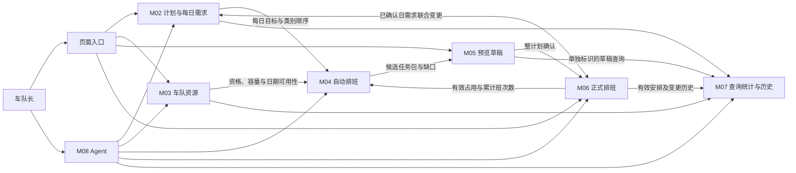

# 司机智能排班 Agent 系统——功能模块梳理

| 项目 | 内容 |
| --- | --- |
| 设计阶段 | 第一阶段：需求与功能模块梳理 |
| 编写日期 | 2026-11-02 |
| 文档状态 | 已同步第二、三阶段逐项确认的业务结论；整体架构及 13 表数据库方案均已于 2026-11-02 审核通过 |
| 整体评审修订 | 2026-11-03，用户审核通过并采纳本轮修订；跨阶段修订及证据见 [05.设计方案评审结果](05.设计方案评审结果.md) |
| 设计范围 | 主要功能、业务模块职责、模块关系、核心流程及需求疑点 |
| 范围限制 | 不进行技术选型、数据库设计、API 设计或业务代码开发 |

## 1. 设计依据与本轮确认结论

### 1.1 资料依据

| 标识 | 资料 | 使用方式 |
| --- | --- | --- |
| S1 | [智能排班需求文档](../智能排班-需求文档.md) | 业务范围、R01—R56、全局规则及 AC01—AC23 的主要依据 |
| P1 | [原型说明](../../prototype/README.md)、[页面入口](../../prototype/index.html) | 核对页面范围、操作入口及演示边界 |
| P2 | [原型交互](../../prototype/app.js) | 核对计划向导、需求编辑、资源管理、任务包编辑、确认取消、统计历史及 Agent 交互 |
| P3 | [工作台](../../prototype/screenshots/desktop.png)、[正式修改摘要](../../prototype/screenshots/change-review.png)、[资源管理](../../prototype/screenshots/resources.png)、[Agent](../../prototype/screenshots/agent.png) | 核对页面实际展示及确认交互 |

原型用于说明交互，不将原型中的简化行为当作新增需求。历史方案及现有服务端代码不作为本次功能范围的依据。以下模块是业务职责划分，供审核使用，不代表代码目录、服务拆分或部署方案。

### 1.2 本轮已确认的澄清与调整

| 编号 | 已确认结论 | 影响 |
| --- | --- | --- |
| C01 | 未来已确认日的需求与受影响排班允许同次调整，统一展示全部差异，一次保存；任一校验失败，两者均保留原数据。 | M02 与 M06 协作；补齐原型分开编辑的限制。 |
| C02 | 同模式容量利用率的分母采用全部符合条件的可用容量，包含未使用的可用班次容量。 | M07 统计口径；不采用原型“仅已安排班次容量”的分母。 |
| C03 | 首次确认以整个采集计划的全部日期为单位，取消从多日计划中单独选择一天或部分日期确认；任一待确认日失败，整次新增确认全部回滚。 | 替换原有单日及所选多日确认设计；影响 M05、M06、M08、页面及验收场景。单日计划仍可整体确认。 |
| C04 | 仅确认粒度调整；未来正式排班仍允许按单日修改、单日取消。 | M06 继续保留两类单日操作；取消后可能出现部分日期仍有效的计划。 |
| C05 | 取消后重新排班，从整计划入口发起确认；仍有效的正式日期只读保留，包括已到来或过去的已确认日期。所有待确认未来日期统一成功或统一回滚。 | 不覆盖原有有效安排，不因历史确认记录阻止重排。 |
| C06 | 每个待确认日均有合法非空排班时，允许存在未分配需求；未分配量只提醒。日期锁定、空排班、资源冲突等校验失败才阻止整次确认。 | “任一天异常”不包含单纯的需求缺口；部分分配与部分日期确认必须区分。 |
| C07 | 第二阶段确认首版为 Windows 本机免登录模式，固定车队长身份，启动即进入工作台。 | M01 改为本地访问控制与操作者身份；不设置登录页、密码、登录会话或账号管理。 |
| C08 | 第二阶段确认统计需求纳入筛选范围内全部计划需求，包括未确认、仅有草稿及已取消日期；正式分配仅计有效安排。 | Q01 已解决，M07 统一需求基数、缺口与分配率。 |
| C09 | 第二阶段确认正式排班及变更历史保留类别原名；被需求、草稿或正式历史引用的类别禁止删除。 | Q02 已解决，M02 与 M07 保留当时信息及完整引用保护。 |
| C10 | 第二阶段确认 Agent 资料逐条写入，不支持同模块多条或跨模块批量修改；整计划确认保留。 | Q03 已解决；已确认日需求排班联合变更继续按专用业务操作执行。 |

以上结论已用于同步需求文档。原型业务代码未修改，差异见第 8 节。第一阶段三项疑问在第二阶段逐项确认，结果见第 9 节；技术方案及其审核状态见 [整体架构设计](02.整体架构设计.md)。

第三阶段又逐项确认了 [数据库设计 B01—B04](03.数据库设计.md)：容量分母按车辆自身条件计算，不扣减司机不足或已排另一模式；计划日期容量基准未来刷新、当天及过去冻结；草稿和任意正式历史均阻止资源删除，纯统计快照不阻止；类别改名刷新未来需求与草稿名称，锁定日期需求及已有正式历史保留原名。这些是已确认业务口径，第三阶段 13 表精简方案及 SQL 已于 2026-11-02 通过用户审核。

第四阶段又确认了 [API 设计 I03/I05/I06](04.API接口设计.md)：整体分配统计与司机/车辆指标筛选分开；整份计划编辑仅限全部未来且从未有正式历史，之后仅保留未来单日调整；先生成预览（可为空）再手工编辑，不从未生成状态直接建纯手工草稿。已同步需求 V1.4，API 整体契约已于 2026-11-03 通过用户审核。

## 2. 项目主要功能与业务边界

系统服务于单车队、固定车队长操作身份，首版在 Windows 本机免登录使用。车队长通过页面或 Agent 管理需求和资源，生成并调整预览，明确确认后形成正式排班，再查询分配情况、资源使用和操作历史。

| 主要功能 | 功能内容 | 对应模块 |
| --- | --- | --- |
| 使用系统 | 打开本机工作台，无需登录；页面与 Agent 共用固定车队长身份和业务范围 | M01 |
| 管理采集需求 | 维护采集类别，创建计划、设置日期和每日需求、调整同模式类别顺序、查看计划及每日状态 | M02 |
| 管理车队资源 | 维护司机、效率等级、班次资格、车辆各班容量、启用状态及整日请假或维修 | M03 |
| 自动生成安排 | 根据每日需求、可用资源、已有正式安排及优化偏好，生成任务包和缺口解释 | M04 |
| 检查并调整预览 | 恢复草稿，查看车辆班次看板或明细，增删任务包、调整人员车辆及任务量，重新生成前提示覆盖 | M05 |
| 使安排生效 | 整计划确认；未来单日正式修改；未来单日取消；取消后在原计划重排并从整计划重新确认 | M06 |
| 查询及分析 | 筛选需求和安排，查看正式排班历史、变更记录、分配指标及司机车辆使用情况 | M07 |
| 自然语言操作 | 理解指令、澄清对象和日期、调用相应业务能力、展示待确认内容、返回真实结果 | M08 |
| 操作追溯 | 记录并查询关键写操作的对象、变更、入口及成功或失败原因 | M09 |

首版边界继承 S1 第 2 节：不增加多车队、多角色管理、司机端、接拒单、实际出勤或采集结果、实际完成率、当天补排、执行中自动换人换车、小时级不可用、路线规划、容量折算、自动效率评级、任意 SQL、跨模块批量资料修改及多日正式排班批量修改。

通知仅为页面中的“通知未接入”占位，不作为首版独立业务模块；不发送、不模拟成功、不保存发送状态、不运行失败重试，也不建设通知中心。

## 3. 功能模块与职责

### M01 本地访问与操作者身份

- 职责：提供本机免登录访问及固定车队长操作身份；页面和 Agent 使用相同业务范围。
- 主要结果：车队长可访问计划、资源、排班、统计和记录功能。司机是排班资源，不是登录用户。
- 职责边界：不建设登录页、密码、登录会话、管理员端、账号管理后台或多角色权限配置；扩大访问范围时另行评审认证方式。
- 依据：R01、R43、R53 及 C07；原型登录仅为旧演示行为，不作为新版本入口要求。

### M02 采集计划与每日需求管理

- 职责：维护 TAG、ROAD 采集类别；创建、查询、编辑或按规则删除采集计划；管理日期范围、每日类别目标量、排列顺序及可选备注。
- 输入：未来单日或连续日期范围、默认每日需求及指定日期独立需求。默认需求复制到各日，单日调整不影响其他日期。
- 输出：明确的逐日需求、日期归属、计划及日期状态，为排班和统计提供依据。
- 关键边界：同一日期只属一个计划；重叠时整体拒绝并列出冲突日期。存在正式排班历史的计划保留记录，不直接删除或迁移已确认日期。未来已确认日需求变更与 M06 联合处理，不单独保存会造成非法安排的需求。
- 类别改名后，未来需求与草稿使用新名称，当天及过去需求、已有正式排班及变更历史保留原名；被计划需求、草稿或正式历史引用时禁止删除，见 C09 及 B04；不增加类别审批或停用功能。
- 依据：R02—R14；P2 计划向导、计划详情、当日需求编辑及采集类别维护。

### M03 车队资源管理

- 职责：维护司机和车辆资料、启用状态及指定日期的可用情况。
- 司机子功能：姓名必填、联系方式选填、允许重名且以唯一编号定位；人工设置 HIGH、MEDIUM、LOW，新增默认 MEDIUM；早中晚资格默认均具备；登记整日请假。
- 车辆子功能：必填且唯一的车牌、可选名称或备注；分别维护早中晚每班 TAG、ROAD 容量；登记整日维修。容量允许为零，零容量不允许承接对应模式。
- 输出：按日期可用的资源、班次资格、容量及司机效率；累计排班次数由有效正式排班提供，不作为手工出勤记录。
- 关键边界：当前草稿、当前正式或任意正式历史引用均阻止直接删除，可先移除草稿引用再删除，或停用；纯统计容量快照不阻止删除并保留当时信息。变更若使未来正式排班非法，拒绝并列出受影响日期，须先调整排班；只影响草稿时提示重新校验。效率变化不自动重排正式安排。
- 依据：R15—R23、R27、R34；P2 资源列表、资料编辑、请假维修及引用保护。

### M04 自动排班与未分配解释

- 职责：按单日或连续多日需求生成候选任务包，说明分配结果及未分配量；只产出预览，不使正式安排生效。
- 输入：M02 每日需求及类别顺序、M03 资源资料、M06 有效正式排班占用及司机累计班次数。
- 分配偏好：先 TAG 后 ROAD；各模式内依次考虑需求覆盖、司机效率、同模式车辆容量利用比例均衡、同效率等级司机累计班次数均衡。同条件按日期先后、早中晚班次、稳定编号选择，保持可复现。
- 多日处理：各日需求独立，本次前面日期已分配班次临时影响后面日期的司机选择；其他未确认草稿、取消班次不计入累计。缺口不跨日期、计划或下次排班自动转移。
- 输出：供 M05 保存的候选任务包、容量占用，以及按日期、模式、类别展示的缺口和可核实原因；不声称结果必然全局最优。
- 依据：R12—R13、R24—R31；P2 预览生成与工作台需求面板。原型本地分配仅为演示，不能代替正式业务目标或性能验收。

### M05 排班预览与草稿管理

- 职责：每个计划日期保留一份当前草稿；展示、恢复、保存及人工调整预览，供 M06 整计划确认。
- 手工编辑前先生成一次预览，允许在空预览上新增任务包；不增加独立的纯手工建稿流程，见第四阶段 I06。
- 展示内容：日期、车辆、司机及效率、班次、模式、任务包类别与数量、容量占用及未分配量；支持原型中的车辆看板、明细列表及模式筛选。
- 编辑范围：增删任务包或明细，修改车辆、司机、班次、模式及任务数量；每次修改都检查全部硬约束，失败完整保留原草稿。合法人工方案可偏离自动优化偏好。
- 生命周期：草稿关闭页面后可恢复，暂不自动过期；重新生成前提示覆盖未确认人工修改；计划或资源变化后提示重新校验，不静默换人、换车或改任务。
- 职责边界：保存草稿不占正式资源，不计入正式统计，不等于确认。生成与编辑可按日进行，但不能从多日计划中单独确认该日。
- 依据：R29、R32—R34、R36、R55 及 C03；P2 工作台、任务包编辑、重新生成提示。

### M06 正式排班生命周期管理

- 职责：处理整计划确认、未来单日正式修改、未来单日取消及重排后的整计划再确认；产生正式占用及正式变更历史。
- 整计划确认：首次覆盖计划全部日期。再确认时，仍有效的正式日期只读保留，对全部其余日期检查最新需求、日期边界、资源及硬约束；所有待确认日通过才一起生效，任一失败则整次新增确认全部回滚，草稿保留。
- 重复确认：整个计划已全部具有有效正式安排时，返回 ALREADY_CONFIRMED，不重复创建。过去仍有效的正式日期可以只读保留；过去未确认日期不能绕过锁定规则。
- 正式修改：仅未来单日；展示全部前后差异，由“保存并生效”承担一次最终确认。涉及需求变更时与 M02 联合校验、保存；失败完整保留原需求与安排，不建立独立调整草稿或重复确认步骤。
- 取消与重排：未来按日取消，明确展示影响并确认；释放对应司机车辆占用，保留需求、原安排及取消历史，不释放计划日期归属。之后在原计划生成草稿，再从整计划入口确认。
- 空与部分分配：每个待确认日必须非空合法，未分配量只提醒；已确认日继续追加安排属于正式修改。清空整日正式安排必须取消，不能保存空正式排班。
- 依据：R14、R24、R35—R42 及 C01、C03—C06；P2 确认、任务包正式编辑、取消及变更历史，P3 正式修改摘要。确认入口按新结论调整，不能直接沿用原型的日期勾选方式。

### M07 业务查询、统计与排班历史

- 职责：按日期或范围、计划、司机、车辆、效率、确认状态及未分配情况筛选；展示计划需求、当前安排、正式历史与资源使用指标。
- 历史查询：查看正式排班及修改、取消记录，保留当时司机、车辆名称、效率等信息；当天及过去日期只读。历史状态不表示执行或实际完成。
- 分配统计：分别展示 TAG 个数和 ROAD 公里数的需求、正式已分配量、未分配量及分配率；草稿单独标识，不与正式数据相加。需求基数包含筛选范围内全部计划需求，未确认、仅有草稿及已取消日期也纳入，见 C08。
- 资源统计：司机次数仅计有效正式班次，取消不计；车辆班次使用率反映已安排班次与可用班次；同模式容量利用率按全部符合条件的可用容量计算，见 C02。
- 职责边界：提供查询与解释，不直接改动资料、生成正式排班或改变历史信息。历史记录由 M06 产生，操作审计记录由 M09 管理。
- 依据：R27—R28、R42、R50—R51 及 C02；P2 排班历史、统计分析及各页面查询入口。

### M08 Agent 自然语言业务助手

- 职责：理解采集计划、排班、司机、车辆的业务指令及相关查询；定位对象、解析日期、澄清必要信息，再交由对应模块执行。
- 可直接执行：信息明确的查询、统计和预览生成；覆盖人工草稿仍遵守覆盖提示，不借自然语言入口省略必要检查。
- “可直接执行”表示无需额外人工生效确认；预览生成、保存仍按第四阶段统一操作协议准备、执行及核实结果，人工覆盖的确认要求不变。查询保持只读，不创建业务操作。
- 生效操作：新增、修改、删除资料，正式确认或取消排班，执行前展示完整摘要或全部差异，并由车队长明确确认一次。确认排班必须表达整计划范围，不能恢复被取消的部分日期确认能力。
- 日期与歧义：按北京时间解析“明天”等相对日期，“本周”为周一至周日；写操作显示具体日期和唯一对象。缺日期、数量、重名或目标不清时先澄清，不选第一条、不自动缩小涉及只读日期的范围。
- 结果与边界：页面和 Agent 使用同一固定身份、业务范围和规则；结果未知先查询核实，不盲目重试，不虚报成功。不提供任意 SQL；业务资料逐条写入，不支持同模块多条或跨模块批量资料修改，见 C10。
- 依据：R43—R49、C03、C05；P2 Agent 侧栏与确认摘要。原型预设表达和跳转表单不限制需求中已确认的自然语言业务范围。

### M09 操作记录

- 职责：记录并查询关键写操作，覆盖计划、资源、草稿、正式排班等相关变更。
- 记录内容：操作者、时间、页面或 Agent 入口、操作对象、变更内容、成功或失败及原因；提供原型中的关键词查找与详情查看。
- 职责边界：回答“谁在何时通过什么入口做了什么、结果如何”；M07 的排班历史回答“当时的正式安排是什么、如何变化”。失败操作不能成为有效正式安排或进入正式分配量。
- 依据：R52、R55；P2 操作记录页面及详情。

## 4. 模块关系

以下箭头表示业务信息或操作结果的关系，不定义接口、调用协议或技术架构。

M01 约束全部业务入口的访问范围；M09 接收各模块关键写操作的结果。两者不替代各业务模块的合法性判断。

| 关系 | 业务约定 |
| --- | --- |
| M02 → M04/M05/M06 | 每日需求是分配上限；草稿、正式修改和确认均检查当前需求，不跨日借量。 |
| M03 ↔ M06 | 正式排班形成占用；资源变更先检查未来正式安排，导致非法则拒绝，不自动修正排班。 |
| M04 → M05 → M06 | 生成候选、保存草稿、正式生效分别承担不同职责；前两者不产生正式占用。 |
| M02/M03 → M05 | 需求或资源变化提示草稿重新校验；确认时检查最新资料，不静默重排。 |
| M06 → M04/M07 | 有效正式班次影响司机累计及统计；取消释放资源并从当前有效统计移除，历史仍保留。 |
| M08 → 各业务模块 | Agent 是操作入口，不能自行决定确认、放宽约束或编造执行结果。 |
| 业务模块 → M09 | 记录关键写操作的真实成功或失败；整计划确认失败不得留下部分生效结果。 |

## 5. 共同业务规则与统计口径

### 5.1 日期、资源及数量硬约束

| 规则组 | 必须满足的规则 |
| --- | --- |
| 日期 | 北京时间，范围含首尾；仅未来日期可新增、生成、确认、修改或取消安排。整计划再确认中的已有有效日期只读保留。提交时重新检查零点边界。 |
| 计划 | 同一日期唯一归属；冲突整体拒绝，不自动合并、截取或迁移正式排班。取消不删除日期归属。 |
| 司机 | 启用且对应日期可用，具有班次资格；一个自然日最多一个班次，不与车辆固定绑定。 |
| 车辆与班次 | 早、中、晚三班；车辆一天最多三班；同车同班最多一个任务包和一名司机；同车同日只采用一种模式。 |
| 任务包 | 可包含多个同模式类别；TAG 数量或 ROAD 公里数直接相加，不得超过该车该班对应容量；不得混合模式。 |
| 数量 | TAG 正整数，ROAD 正数且最多三位小数；需求零值表示无该项任务，每个计划日期至少一项正数需求。每类每日分配总量不超过当日目标。容量可以为零。 |
| 生效一致性 | 保存前展示和确认的内容必须与实际生效内容一致；旧页面不得覆盖新数据；任何失败保留该操作前完整业务数据。 |

硬约束同时适用于自动、手工、页面和 Agent。效率与均衡仅用于比较合法自动方案，不改变容量，也不能覆盖硬约束。

### 5.2 状态与统计含义

- 草稿是候选安排；正式排班是已确认的有效安排；取消记录是历史，不能继续占用资源。
- 首次确认不再产生“只确认计划部分日期”的结果。未来按日取消后，可以出现部分日期保留有效正式排班，沿用“部分确认”展示并列明取消日期，不能解释为仍支持部分日期首次确认。
- “全部确认”只表示全部计划日期存在有效正式安排；允许仍有需求缺口，不代表实际采集完成。草稿待校验和日期只读是展示提示，不是执行状态。
- 正式已分配量只计有效正式排班；需求量包含筛选范围内全部计划需求。未分配量为对应需求量减去正式已分配量；分配率为正式已分配量除以对应需求量，无该类需求时为不适用。未确认、仅有草稿及已取消日期的需求仍计入基数。
- 司机累计次数计系统内有效正式班次；统计页面选定范围内的班次数与自动分配使用的系统累计次数应明确区分。
- 车辆班次使用率 = 已安排班次数 ÷ 对应可用班次数；同模式容量利用率 = 该模式正式已分配量 ÷ 该模式全部符合条件的可用容量。未使用的可用班次纳入分母，TAG 与 ROAD 分开计算。
- C02 示例：某模式 10 个符合条件的可用班次，每班容量 100，安排其中 2 班合计 160，则同模式容量利用率为 16%，不按已安排的 200 容量计算为 80%。
- B01/B02 补充：分母只看车辆启用、无维修及对应正容量，不因司机不足或已排另一模式扣减；可用班次至少一种模式容量为正。计划日期基准未来随资料刷新、当天及过去冻结，未确认与取消日期也保留。
- 历史中的司机、车辆、采集类别名称及效率保留当时信息；不能因当前资料变更而改写历史统计，见 C09。

## 6. 核心业务流程

### F01 资源及需求准备 → 预览 → 整计划首次确认

1. 车队长通过 M01 打开本机工作台，无需登录；在 M03 维护资源，在 M02 维护类别及未来计划的逐日需求。
2. M02 检查日期唯一性、数量和类别；车队长明确保存，形成采集需求，不自动排班。
3. M04 按所需日期生成预览；M05 保存逐日草稿，展示任务包、容量占用、缺口及原因。
4. 车队长按日检查、调整草稿；修改非法则拒绝并保留原稿。重新生成前提示覆盖人工修改。
5. 从整计划发起确认，展示全部计划日期、每日待确认安排及缺口摘要；不提供选择部分日期确认的入口。
6. 车队长明确提交后，M06 使用最新数据校验全部待确认日：任何一天过期、无草稿、空排班或违反硬约束，整次新增确认均不生效，保留所有草稿并列出失败日期及原因。
7. 所有待确认日通过才一起生效，形成正式占用和历史，更新 M07 正式统计，M09 记录真实结果。需求未全分配但每日安排非空合法，仍可整体确认。
8. 页面保持“通知未接入”，不触发发送。

### F02 未来单日正式修改与需求联合变更

1. 选择一个未来日期的有效正式排班；可修改任务包、司机、车辆、班次及任务数量。
2. 若同时修改当日需求，由 M02 与 M06 将新需求及受影响安排作为同一次业务变更处理；不得先保存一半造成非法状态。
3. 展示全部变更前后差异，包括关联变化；车队长执行一次“保存并生效”。
4. 重新核对日期、最新资料、全部硬约束及生效内容与摘要的一致性；通过才统一更新，失败保留原需求与完整正式安排。
5. 保存变更历史及操作结果，更新有效占用和统计。若要清空该日全部正式安排，改用 F03 取消。

该流程不使用整计划确认中“已有有效日期只读保留”的逻辑忽略正式修改请求，不另设独立调整草稿，不提供多日正式修改。

### F03 未来单日取消 → 原计划重排 → 整计划再确认

1. 选择未来单日正式排班，展示影响并由车队长明确确认取消。
2. M06 取消该日有效安排，释放相应资源；保留原需求、日期归属和历史。其他日期安排保持有效。
3. 在原计划为已取消日期重新生成和调整草稿，不能另建同日计划绕过日期唯一性。
4. 从整个计划发起再确认：已有有效日期只读保留，包括过去已确认日期；对全部其余日期检查草稿和未来日期限制。
5. 全部待确认日期通过才一起生效；任一失败则全部待确认新增结果不生效，原有有效日期不变，草稿保留。计划全部已有效时返回 ALREADY_CONFIRMED。

这里的“整体”指完整计划范围内本次所有新增确认统一生效；只读保留的正式安排不被撤销、重算或回滚。

### F04 资源变更及影响检查

提交资料、停用、请假、维修、资格或容量变更 → 检查未来正式排班 → 若造成非法，拒绝并列明日期 → 车队长先通过 F02 调整排班 → 重新提交资源变更。

合法资源变更后，相关草稿提示重新校验；不自动更换草稿资源。当天突发请假或故障线下处理，正式排班保持只读。

### F05 Agent 查询及写操作

理解指令 → 定位唯一对象和具体日期／计划 → 缺失或歧义先澄清 → 查询、统计、生成预览按明确指令执行；生效操作先展示完整摘要或差异 → 车队长确认一次 → 对应业务模块重新校验并执行 → 查询核实未知结果 → 返回真实结果并记录关键操作。

Agent 确认使用 F01/F03 的整计划规则，正式修改使用 F02，不能用同一模糊“确认”动作混淆不同操作。

## 7. 页面与模块映射

| 页面或入口 | 使用模块 | 审核重点 |
| --- | --- | --- |
| 本机应用入口 | M01 | 免登录直接进入，操作归于固定车队长；原型登录是旧演示交互。 |
| 排班工作台 | M02、M03、M04、M05、M06 | 按日查看、生成和编辑；整计划确认；未来单日正式修改、取消；缺口及通知占位。 |
| 采集计划及详情 | M02、M06 | 默认及单日独立需求、类别顺序、日期归属、状态明细及已确认日联合变更。 |
| 车队资源 | M03，引用 M06/M07 结果 | 司机车辆切换、指定日期可用性、等级及关键词筛选、资料和不可用时间维护、引用保护。 |
| 排班历史 | M07 | 查看有效及取消安排、当时信息和变更记录；历史日期只读。 |
| 统计分析 | M07 | 正式与草稿区分，TAG/ROAD 分开；全部筛选内计划需求作为基数；可用容量作容量利用率分母。 |
| 操作记录 | M09 | 页面及 Agent 入口、成功失败、变更详情与查找。 |
| Agent 侧栏 | M08，使用对应业务模块 | 日期与对象澄清、完整摘要、明确确认、真实结果。 |
| 通知区域 | 业务状态占位 | 只显示“通知未接入”，无通知中心。 |

原型的演示日期切换、恢复示例、清空演示、固定身份及预设意图用于评审，不转化为正式系统中的日期修改、业务数据清空或账号管理功能。

## 8. 需求与原型的差异登记

本节只登记对齐事项，不修改原型代码，也不将演示验证结果当作正式功能或性能验收结果。

| 事项 | 现有原型表现与定位 | 本阶段处理 |
| --- | --- | --- |
| 确认粒度 | 工作台提供“确认本日”及日期勾选批量确认；P2 `showBatchPicker`、`showConfirmDates`。 | 按 C03/C05 改为整计划确认，按日生成、编辑、修改和取消保留；原型说明同步标记差异。 |
| 已确认日需求修改 | P2 `showDemandEditor`、`saveDayDemands` 仅独立编辑需求；调低到当前分配量以下直接拒绝。 | 按 C01 定义需求与排班同次联合变更，后续补齐联合交互。 |
| 容量利用率 | P2 `renderReports` 用已安排任务包对应容量作分母。 | 按 C02 纳入全部符合条件的可用容量，不能以原型公式定稿。 |
| 统计需求日期范围 | P2 `renderReports` 先筛选存在正式排班的日期，再汇总需求。 | 按 C08 纳入筛选范围内全部计划需求，正式分配仍只计有效安排。 |
| 零需求输入 | R10 允许零表示无该项需求；P2 `validateDemands` 拒绝零值。 | 依 R10 保留零值不生成任务的语义；不得扩展为允许整日无正数需求。 |
| 未分配原因 | P2 `renderDemandPanel`、Agent 缺口回复以通用提示为主。 | 依 R31 要求展示按日期、模式、类别可核实的缺口原因，不能编造或仅以固定话术替代。 |
| Agent 范围 | 仅部分预设意图，多项操作跳转表单，多日期指令提示转工作台。 | 以 R43—R49 及新整计划规则为准，不缩减为预设表达列表。 |
| 类别改名与历史 | P2 `categoryName` 按当前类别名称展示；删除保护仅检查计划需求引用。 | 按 C09 保留正式历史原名；删除保护覆盖需求、草稿及正式历史。 |
| 使用入口 | 原型提供模拟登录、退出。 | 按 C07 改为本机免登录及固定车队长身份，不建设账号密码功能。 |
| 操作记录保存 | P2 演示仅保留最近 200 条记录。 | 不采用 200 条作为正式业务限制；R52/R55 未授权此截断规则。 |
| 演示能力 | 本地保存、模拟登录、本地分配及预设 Agent。 | 仅作交互依据；首次正式业务为空，重启保存和 R56 性能需后续实际验收。 |

## 9. 第一阶段问题的确认结果

以下三项已于 2026-11-02 第二阶段逐项确认，分别对应 C08—C10，不再作为待决策项。保留编号便于追溯。

| 编号 | 原问题 | 已确认结果 | 影响范围 |
| --- | --- | --- | --- |
| Q01 | 统计需求是否纳入尚未确认、仅有草稿及已取消日期？ | 纳入筛选范围内全部计划需求；正式分配仅计有效安排。 | M07 需求量、缺口及分配率；R50/R51。 |
| Q02 | 类别改名后历史显示什么名称，删除检查哪些引用？ | 正式历史保留原名；需求、草稿或正式历史存在引用时禁止删除。 | M02 类别维护及 M07 历史；R09/R42。 |
| Q03 | Agent 是否支持同模块多条资料批量写入？ | 资料逐条写入；整计划确认及需求排班联合变更继续按专用规则执行。 | M08 范围及确认边界；R48。 |

## 10. 需求覆盖与本阶段核对

| 需求 | 主要承接位置 |
| --- | --- |
| R01 | M01、M08 |
| R02—R07 | M02、M06；日期、状态、删除及迁移规则 |
| R08—R14 | M02、M04、M06；逐日需求、顺序、拆分及联合变更 |
| R15—R23 | M03、M06；资料、可用性及正式影响保护 |
| R24—R31 | M04、M05、M06、M07；硬约束、优化偏好及统计解释 |
| R32—R34 | M05；展示、恢复、覆盖提示及重新校验 |
| R35—R42 | M06、M07；按本轮 C03—C06 调整确认粒度，保留修改、取消及历史规则 |
| R43—R49 | M08，使用 M01—M07 的相同权限和规则 |
| R50—R51 | M07；C02 明确容量分母，C08 明确全部筛选内计划需求基数 |
| R52 | M09 |
| R53—R54 | 第 2、7 节；页面覆盖与通知 TODO |
| R55 | M02、M03、M05、M06、M09 保存；首次业务为空、演示与正式数据区分 |
| R56 | 跨模块验收要求：50 辆车、150 名司机、31 天、每天 10 类任务，排班计算目标不超过 5 秒；模型等待另计，不将样例作为业务上限 |

本阶段已对照 R01—R56、核心流程、异常规则、验收场景及原型页面入口核对职责覆盖；整计划确认变更同步到需求基线及原型说明。原型中的确认入口、统计公式等业务行为尚未改动，不宣称已实现或通过正式验收。

第二阶段整体架构已于 2026-11-02 经用户审核通过，详见 [02.整体架构设计](02.整体架构设计.md)；第一阶段原有三项疑问已解决，M01 已按本机免登录要求同步。本轮未进入具体数据库、接口或业务代码开发。
