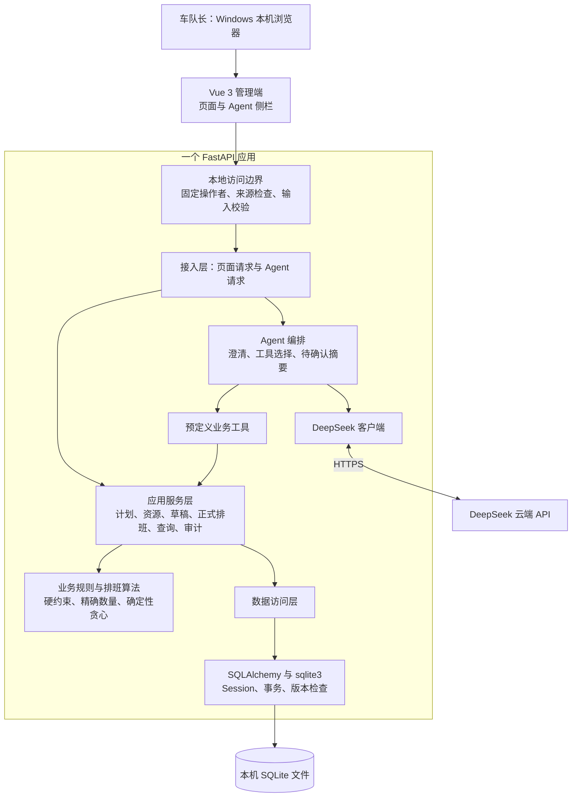
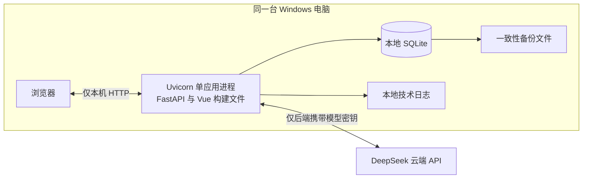
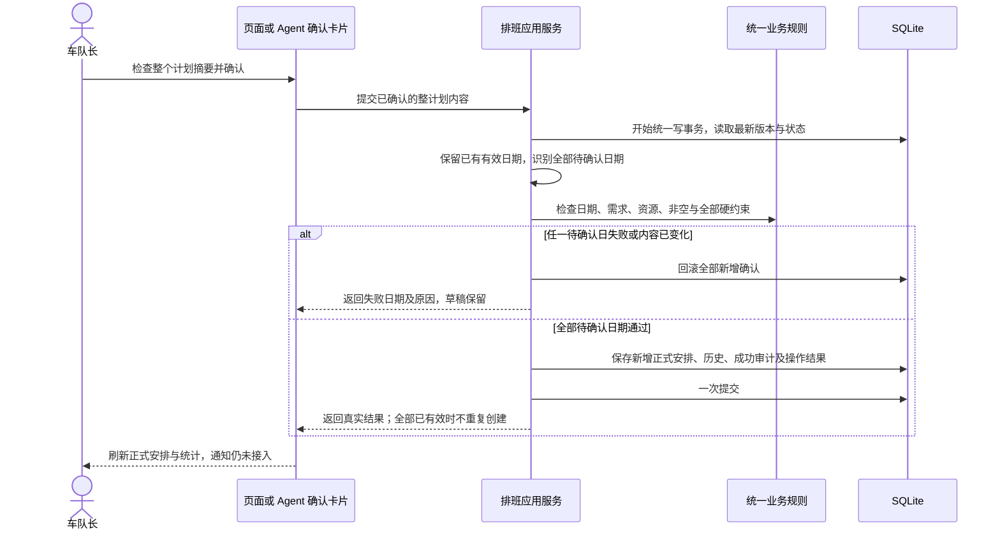
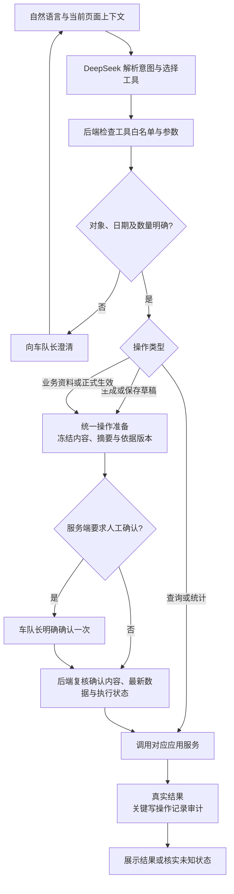

# 司机智能排班 Agent 系统——技术选型与整体架构设计

| 项目 | 内容 |
| --- | --- |
| 设计阶段 | 第二阶段：技术选型与整体架构 |
| 编写日期 | 2026-11-02 |
| 文档状态 | 2026-11-02 用户审核通过，整体技术方案与目录方案已采纳；实施参数见第 8.2 节 |
| 整体评审修订 | 2026-11-03，用户审核通过并采纳本轮修订；流程与表述同步见 [05.设计方案评审结果](05.设计方案评审结果.md) |
| 设计依据 | 第一阶段 M01—M09、需求 R01—R56、页面原型及项目规范 |
| 本阶段边界 | 明确技术方案、分层、协作、模块依赖与目标目录；不定义具体表结构、接口、工具参数，不编写业务代码 |

## 1. 依据、约束与已确认事项

### 1.1 资料优先关系

| 资料 | 本次用途及边界 |
| --- | --- |
| [第一阶段功能模块梳理](01.功能模块梳理.md) | 业务模块、整计划确认、未来单日修改取消、联合变更及统计口径的直接依据；本轮确认的免登录及三项遗留口径已同步。 |
| [需求文档](../智能排班-需求文档.md) | 首版范围、硬约束、保存要求与验收目标。 |
| [AGENTS.md](../../AGENTS.md) | Vue 3、Element Plus、Python 3.11+，优先 FastAPI、Pydantic、SQLAlchemy，采用模块化分层；用户本轮选择 SQLite，优先于规范中 MySQL 等技术的参考建议。 |
| [数据库规范](../rules/database-rules.md)、[API 规范](../rules/api-rules.md) | 后续设计继续遵守逻辑关联、应用层完整性、唯一性防线、统一输入校验及响应语义；本阶段不展开字段和接口。 |
| [原型说明](../../prototype/README.md)、[原型入口](../../prototype/index.html)、[交互脚本](../../prototype/app.js) | 页面布局及操作反馈依据；单日确认、部分统计公式等旧交互差异按新基线调整。 |
| [现有实现说明](../../README.md)、[现有依赖](../../requirements.txt)、[旧 NL2SQL 建议](../原项目/NL2SQL方案.md) | 仅用于识别复用点和冲突。旧代码的通知发送、草稿过期、演示初始化、共享密钥及 NL2SQL 不成为新版本需求。 |

首版规模为单车队、一个直接操作角色、几十辆车。R56 使用 50 辆车、150 名司机、31 天、每天 10 类任务验收排班计算不超过 5 秒；该样例不是业务上限，模型等待另计。

### 1.2 本轮已逐项确认

| 编号 | 结论 | 设计结果 |
| --- | --- | --- |
| A01 | 设计对象仍为司机智能排班项目。 | 延续第一阶段 M01—M09，不引入其他项目功能。 |
| A02 | 使用 SQLite，不引入 MySQL、Redis、MinIO。 | 业务事实、草稿、历史、操作结果及必要确认状态集中保存到本地 SQLite。 |
| A03 | Windows 本机运行，车队长用本机浏览器访问。 | 单台主机部署，服务仅监听本机；正式使用时由同一后端托管前端构建文件。 |
| A04 | 本机免登录，固定车队长身份。 | 不建设登录页、密码及登录会话；M01 改为本地访问控制与操作者身份，不引入账号管理。 |
| A05 | Agent 使用 DeepSeek 云端 API，具体模型在接入验证后锁定。 | 模型接入集中在后端；本地业务流程与模型可用性分离。 |
| A06 | 旧库不迁移，原样保留，新版本使用空业务数据。 | 新旧数据库使用不同文件，迁移工具只用于新版本结构演进，不自动导入旧库或演示数据。 |
| A07 | 统计纳入筛选范围内全部计划需求，正式已分配量只计有效正式安排。 | 未确认、只有草稿及已取消日期的需求计入统计缺口；草稿不冒充正式分配。 |
| A08 | 类别历史保留原名；需求、草稿或正式历史存在引用则禁止删除。 | 类别当前资料与正式历史当时信息分开处理，删除前由应用层检查全部引用。 |
| A09 | Agent 资料逐条写入；保留整计划排班确认。 | 不新增同模块多条资料批量修改；联合需求排班变更仍是已确认的专用业务操作。 |

第一阶段既有规则保持：首次整计划统一确认；取消后整计划再确认时保留已有有效日期；未来单日修改、取消；需求和受影响排班可同次变更；合法非空安排允许存在缺口；模式容量利用率按全部符合条件的可用容量计算。

## 2. 技术选型

### 2.1 已确认技术组合

本节技术组合已于 2026-11-02 经用户整体审核采纳，连同原有项目约束共同作为后续设计基线。这里只确定技术系列与职责，补丁版本及完整依赖组合在实施前经过兼容性验证后锁定，不将接入参数视为已经确定。

| 范围 | 方案 | 状态与依据 |
| --- | --- | --- |
| 前端框架与组件 | Vue 3、Composition API、`<script setup>`、Element Plus | 项目约束。匹配资源表格、需求表单、日期选择、差异确认和侧栏；原型布局继续作为依据。 |
| 前端语言与构建 | TypeScript、Vite；Node.js 24 LTS 作为构建基线 | 已采纳。数量、状态及不同确认操作适合类型约束；构建产物是本地静态文件，车队长使用时不必运行 Node 服务。Vue 官方提供 Vite 与 TypeScript 的配套方案；Node 版本实施前复核支持状态。[Vue 官方说明](https://vuejs.org/guide/typescript/overview)、[Node.js 发布信息](https://nodejs.org/en/about/previous-releases) |
| 页面路由与状态 | Vue Router、Pinia | 已采纳。承接六个主页面、共享计划日期上下文和 Agent 侧栏；前端状态仅为交互副本，不承担正式占用或最终合法性判断。[Vue Router](https://router.vuejs.org/introduction.html)、[Pinia](https://pinia.vuejs.org/introduction.html) |
| 前端请求与图表 | 原生 Fetch 的统一封装；Apache ECharts 按需使用 | 已采纳。统一处理加载、失败及提交反馈；图表用于 TAG、ROAD 和资源指标，指标计算由后端统一完成。[ECharts 官方入门](https://echarts.apache.org/handbook/en/get-started/) |
| 后端语言与服务 | Python 3.12、FastAPI、Uvicorn | Python 3.11+ 是约束；具体组合已采纳。沿用现有 Python 3.12 环境和 FastAPI 经验，减少重建范围。3.12 当前处于安全维护阶段，实施时选受支持补丁并记录升级计划，不将旧环境版本视为锁定结果。[Python 支持信息](https://www.python.org/downloads/) |
| 输入与配置 | Pydantic 2、pydantic-settings | 已采纳，符合项目方向。分别处理页面输入、模型工具参数和服务端配置；结构合法后仍须检查业务硬约束，不能以自动类型转换代替业务校验。[Pydantic 严格校验](https://docs.pydantic.dev/latest/concepts/strict_mode/) |
| 持久化访问 | SQLAlchemy 2.x 同步 ORM、Python `sqlite3` 驱动 | 已采纳。复用既有分层方式，适配本地 SQLite；按业务操作建立独立 Session，事务由应用服务统一控制。[SQLAlchemy Session](https://docs.sqlalchemy.org/en/20/orm/session_basics.html) |
| 数据库与演进 | SQLite；Alembic 管理新版本数据库迁移 | SQLite 已确认；Alembic 已采纳。无需额外数据库服务；结构变更应有版本和升级步骤，不用自动建表冒充既有库升级。[SQLite 适用场景](https://www.sqlite.org/whentouse.html)、[Alembic 官方说明](https://alembic.sqlalchemy.org/en/latest/) |
| 缓存与对象存储 | 首版不引入服务端业务缓存，不使用 Redis、MinIO | 已确认。当前没有文件业务；有效占用、待确认操作和结果不依赖易失缓存。前端临时状态不等于持久保存。 |
| Agent 实现 | 后端显式编排、预定义业务工具、HTTPX 调用 DeepSeek | 服务来源已确认，轻量编排方式已采纳。工具复用应用服务；不新增通用工作流框架、NL2SQL 或独立模型运行服务。DeepSeek 返回的工具参数仍须本地校验。[DeepSeek 工具调用说明](https://api-docs.deepseek.com/api/create-chat-completion/)、[HTTPX 超时机制](https://www.python-httpx.org/advanced/timeouts/) |
| 质量验证 | pytest、前端类型检查与 Vitest、Playwright | 已采纳。分别覆盖业务约束、事务与恢复、前端交互、浏览器整流程；当前旧测试通过记录不代表新版本已验收。 |

### 2.2 选型取舍

1. 本项目的主要复杂度在规则一致性及确认边界。模块化单体使资源保护、整计划确认、需求联合变更和审计能够在同一个事务中协作，适合首版规模。
2. Vue 前端与 Python 后端分别开发、构建，发布时可以同进程托管静态文件。“前后端分离”不要求为本机使用额外部署前端服务器。
3. SQLite 符合用户明确选择和本机运行方式。其单写者特性决定必须保持事务短、避免在事务内等待模型；不能把多标签页理解为没有并发。
4. 自动排班继续采用需求指定的确定性贪心策略，由本地业务代码执行。大模型用于理解指令与选择工具，不替代排班算法、容量判断或生效决定。
5. 首版使用普通 HTTP 请求响应。Vue 页面提供等待、错误和真实结果反馈；无需为了聊天侧栏增加独立推送服务。全部前端资源随构建产物本地提供，模型访问由后端出网完成。

以上是基于本项目规模和业务一致性要求作出的架构判断，不是框架性能保证；5 秒目标仍以实际环境测试为准。

## 3. 整体架构与技术分层

### 3.1 逻辑架构



页面与 Agent 使用同一套应用服务和规则。Agent 不能直接访问数据库或调用任意 SQL；数据库也不向浏览器开放。通知仅展示未接入，不增加发送组件。

### 3.2 分层职责

| 层次 | 职责 | 依赖边界 |
| --- | --- | --- |
| 前端表现层 | 页面、表单、看板、差异展示、确认动作、Agent 侧栏、加载和错误反馈 | 通过统一请求封装访问后端；不自行计算正式生效结果，不持有模型密钥。 |
| 接入层 | 本地访问检查、参数解析、调用应用服务、统一错误与结果转换 | 保持轻量；不在路由中实现排班、事务提交或直接拼接数据库操作。 |
| 应用服务层 | 组织计划、资源、生成预览、正式修改、确认取消及查询；确定事务边界和审计结果 | 组合业务规则与 Repository；页面和工具共用，不依赖 Vue、FastAPI 请求对象或模型回复文本。 |
| 业务规则与算法层 | 校验硬约束、数量精度、可用性、容量、优化顺序、缺口原因；生成确定性候选安排 | 输入输出为普通业务数据，不持有数据库 Session，不调用模型或页面；首版只实现需求规定的策略。 |
| 数据访问层 | 按业务所需读取需求、资源、占用、草稿、历史；保存应用服务决定的变更 | Repository 使用 SQLAlchemy；不能自行提交一部分日期，也不能依赖数据库物理外键完成业务检查。 |
| 基础支撑 | SQLite 连接与事务、迁移、配置、技术日志、DeepSeek 客户端 | 作为实现细节注入；不在基础设施层决定业务优化顺序或确认范围。 |

Agent 是接入与应用编排的一部分，不形成第二套业务后端。M09 的业务操作记录与运行日志分开：前者供业务追溯，后者供故障排查。

首版采用同步业务路由、同步 SQLAlchemy 和同步 HTTPX 客户端，由 FastAPI 将同步路由交给线程池执行。接入依赖提供 Session 工厂，实际 Session 在同步应用用例内创建、使用并关闭，保持同一执行线程；不跨线程传递 Session，也不在异步路由中直接调用阻塞数据库或模型请求。线程池只解决请求执行方式，不能作为排班计算并行提速或事务正确性的保证。[FastAPI 同步与异步说明](https://fastapi.tiangolo.com/async/)

### 3.3 本机运行结构



- 开发时运行 Vite 开发服务器和 FastAPI，前端通过开发代理访问后端；开发来源需显式允许。
- 正式本机使用时，FastAPI 提供前端构建文件及业务能力，同源访问，单个应用进程启动；不要求 Nginx、Docker 或 Node 常驻服务。
- 应用和数据库文件位于同一主机本地磁盘；以稳定绝对路径解析配置，工作目录变化不得意外创建另一份业务库。新版本文件与旧库分开。
- 仅监听本机回环地址，校验允许的 Host、浏览器来源及写请求来源，不开放通配跨域。免登录信任本机使用环境，并不识别多个真实操作者；页面和 Agent 统一记录固定车队长身份。
- DeepSeek 故障只影响自然语言能力；计划、资源、手工排班、确认及查询继续由本地页面和业务服务处理。

## 4. 功能模块在架构中的位置与依赖

业务模块继续使用第一阶段编号；逻辑模块与源代码目录不是一一对应关系。

| 模块 | 前端位置 | 后端位置与主要职责 | 主要依赖 |
| --- | --- | --- | --- |
| M01 本地访问与操作者身份 | 应用入口，固定车队长上下文；无登录页 | 接入层的本机来源限制、固定身份及操作入口标记 | 配置、M09；不建设账号或权限管理服务。 |
| M02 计划与每日需求 | 计划页面、创建向导、逐日需求及类别维护 | 计划应用服务、需求校验及相应 Repository | M03/M06 所需的需求输出；已确认日联合变更由 M06 协调。 |
| M03 车队资源 | 司机、车辆表格及请假维修表单 | 资源应用服务，资料及不可用时间维护、变更影响检查 | 读取 M06 有效安排；复用统一硬约束，不能自动改正式排班。 |
| M04 自动排班 | 工作台生成入口、缺口展示 | 应用服务准备输入，`scheduling/` 执行纯规则与贪心算法 | M02 需求、M03 资源、M06 有效占用及累计次数；结果交 M05。 |
| M05 预览草稿 | 工作台看板、明细、编辑和覆盖提示 | 排班应用服务管理逐日草稿的生成、保存、恢复与编辑 | M04、统一规则、需求和资源当前版本；草稿持久保存但不占正式资源。 |
| M06 正式排班 | 整计划确认、未来单日编辑取消、完整差异展示 | 排班应用服务协调统一校验、事务、占用、历史与重复结果 | M02/M03 的 Repository、统一规则、M05、M09；不按日期拆成多个提交事务。 |
| M07 查询统计与历史 | 历史、统计及页面筛选 | 只读查询服务及聚合查询；统一指标口径、读取当时历史信息 | M02 目标需求、M06 有效安排和历史、M03 对应可用容量；不通过回调写服务改变数据。 |
| M08 Agent | 共用侧栏，澄清及确认卡片 | `agent/` 编排、Prompt、模型客户端、工具适配；写入准备后等待明确确认 | 对应应用服务、共享确认处理、M09；不直接使用 Repository。 |
| M09 操作记录 | 操作记录列表及详情 | 审计服务保存操作者、入口、对象、差异、结果和原因 | 由各写用例提供结果；查询由只读查询服务承接。 |

避免双向 Service 调用：M03 的影响检查读取正式安排 Repository 并复用规则，不调用完整排班流程；M06 的联合变更直接在同一用例中组织需求与排班 Repository，不先调用一次会自行提交的计划保存服务。

## 5. 关键一致性与 Agent 设计

### 5.1 SQLite 事务与并发

SQLite 支持多个并发读事务，但同一时刻只有一个写事务；`BEGIN IMMEDIATE` 可在校验读取前申请写事务，获得写入机会或明确失败。[SQLite 事务说明](https://www.sqlite.org/lang_transaction.html)

首版采用默认回滚日志模式和显式写事务，保证简单、一致的本机运行。写锁申请发生在读取待修改版本、需求及有效占用之前；锁等待设有限时间，超时返回未成功结果，不能绕过校验或只提交部分日期。Session 由一次同步业务操作独占，不在线程间共享。

具体原则：

1. 应用服务拥有提交／回滚权，Repository 只参与当前事务，不逐日提交。
2. 确认提交后才对外报告成功；保存正式安排、必要历史、成功操作记录和重复请求结果处于同一事务。
3. 每次修改核对前端或待确认摘要所基于的版本。内容已经变化时拒绝并要求重新查看，不能仅凭当前安排合法就覆盖旧页面未确认的变化。
4. 保存数据所需的逻辑关联、业务唯一性及硬约束由服务端维护；遵守项目禁止物理外键的规范，数据库唯一性约束作为补充，具体约束遵循已审核的 [数据库设计](03.数据库设计.md)。
5. 失败后先回滚业务变更，再以独立短事务尝试记录失败原因；若数据库本身不可用，使用技术日志报告故障，不能声称操作记录已经持久保存。
6. 不在写事务内调用 DeepSeek、等待用户确认或执行排班计算。生成时读取完整输入和版本，释放读事务后计算，保存草稿的最终写事务中先重查操作终态，再复查输入版本；其他请求已完成同一操作时返回已存结果，输入已变化则拒绝旧结果，不静默生成另一份内容。

日期锁定以服务端北京时间判断：业务写入前校验，提交前再取当前业务日期检查本次实际改动的日期；中途跨零点导致日期锁定时整体回滚。只读保留的既有有效日期不参与写入校验。只有已明确回滚的业务失败才独立记录 FAILED；COMMIT 结果不明时先关闭失效 Session，再用新的短事务核实已存终态，无法核实时返回未知结果，不凭连接异常推断失败或覆盖已提交成功。

默认回滚日志模式已随本阶段整体方案审核通过。WAL 可在实际读写等待需要时再评估。当前旧环境检测到 Python 3.12.12、SQLite 3.50.4；旧代码默认开启 WAL。SQLite 官方已披露 WAL-reset 问题，修复见 3.51.3 及之后版本或指定回补版本；因此不能直接把旧 WAL 配置带入新版本。若后续启用 WAL，必须核验实际运行库的修复情况，数据库仍须本地存放，并使用一致性备份。[SQLite WAL 说明](https://www.sqlite.org/wal.html)

### 5.2 整计划确认与单日变更



- 首次确认覆盖完整计划；再确认只读保留已有有效日期，包括过去已确认日期；过去未确认日期仍使新增确认失败。
- 只要各待确认日合法且非空，需求缺口可以保留，不作为确认失败。
- 未来单日正式修改使用独立用例，不套用“已有有效日期保留”而忽略修改；需求与安排联合变更统一保存。
- 未来单日取消释放当前占用，保留原需求和历史；重排后仍从整计划确认入口处理。
- 相同已处理操作返回可核实结果；回复丢失时先查询执行状态，不盲目重复写。请求键、摘要 hash、对象版本及状态语义遵循已审核的 [API 操作协议](04.API接口设计.md)。

### 5.3 Agent 受控业务执行



模型不能自行证明某个写操作已经得到确认，也不能将用户原话转换为未经确认的附带修改。拟执行内容及其结果以服务端记录为准，必要状态保存在 SQLite；明确确认后由后端执行已保存内容，不再次让模型重新决定修改范围。普通页面的明确保存仍可承担一次确认，不增加重复步骤。

生成操作准备时只冻结生成范围、输入依据及旧草稿覆盖内容，不提前运行算法或假称已有新任务包；无需人工确认的草稿动作可自动执行，人工草稿覆盖仍必须明确确认。全部业务写入共用第四阶段 operations/executions，查询不创建写操作。

工具是应用服务的薄适配层，不提供自由 SQL、任意代码、跨模块或同模块多条资料批量修改。计划内逐日需求、整计划确认和已确认日需求排班联合变更属于明确的专用业务操作，不据此开放通用批量写入。

模型客户端使用 HTTPX，设置连接、读取、连接池等待及整轮总时限；编排设置最大轮数、工具调用数及输出规模。具体数值在模型接入验证后确定。超时及未知结果先核实，不能自动重复业务写入。所有资源冲突、数量、精度、唯一对象及未来日期限制在本地重新检查。

### 5.4 数量、日期、历史与统计

- TAG 使用整数个，ROAD 使用整数米；页面以公里输入输出并用精确十进制检查三位小数。HTTP 按第四阶段契约传既有整数米字段及十进制整数字符串，前端不以浮点求和判断合法性。
- 业务日期按 Asia/Shanghai 自然日解释，范围含首尾；操作时间统一记录 UTC，展示转换为北京时间。不能把采集日期当成任意时刻进行时区换日。
- 正式安排和变更历史保留当时司机、车辆、效率、采集类别名称及相关容量信息，当前资料变更不改写历史。
- M07 统一计算口径：筛选范围内全部计划需求作为需求基数，正式分配仅计有效安排；草稿单列，取消不计当前有效安排；TAG 与 ROAD 分开。
- 同模式容量利用率纳入全部符合条件的可用容量，未使用班次也进入分母；历史使用第三阶段按计划日期保存并冻结的全部车辆班次容量及正式事件快照，不能用当前资料重算过去。

2026-11-02 第三阶段已逐项确认 [数据库设计 B01—B04](03.数据库设计.md)：分母只考虑车辆自身启用、无维修与正容量，不扣减司机不足或已排另一模式；各计划日期容量基准在未来刷新、当天及过去冻结，未确认或取消日期也保留，正式变更另存当时快照；资源删除保护含草稿与全部正式历史，纯统计快照不阻止；类别改名只刷新未来需求与草稿名称，锁定日期需求及已有正式历史保留原名。以上补充不改变已审核架构，具体数据库方案已随第三阶段 13 表精简稿审核通过。

第三阶段按用户精简要求将未审核的 20 表草案修订为 13 表：草稿与正式任务按类型共用关系明细、每日状态与容量快照归入日期、固定三班容量归入车辆、正式版本历史归入操作记录。物理表合并不改变草稿/正式的业务边界、历史完整性或统一事务；13 表方案及 SQL 已于 2026-11-02 通过用户审核，详见第三阶段文档。

第四阶段已确认 [API 设计 I02](04.API接口设计.md)：查询按资源路径，业务写入使用统一 operations 准备和 executions 执行，一次人工确认，页面与 Agent 共用服务。API 以既有 `_meters` 字段传整数米、页面仍显示公里，并明确元信息/计算响应与数据库列的映射；具体传输类型及全部接口契约已于 2026-11-03 通过用户审核，不改变已审核数据库字段。

## 6. 项目目标目录

以下为已审核通过的目标结构，不表示已创建。保留现有根目录下 `app/` 的分层方式，新增 `frontend/`；不为九个逻辑模块各建一个独立服务，也不建立通用插件框架。

```text
Intelligent_Scheduling_Agent/
├─ frontend/                         # Vue 管理端
│  ├─ src/
│  │  ├─ main.ts
│  │  ├─ App.vue
│  │  ├─ router/                     # 六个主页面路由，无登录路由
│  │  ├─ views/
│  │  │  ├─ workbench/               # M04/M05/M06 工作台
│  │  │  ├─ plans/                   # M02 计划与类别
│  │  │  ├─ resources/               # M03 司机和车辆
│  │  │  ├─ history/                 # M07 正式历史
│  │  │  ├─ reports/                 # M07 统计
│  │  │  └─ logs/                    # M09 操作记录
│  │  ├─ components/
│  │  │  ├─ agent/                   # M08 共用侧栏、澄清及确认卡片
│  │  │  └─ scheduling/              # 任务包、差异及确认展示
│  │  ├─ api/                        # 统一请求封装及按业务分类的调用
│  │  ├─ stores/                     # 计划日期、界面状态和当前对话上下文
│  │  ├─ types/                      # 前端类型，遵循第四阶段已审核契约
│  │  ├─ styles/                     # 原型视觉语言与统一样式
│  │  └─ utils/                      # 展示辅助，不复制后端权威规则
│  ├─ tests/                         # 关键前端交互
│  ├─ package.json
│  ├─ package-lock.json
│  ├─ vite.config.ts
│  └─ dist/                          # 构建产物；供正式本机服务托管
├─ app/
│  ├─ main.py                        # 应用装配、本机访问边界及静态文件托管
│  ├─ api/                           # plans/resources/schedules/reports/logs/agent 等接入
│  ├─ core/                          # 配置、固定身份、异常、技术日志
│  ├─ schemas/                       # 页面与工具参数的结构校验
│  ├─ services/
│  │  ├─ plan_service.py             # M02 未确认需求与类别维护
│  │  ├─ resource_service.py         # M03 资源及影响检查
│  │  ├─ scheduling_service.py       # M04/M05/M06 用例及事务协调
│  │  ├─ query_service.py            # M07 只读查询与统计
│  │  ├─ confirmation_service.py     # 拟执行摘要、明确确认及重复结果核实
│  │  └─ audit_service.py            # M09 业务记录
│  ├─ scheduling/
│  │  ├─ interfaces.py               # 普通业务输入输出与策略边界
│  │  ├─ constraints.py              # 自动、人工、页面和 Agent 共用硬约束
│  │  ├─ quantities.py               # 精确数量与容量计算
│  │  └─ strategies/greedy.py         # 首版确定性贪心，不读库、不调模型
│  ├─ agent/
│  │  ├─ orchestrator.py             # 有界的理解、澄清和工具调用流程
│  │  ├─ model_client.py             # HTTPX 与 DeepSeek 适配
│  │  ├─ tools/                      # 到应用服务的预定义工具适配
│  │  └─ prompts/                    # 提示词及业务指引，与业务代码分离
│  ├─ repositories/                  # 计划、资源、排班及只读聚合访问
│  ├─ models/                        # 按第三阶段已审核数据库设计实施映射
│  └─ database/                      # 连接、Session、显式事务及初始化边界
├─ migrations/                       # Alembic，新版本结构演进
├─ tests/
│  ├─ unit/                          # 硬约束、数量、贪心、口径
│  ├─ integration/                   # SQLite 事务、并发、恢复及工具真实结果
│  └─ e2e/                           # 页面与 Agent 的关键业务整流程
├─ scripts/                          # 本机启动、迁移、备份恢复等运行辅助
├─ data/
│  ├─ active/                        # 新版本业务库；与旧文件隔离
│  └─ backups/                       # 一致性备份；不作为源代码提交
├─ logs/                             # 技术日志；不等同于 M09 操作记录
├─ prototype/                        # 保留评审原型，不作为生产前端继续扩写
├─ docs/
│  ├─ 智能排班-需求文档.md
│  ├─ design/                        # 第一、二阶段及后续设计
│  └─ rules/                         # 既有规范
├─ requirements.txt                  # Python 直接依赖
├─ requirements.lock                 # 经兼容验证的锁定依赖
├─ pyproject.toml                    # 现有质量工具配置，按实施需要维护
├─ .env.example                      # 服务端配置样例，不保存真实密钥
├─ start.ps1                         # 本机运行入口；本阶段不修改
└─ README.md                         # 新版实施后同步实际启动及使用方式
```

目录使用约定：

- 前后端共用一个仓库；先沿用现有 Python 依赖及启动组织方式，不为了目录整齐搬移整个后端。
- 持久化模型、输入结构、Repository 与应用服务分开；只有真正复用的规则放入 `scheduling/`，不堆积通用抽象。
- `dist/`、业务库、备份、日志和真实配置为构建或运行产物，不混入源码与演示数据。
- 旧 `app/templates/`、`app/static/`、通知实现及旧数据库保持原样；后续实施依据明确范围替换或处置，本阶段不删除、不覆盖、不重命名。
- 不建立 MySQL、Redis、MinIO、消息队列、文件上传、通知中心及司机端目录。

## 7. 关键设计决策与验证方式

| 决策 | 依据及结果 | 后续验证 |
| --- | --- | --- |
| D01 模块化单体、共享应用服务 | 规模较小，核心变更需要同一事务；九个模块通过分层协作。 | 页面和 Agent 对同一操作得到相同合法性结果；无路由或工具绕过服务层。 |
| D02 Windows 本机免登录 | A03/A04；固定业务身份，服务仅本机使用。 | 浏览器直接进入工作台；外部来源写请求被拒绝；审计来源与固定身份准确。 |
| D03 SQLite 为唯一业务持久层 | A02/A06，重启保存；新旧库隔离、首次空业务。 | 重启恢复草稿、正式数据及记录；新版本不写旧库、不默认造示例数据。 |
| D04 整计划统一写事务 | 第一阶段整计划规则；单账号也可能多页面并发。 | 构造中间日失败、并发旧页面和写入异常，新增正式安排全部回滚，已有有效日期不变。 |
| D05 生成计算与写入分离 | 不占用写锁等待算法或模型；保存前复查输入版本。 | 生成期间改变资源，旧生成结果不能覆盖；记录纯计算与业务耗时。 |
| D06 模型理解、工具执行、人工生效 | R43—R49；工具返回真实业务结果，确认内容不被模型重新解释。 | 重名澄清、遗漏字段、超时、重复确认、结果未知及附带修改均按规则处理。 |
| D07 历史与当前事实分开 | A08、R42；改名、改容量不能改写当时安排与统计。 | 改资料再查询历史；取消仅影响当前有效量，原历史仍可追溯。 |
| D08 无服务端缓存及外部存储 | A02；SQLite 足以作为本机事实来源。 | 写入后重新查询显示一致；前端暂存不冒充已确认，不依赖内存恢复草稿。 |
| D09 迁移版本化与一致性备份 | A06、R55；当前自动建表不是升级方案。 | 新库初始化、版本升级、备份恢复分别验证；旧库不参加新版本自动升级。 |

备份使用 SQLite 的一致性备份机制，由运行辅助工具执行，不新增业务页面。正在运行时不直接只复制主数据库文件；备份文件和恢复步骤应实际演练。[SQLite Backup API](https://www.sqlite.org/backup.html)

## 8. 风险、接入验证及审核事项

### 8.1 潜在风险

| 风险 | 影响与处理 |
| --- | --- |
| 旧实现规则混入新版本 | 旧通知发送、预览过期、物理外键、默认演示及部分日期确认与新基线冲突；复用必须逐项核对，不以旧测试或旧 API 文档为新验收依据。 |
| SQLite 写等待及长事务 | 整计划确认必须统一提交，不能分批提交来规避锁；计算和模型等待放到事务外，缩短数据库读取及持锁时间，按 R56 实测。 |
| 旧环境 SQLite/WAL 配置 | 已核验旧运行库 3.50.4，不能直接沿用旧 WAL 配置；首版采用默认回滚日志，启用 WAL 前验证已修复版本。 |
| 本机免登录的信任边界 | 该方案不能区分本机不同真实使用者，也不适用于直接开放局域网或公网；以后改变访问范围必须重新评审身份认证。 |
| 模型输出及云服务故障 | 工具参数、目标和数量可能不正确；本地校验和明确确认决定生效，模型不可用时保留页面业务操作。 |
| 数据库禁用物理外键 | 应用层必须覆盖删除引用保护及联合变更；数据库唯一性约束不能替代关联及业务规则验证。 |
| 历史口径与可用容量 | 历史统计不能用当前类别名、容量和不可用资料覆盖当时信息；保存粒度遵循已审核第三阶段，查询口径遵循已审核第四阶段。 |
| 本机掉电、磁盘及升级故障 | 采用明确提交、持久保存、备份与升级前检查；恢复流程验证业务一致性，不把文件存在视为恢复成功。 |

### 8.2 尚未锁定的实施参数

以下属于接入或实施前仍需确定的参数。其中具体模型已按用户要求留到接入验证后锁定，其余需后续确认或实测，不在本阶段将未确认参数写成既定值：

1. DeepSeek 具体模型、调用预算、最大编排轮数、工具调用数、各类超时和输出限制；由业务用例验证澄清能力、工具参数及延迟后锁定。
2. Python、SQLite 实际运行库及前后端依赖补丁版本；完成安装兼容和事务行为验证后生成锁文件，不能只按 Python 版本推断 SQLite 版本。
3. R56 验收电脑配置、样例数据及计时方式；排班计算、数据库操作、模型等待分别记录，不预先承诺现有电脑已经达标。
4. 本地备份频率、保留周期和恢复操作方式；在发布运行方案中确认，不新增首版产品功能。

### 8.3 第二阶段审核结论

2026-11-02，用户确认“采纳整体方案，第二阶段文档审核通过”。A01—A09 及以下技术与目录方案共同作为后续设计基线：

- 前后端分别开发、发布时由 FastAPI 同源托管；一个模块化单体应用，不拆独立排班或 Agent 服务。
- Vue 3 + TypeScript + Vite + Element Plus + Vue Router + Pinia；Fetch 统一封装，统计使用 ECharts。
- Python 3.12 + FastAPI + Uvicorn + Pydantic 2 + SQLAlchemy 2.x + Alembic；SQLite 默认回滚日志，显式写事务，单应用进程。
- HTTPX 直连 DeepSeek，显式有界工具编排、共享业务服务和服务端确认内容；不引入通用 Agent 框架。
- 采用第 6 节目标目录；后续按功能实施，不预先创建空目录框架。

第二阶段审核已完成，本轮停留于架构文档交付；后续按用户新指令进入下一阶段。本文件没有定义具体表、字段、索引、接口路径、请求响应结构或工具参数，也没有修改业务代码、安装依赖或启动新服务。第 8.2 节实施参数仍需后续确认或实测。

## 9. 第一阶段开发落实记录

2026-11-03，按用户新的基础与公共能力开发任务，已落实 Vue 基础入口、FastAPI 同源托管、本机访问边界、独立新库、Alembic 和公共操作服务。旧版入口保存为 app/legacy_main.py，既有业务源码保留供回归和后续复用。新版相关代码分别位于 app/core/runtime.py、app/database/foundation.py、app/models/foundation.py 和公共服务模块。

默认后端为 127.0.0.1:8000，开发前端为 127.0.0.1:5173，SQLite 锁等待采用 5000ms，DELETE/FULL 运行参数通过测试。新配置统一使用 FLEET_ 前缀。实际运行、依赖补丁、测试及阶段边界见 [第一阶段实施记录](../implementation/01.基础与公共能力.md)。

## 10. 第二阶段开发落实记录

2026-11-03，按基础资料开发任务，已接入类别、司机、车辆及请假维修管理。新增基础资料查询、专用动作适配器和资料关联影响服务，页面和应用服务共同复用第一阶段公共确认、事务、幂等、版本及审计。前端新增类别、资源、不可用记录和审计页面。

资料变更通过 Repository 读取当前和历史任务关联，完成引用保护、未来正式影响检查、名称传播、草稿标记及未来车辆容量刷新。实际范围及验证见 [第二阶段实施记录](../implementation/02.基础资料管理.md)。
