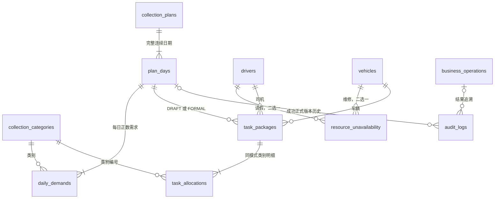
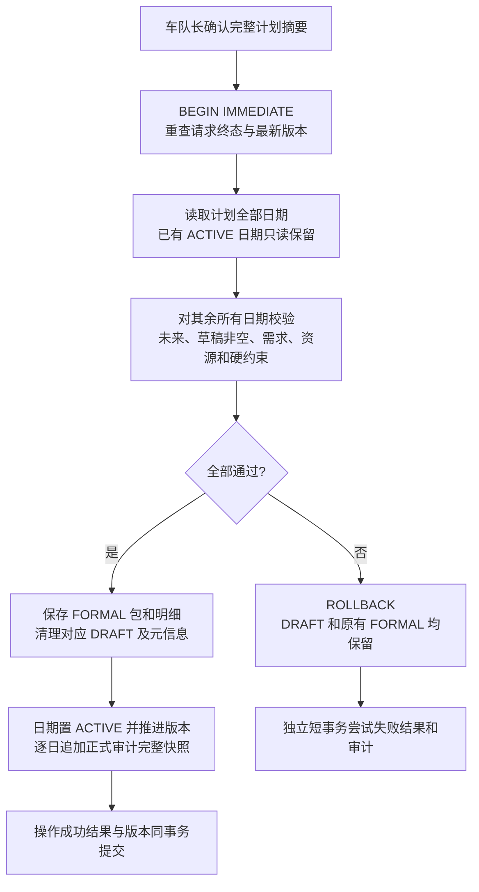

# 司机智能排班 Agent 系统——数据库设计

| 项目 | 内容 |
| --- | --- |
| 设计阶段 | 第三阶段：数据库设计 |
| 修订日期 | 2026-11-02 |
| 文档状态 | 2026-11-02 用户审核通过，采纳 13 表精简方案及建表 SQL；替代此前未通过审核的 20 表草案 |
| 整体评审修订 | 2026-11-03，用户审核通过并采纳本轮修订；契约消歧见 [05.设计方案评审结果](05.设计方案评审结果.md)，沿用已审核 13 表结构 |
| 数据库 | SQLite，本地文件、默认回滚日志、单应用进程 |
| 建表脚本 | [scripts/sql/schema.sql](../../scripts/sql/schema.sql)，只用于新的空库 |
| 本轮范围 | 精简数据库模型，保留既有业务规则；不编写业务代码、ORM、API 或迁移实现，不修改旧库 |

## 1. 设计依据与精简结果

依据 [当前需求 V1.4](../智能排班-需求文档.md)（第三阶段以 V1.3 建模，第四阶段补充的用例边界见 1.2）、[功能模块](01.功能模块梳理.md)、[已审核架构](02.整体架构设计.md)、[数据库规范](../rules/database-rules.md)、[原型说明](../../prototype/README.md) 及 [原型交互](../../prototype/app.js)。历史 [docs/原项目/schema.sql](../原项目/schema.sql) 保留原样，不是本轮执行脚本。

### 1.1 为什么由 20 表改为 13 表

原草案为草稿和正式排班分别设置整套头、任务包、分配明细，又单列固定三班容量、每日容量快照和正式历史，拆分偏细。首版本机、单车队场景可以共享结构和复用已有日期/日志实体。

| 原设计 | 精简处理 | 减少 |
| --- | --- | ---: |
| vehicle_shift_capacities | 三班固定，六个容量字段直接放入 vehicles | 1 表 |
| schedule_drafts、formal_schedules | 每日草稿元信息、正式状态和版本放入已有 plan_days | 2 表 |
| draft_task_packages、formal_task_packages | 合为 task_packages，用 schedule_kind 区分 DRAFT / FORMAL | 1 表 |
| draft_allocations、formal_allocations | 合为 task_allocations，所属类型通过任务包确定 | 1 表 |
| daily_vehicle_capacities | 当作整日统计快照，结构化保存在 plan_days.vehicle_capacities_json | 1 表 |
| schedule_changes、audit_logs | 正式版本历史并入 audit_logs；正式事件保存完整前后快照与版本 | 1 表 |
| 合计 | 20 → 13 | 7 表 |

精简的是独立表与重复结构，没有取消草稿恢复、正式历史、容量冻结、明确确认、幂等结果或删除保护。草稿和正式排班共用物理表但业务含义仍分开；**正式统计及占用必须限定 schedule_kind=FORMAL**。

当前任务包与类别分配继续关系化，草稿同日司机/车班重复也有数据库唯一约束，没有通过全部塞进 JSON 来减少表数。每日容量快照是随日期整体刷新或冻结的结构化文档，适合按日期保存；JSON 允许方式符合数据库规范第 3.7 条。

### 1.2 已确认业务口径

| 编号 | 已逐项确认的结论 | 精简后的承载方式 |
| --- | --- | --- |
| B01 | 可用容量只看车辆启用、无维修、对应正容量；不扣减司机不足或已排另一模式。班次分母是至少一种模式容量为正的可用班次。 | 日期容量快照保存全部车辆班次，包括未安排车辆。 |
| B02 | 建计划时保存逐日容量基准；未来随资料/维修变化刷新，当天及过去冻结，未确认、草稿、取消日期也保留；正式事件另存当时快照。 | plan_days 的容量快照与采集时间；audit_logs 保存正式事件时的完整容量依据。 |
| B03 | 草稿和任意正式任务历史引用资源均保护删除；纯统计容量引用不阻止删除，保留当时信息。 | task_packages 检查两种类型；audit_logs 检查所有正式前后任务快照。 |
| B04 | 类别改名刷新未来需求和草稿名称；锁定日期需求、已有正式安排和历史保留原名。 | daily_demands 与 task_allocations 各自保留名称；仅刷新未来 DRAFT 明细。 |

整计划确认、未来单日修改取消、需求排班联合变更、非空合法但有缺口可确认、全部需求纳入统计、本机免登录、新旧库隔离均保持。没有新增业务规则或功能模块。

第四阶段已逐项确认 [API 设计 I03/I05/I06](04.API接口设计.md)：统计筛选按指标分开，整计划编辑仅限全部未来且无正式历史，手工编辑前先生成预览（可为空）。这些是应用用例边界，不增加或修改本阶段字段、索引和 SQL；接口整体方案已于 2026-11-03 通过用户审核。

## 2. 最终表清单与关系

### 2.1 11 张业务相关表＋2 张元数据表

| 分类 | 表 | 职责 |
| --- | --- | --- |
| 计划需求：4 表 | collection_categories | 采集类别 |
| | collection_plans | 计划整体信息 |
| | plan_days | 日期归属、草稿元信息、正式状态和版本、每日容量快照 |
| | daily_demands | 每日类别目标量与顺序 |
| 车队资源：3 表 | drivers | 司机、效率、资格与启用状态 |
| | vehicles | 车辆及三班六项容量 |
| | resource_unavailability | 整日请假或维修 |
| 排班明细：2 表 | task_packages | 草稿及当前有效正式任务包，按 DRAFT / FORMAL 隔离 |
| | task_allocations | 任务包中的类别分配量 |
| 确认与追溯：2 表 | business_operations | 精确待确认内容、幂等键、执行状态与真实结果 |
| | audit_logs | 关键写操作；成功正式事件还承载完整版本历史 |
| 元数据：2 表 | schema_migrations | Alembic 结构版本 |
| | business_state | 单行全局业务数据修订号 |

不再压缩计划、日期、需求和当前分配等不同实体；不合并可变的待执行操作与只追加的审计历史。不增加账号、会话、聊天历史、通知、实际出勤和实际采集结果表。

### 2.2 逻辑关系

所有关系均为逻辑关联，不创建物理外键。需求与分配通过“任务包所属日期＋类别编号”匹配，不保存可能被需求调整删除的需求行编号。草稿可暂留被移除需求的类别并提示重新校验；正式分配必须对应当前同日需求。

## 3. 类型、公共字段及规则

- 所有 13 表都有 `id INTEGER PRIMARY KEY AUTOINCREMENT`；逻辑编号不复用。联合业务键使用 UNIQUE，不使用复合主键。SQLite 内部对象不属于项目业务表。
- 所有表使用 STRICT。列实际类型为 INTEGER 或 TEXT；布尔为 0/1 并 CHECK；JSON 为 TEXT 并校验合法性与顶层类型。
- TAG 为整数个；ROAD 为整数米。输入公里必须先用精确十进制验证最多三位小数再转换，不用 REAL、浮点舍入或跨模式求和。
- 业务日期是 Asia/Shanghai 自然日，TEXT `YYYY-MM-DD`，范围含首尾。SQL 检查有效日期、区间顺序；未来日期限制在提交事务内重新判断，不在 CHECK 内依赖“今天”。
- 操作时间统一 UTC，TEXT `YYYY-MM-DDTHH:mm:ss.SSSZ`。时间格式由服务端检查；created_at、updated_at 默认当前 UTC，后续 updated_at 由应用更新，无自动触发器。
- 字典标“可空”才允许 NULL；没有明确默认的容量、需求、快照和结果不造默认值。名称非空白，可选文本未填保存 NULL。
- 本文称“版本、时间戳”的表额外有 version INTEGER NOT NULL DEFAULT 1 CHECK≥1，以及 created_at、updated_at TEXT NOT NULL，默认 UTC 当前时间。主键在各表字典中省略。
- 数据库能力下限为 SQLite 3.38+、STRICT 与 JSON 函数可用；不把语法下限当发布补丁版本。精简不改变第二阶段 SQLite、SQLAlchemy、Alembic 和事务选型。

## 4. 字段字典

### 4.1 collection_categories：采集类别

包含公共版本、时间戳。

| 字段 | 类型 | 可空 | 含义与约束 |
| --- | --- | --- | --- |
| task_mode | TEXT | 否 | TAG / ROAD，创建后不提供改模式功能 |
| name | TEXT | 否 | 去首尾空白、非空；UNIQUE(task_mode, name) |

同模式不能重名，跨模式可以同名，采用原型的精确比较。不增加类别停用功能。

### 4.2 collection_plans：采集计划

包含公共版本、时间戳。

| 字段 | 类型 | 可空 | 含义与约束 |
| --- | --- | --- | --- |
| name | TEXT | 否 | 非空计划名称，不要求唯一 |
| start_date / end_date | TEXT | 否 | 规范日期，end_date≥start_date |
| notes | TEXT | 是 | 计划备注 |

状态根据全部日期推导：无正式历史为待排班；全为 ACTIVE 是全部确认；部分 ACTIVE 是部分确认；有正式历史且无 ACTIVE 是已取消。全部确认不代表需求全部分配或实际完成。

### 4.3 plan_days：每日业务聚合

包含公共版本、时间戳。每个采集日期一行。

| 字段 | 类型 | 可空 | 含义与约束 |
| --- | --- | --- | --- |
| collection_plan_id | INTEGER | 否 | 所属计划，>0 |
| work_date | TEXT | 否 | 规范日期，全局 UNIQUE；取消不释放日期归属 |
| formal_status | TEXT | 否 | NONE / ACTIVE / CANCELLED，默认 NONE |
| formal_version | INTEGER | 否 | 默认 0；NONE 必须为 0，ACTIVE/CANCELLED 必须≥1 |
| draft_metadata_json | TEXT | 是 | 草稿元信息对象；NULL 表示无草稿，有对象但无 DRAFT 包表示空预览 |
| vehicle_capacities_json | TEXT | 否 | 当日全部车辆班次容量快照数组；无车辆时明确保存 [] |
| capacity_basis_revision | INTEGER | 否 | ≥1，此容量基准对应的全局业务修订号 |
| capacity_captured_at | TEXT | 否 | 此容量快照保存时间，无车也必填 |

SQL 要求 ACTIVE 时 draft_metadata_json 为 NULL；不能在同一天保留有效正式安排和另一份待确认草稿。应用保证 NONE/CANCELLED 无 FORMAL 包，ACTIVE 有合法非空 FORMAL 包；DRAFT 包必须有草稿元信息。

version 控制日期、需求、草稿、容量基准及正式状态的整体变化，不另设草稿头版本。formal_version 仅成功确认、正式修改、取消、再确认时递增，作为不可变历史序号。子项变化同步推进所属计划 version，全局 revision 每次成功业务写入推进一次。

应用保证日期连续完整、符合计划起止、每日至少一条正需求；创建日、需求及容量基准同事务保存。

### 4.4 daily_demands：每日需求

包含公共时间戳，无单独 version，使用 plan_days.version。

| 字段 | 类型 | 可空 | 含义与约束 |
| --- | --- | --- | --- |
| plan_day_id | INTEGER | 否 | 所属日期，>0 |
| collection_category_id | INTEGER | 否 | 类别，>0 |
| category_name_snapshot | TEXT | 否 | 非空；未来随类别改名刷新，锁定日期冻结 |
| task_mode | TEXT | 否 | TAG / ROAD，与类别模式一致 |
| target_tag_count | INTEGER | 是 | TAG 时必填且>0，ROAD 时 NULL |
| target_road_meters | INTEGER | 是 | ROAD 时必填且>0，TAG 时 NULL |
| sort_order | INTEGER | 否 | ≥1，同模式内类别顺序，不是权重 |
| notes | TEXT | 是 | 当日该类别备注 |

UNIQUE(plan_day_id, collection_category_id)、UNIQUE(plan_day_id, task_mode, sort_order)。零需求不落行，不能整日无正需求。默认需求只在创建时展开到每天，不另建模板表。重新排序用事务内不冲突的临时正序号再落最终序号，保持 UNIQUE 生效。

### 4.5 drivers：司机

包含公共版本、时间戳。

| 字段 | 类型 | 可空 | 含义与约束 |
| --- | --- | --- | --- |
| name | TEXT | 否 | 非空，允许重名，按 id 区分 |
| phone | TEXT | 是 | 联系方式，不唯一 |
| efficiency_level | TEXT | 否 | HIGH / MEDIUM / LOW，默认 MEDIUM |
| is_enabled | INTEGER | 否 | 0/1，默认 1 |
| can_morning / can_middle / can_evening | INTEGER | 否 | 各自 0/1，默认 1，允许全部为 0 |

累计次数查询有效 FORMAL 包，不存实际出勤或可失真的累计字段。固定三班不另设班次表。

### 4.6 vehicles：车辆及三班容量

包含公共版本、时间戳。

| 字段 | 类型 | 可空 | 含义与约束 |
| --- | --- | --- | --- |
| plate_number | TEXT | 否 | 非空显示车牌 |
| plate_key | TEXT | 否 | 去全部空白并转大写后的非空唯一键，服务端计算校验，UNIQUE |
| name / notes | TEXT | 是 | 车辆名称、备注 |
| is_enabled | INTEGER | 否 | 0/1，默认 1 |
| morning_max_tag_count | INTEGER | 否 | 早班 TAG 容量，≥0 |
| morning_max_road_meters | INTEGER | 否 | 早班 ROAD 容量，米，≥0 |
| middle_max_tag_count | INTEGER | 否 | 中班 TAG 容量，≥0 |
| middle_max_road_meters | INTEGER | 否 | 中班 ROAD 容量，米，≥0 |
| evening_max_tag_count | INTEGER | 否 | 晚班 TAG 容量，≥0 |
| evening_max_road_meters | INTEGER | 否 | 晚班 ROAD 容量，米，≥0 |

六项容量无默认值，保存车辆时整体填写，避免缺班次行。按原型车牌比较语义，不新增标点等价推断。

### 4.7 resource_unavailability：整日请假或维修

包含公共版本、时间戳。

| 字段 | 类型 | 可空 | 含义与约束 |
| --- | --- | --- | --- |
| driver_id | INTEGER | 是 | 请假司机，>0 |
| vehicle_id | INTEGER | 是 | 维修车辆，>0；与 driver_id 必须且只能填一个 |
| start_date / end_date | TEXT | 否 | 规范日期，含首尾，结束不早于开始 |
| reason | TEXT | 是 | 原因 |

覆盖某日的任一记录即不可用，重叠区间按并集，不重复扣容量，不增加区间禁止重叠规则。变更推进对应资源版本并检查未来正式影响；更新检查原区间与新完整区间均为未来，删除检查原区间为未来，不能通过把起始日向后移动来移除锁定日期。当天突发情况仍线下处理。

### 4.8 task_packages：草稿与正式任务包

两种类型共用结构；无独立行版本，由日期 version 控制。当前表不保存已取消或被替换的旧正式包。

| 字段 | 类型 | 可空 | 含义与约束 |
| --- | --- | --- | --- |
| plan_day_id | INTEGER | 否 | 所属日期，>0 |
| work_date | TEXT | 否 | 规范日期，为数据库占用唯一性而冗余，应用核对等于所属日期 |
| schedule_kind | TEXT | 否 | DRAFT / FORMAL |
| driver_id / vehicle_id | INTEGER | 否 | 司机、车辆编号，>0 |
| shift_code | TEXT | 否 | MORNING / MIDDLE / EVENING |
| task_mode | TEXT | 否 | TAG / ROAD |
| driver_name_snapshot | TEXT | 否 | 非空，生成或生效时的司机姓名 |
| efficiency_level_snapshot | TEXT | 否 | 当时 HIGH / MEDIUM / LOW |
| plate_number_snapshot | TEXT | 否 | 当时车牌，非空 |
| vehicle_name_snapshot | TEXT | 是 | 当时车辆名称 |
| max_tag_count_snapshot | INTEGER | 否 | 当时 TAG 容量依据，≥0 |
| max_road_meters_snapshot | INTEGER | 否 | 当时 ROAD 容量依据，≥0 |

UNIQUE(schedule_kind, work_date, driver_id)、UNIQUE(schedule_kind, work_date, vehicle_id, shift_code)。因此 DRAFT 内部及 FORMAL 内部各自防司机/车班重复，DRAFT 不预占 FORMAL 资源。所选模式容量快照必须>0；最新容量、资格、可用性、同车同日模式及数量汇总由应用检查。

资源变化不静默替换草稿资源或正式快照。草稿通过元信息提示待校验，正式确认读取最新资料，生效内容必须与摘要一致；未改正式对象保留其已确认名称和效率快照，需更新容量依据等差异须显式展示确认。

### 4.9 task_allocations：任务包类别分配

所属 DRAFT / FORMAL 由 task_package_id 关联的包确定，不在明细重复保存类型。

| 字段 | 类型 | 可空 | 含义与约束 |
| --- | --- | --- | --- |
| task_package_id | INTEGER | 否 | 所属任务包，>0 |
| collection_category_id | INTEGER | 否 | 类别，>0 |
| category_name_snapshot | TEXT | 否 | 非空类别名称，未来 DRAFT 可随类别改名刷新，FORMAL 不随资料变化刷新 |
| task_mode | TEXT | 否 | TAG / ROAD，须与包、类别及当日需求一致 |
| assigned_tag_count | INTEGER | 是 | TAG 时必填且>0，ROAD 时 NULL |
| assigned_road_meters | INTEGER | 是 | ROAD 时必填且>0，TAG 时 NULL |

UNIQUE(task_package_id, collection_category_id)。同一类别可拆给多个包。草稿依赖变化可保留原内容；确认前必须修正缺失需求、超目标、超容量或其他非法情况。

### 4.10 business_operations：待确认内容、幂等与结果

包含公共时间戳，不含公共 version。

| 字段 | 类型 | 可空 | 含义与约束 |
| --- | --- | --- | --- |
| request_key | TEXT | 否 | 非空 UNIQUE；不是主键或身份凭证 |
| request_hash | TEXT | 否 | 64 位小写十六进制 SHA-256，绑定规范化完整内容、摘要与依据版本 |
| action_code | TEXT | 否 | SQL CHECK 限定业务动作，见下文 |
| entry_source | TEXT | 否 | PAGE / AGENT，由服务端确定 |
| actor_code | TEXT | 否 | 默认且 CHECK 为 LOCAL_CAPTAIN |
| target_type | TEXT | 否 | CATEGORY / PLAN / PLAN_DAY / DRIVER / VEHICLE / UNAVAILABILITY / DRAFT / FORMAL_DAY |
| target_id | INTEGER | 是 | 对象编号；DRAFT、FORMAL_DAY 都使用 plan_days.id，新建前可空 |
| payload_schema_version | INTEGER | 否 | 默认 1，≥1 |
| request_payload_json | TEXT | 否 | 冻结的精确拟执行内容对象 |
| expected_versions_json | TEXT | 否 | 所依据的对象版本、全局修订对象 |
| summary_json | TEXT | 否 | 实际展示的完整摘要/差异对象 |
| requires_confirmation | INTEGER | 否 | 0/1，服务端决定；生成及未生效草稿保存不作正式确认 |
| confirmed_at | TEXT | 是 | 人工明确确认时间，需确认的成功操作必须有值 |
| status | TEXT | 否 | PENDING / SUCCEEDED / FAILED |
| result_code | TEXT | 是 | 终态必填，包含 ALREADY_CONFIRMED 或具体失败码 |
| result_json | TEXT | 是 | 终态必填对象，保存真实结果及日期/对象编号 |
| error_message | TEXT | 是 | FAILED 必填，其他状态 NULL |
| finished_at | TEXT | 是 | 终态必填，UTC |

动作枚举：CREATE/UPDATE/DELETE_CATEGORY、CREATE/UPDATE/DELETE_PLAN、UPDATE_DEMAND、CREATE/UPDATE/DELETE_DRIVER、CREATE/UPDATE/DELETE_VEHICLE、CREATE/UPDATE/DELETE_UNAVAILABILITY、GENERATE_DRAFT、SAVE_DRAFT、CONFIRM_PLAN、MODIFY_FORMAL_DAY、CANCEL_FORMAL_DAY。不是通用批量修改工具。

PENDING 无终态结果；终态须完整。相同 key、hash 返回已保存终态；相同 key 不同内容拒绝，修正内容必须新 key、新摘要。执行前不允许重写原 payload、摘要、hash，不让模型再次决定范围。未单设持久 RUNNING：业务事务提交时结果一同转终态；PENDING 不能作为“从未开始执行”的证据。

### 4.11 audit_logs：操作记录与正式版本历史

只追加；普通资料/失败日志不填正式版本三字段，成功正式事件才填写。不再另建正式历史表。

| 字段 | 类型 | 可空 | 含义与约束 |
| --- | --- | --- | --- |
| plan_day_id | INTEGER | 是 | 成功正式事件所属日期；普通或失败日志 NULL，目标日仍可在 target_id 表达 |
| formal_version | INTEGER | 是 | 成功正式事件的日期正式版本，≥1 |
| formal_change_type | TEXT | 是 | INITIAL_CONFIRM / MODIFY / CANCEL / RECONFIRM |
| snapshot_schema_version | INTEGER | 否 | 默认 1，≥1，解释 changes_json 的结构 |
| business_operation_id | INTEGER | 是 | 对应操作；成功正式事件必填，入口解析失败可空 |
| actor_code | TEXT | 否 | 默认且 CHECK 为 LOCAL_CAPTAIN |
| actor_name_snapshot | TEXT | 否 | 默认“车队长”，非空 |
| entry_source | TEXT | 否 | PAGE / AGENT |
| action_code / target_type | TEXT | 否 | 非空动作与对象类型；正式事件动作对应整计划确认、修改或取消 |
| target_id | INTEGER | 是 | 目标编号，>0 |
| target_label_snapshot | TEXT | 否 | 非空对象名称/范围，不依赖当前实体显示 |
| outcome | TEXT | 否 | SUCCEEDED / FAILED |
| changes_json | TEXT | 否 | 对象；正式事件含完整 before/after，普通事件含实际变更 |
| reason | TEXT | 是 | FAILED 必填且非空 |
| created_at | TEXT | 否 | 默认 UTC 当前时间 |

UNIQUE(plan_day_id, formal_version)，数据库允许普通日志多个 NULL；正式三字段必须一起填写或全空，填写时须 outcome=SUCCEEDED 且有操作编号；INITIAL_CONFIRM 版本必须=1，其他正式事件版本>1。失败不能占用正式版本号。

整计划成功对每个新增日期写一条完整正式事件，共用 business_operation_id；审计列表可按操作关联展示，不能因此再丢掉逐日历史。整个计划已有效时只写普通操作结果/审计，不新增正式版本。**正式事件不允许后续作为普通日志清理或截断。**

### 4.12 schema_migrations：结构版本元数据

| 字段 | 类型 | 可空 | 含义与约束 |
| --- | --- | --- | --- |
| version_num | TEXT | 否 | 非空 UNIQUE，真实 Alembic 修订号 |

包含公共自增 id；初始为空，不伪造尚未建立的迁移号。Alembic 版本表须适配为自增 id＋唯一 version_num，不能沿用默认字符串主键违反规范。

### 4.13 business_state：全局数据修订元数据

| 字段 | 类型 | 可空 | 含义与约束 |
| --- | --- | --- | --- |
| state_key | TEXT | 否 | UNIQUE 且固定 MAIN，只能一行 |
| revision | INTEGER | 否 | 默认 1，≥1，成功业务事务递增 |
| updated_at | TEXT | 否 | 默认 UTC 当前时间 |

按 state_key 定位，不假设 id 必然为 1。这是初始化脚本唯一数据行，业务数据为空。全局修订捕捉生成期间新增资源、删除对象、需求和占用变化；操作准备、结果核实和审计本身不单独推进业务修订。

## 5. JSON 结构与历史保留

### 5.1 草稿元信息

draft_metadata_json 版本 1 包含 schema_version、algorithm_code、algorithm_version、input_revision、is_manually_modified、needs_revalidation、validation_basis、shortage_reasons、generated_at、updated_at。实际任务包和数量只保存在关系表，不在 JSON 重复存储。

validation_basis 至少含当日需求编号/名称/模式/目标/顺序、相关资源编号与版本、资格与容量依据、全局输入修订和缺口所依据的资源摘要。shortage_reasons 按日期、类别、模式及精确单位保存事实和代码 DRIVER_SHORTAGE、QUALIFICATION_LIMIT、VEHICLE_UNAVAILABLE、CAPACITY_SHORTAGE、VEHICLE_MODE_LIMIT；无法证明原因时只报数量，不编造原因。

无草稿是 NULL；空预览是有效元信息＋零个 DRAFT 包，允许保存但不能确认。元信息不自动过期，不预占资源。input_revision 是生成读取依据，不能在保存推进 revision 后简单比较不等就把所有草稿判失效。依赖变化更新待校验提示，确认始终完整校验。

### 5.2 日期容量快照

vehicle_capacities_json 数组每项含 vehicle_id、plate_number_snapshot、vehicle_name_snapshot、shift_code、is_available、max_tag_count、max_road_meters。全部车辆各三班都保存，包括未使用、停用、维修和零容量班次；车辆/班次组合在数组内必须唯一且完整，服务端按固定结构校验，不以当前车辆表重算历史。

这是一份有明确结构、按日期整体维护的快照，不是独立可编辑的容量记录集合。JSON 合法和数组类型由 SQL 保证，内部编号、三班完整、重复项、整数、非负容量和可用标记由应用校验。无车保存 [] 以及非空 capacity_captured_at，不能把缺快照伪装成无车。

车辆新增、删除、改名、启停、容量和维修变更在同一事务刷新受影响的全部未来计划日期。司机资料不改变 B01 容量分母。当天及过去禁止回写快照；不需要后台任务，程序离线跨日也保留最后一版。期间量约为 50车×31日×3班=4650 个结构化快照项，实际性能仍需验证。

### 5.3 audit_logs 中的正式完整快照

成功正式事件 changes_json 至少包含 schema_version、before、after。首次 before 为 NULL，其他事件 before 为完整旧对象；after 始终完整，取消后 status=CANCELLED、packages=[]，原需求保留。

| 前后对象部分 | 内容 |
| --- | --- |
| header | 当时计划编号/名称、日期编号/日期、正式状态和正式版本；不再有独立正式头编号 |
| demands[] | 当时类别编号、名称、模式、TAG 个或 ROAD 米目标、顺序和备注 |
| packages[] | 包编号、司机编号/姓名/效率、车辆编号/车牌/名称、班次、模式、两种容量依据；含 allocations[] 类别编号/当时名称/模式/精确分配量 |
| capacity_basis | 当时该日全部车辆班次快照、capacity_basis_revision、采集时间，包含未使用车辆 |
| generation | algorithm_code、algorithm_version、input_revision、is_manually_modified；输入依据指来源修订号，后续正式修改继承来源并标明人工修改 |
| shortages[] | 当时各类需求和分配差额、已核实原因；不编造原因 |

正式历史查询 audit_logs 的正式版本行，不使用当前资料替换当时名称。改名后未改正式对象的快照保留原值；需改变的对象或容量依据差异须纳入明确确认。

第五阶段用户已确认：正式历史保留上述正式需求、任务包、全车辆容量、当时缺口说明及来源修订号，不额外保存整个司机候选池用于算法重放。input_revision 是来源标记，business_state 只保留当前修订，不能凭该编号读取当时全量输入；不承诺历史算法重放。历史说明只读当时已保存的事实，缺失原因时仅报可核实数量，不能用当前资源状态补造过去原因。此澄清不改变表结构或正式快照已有字段。

### 5.4 确认内容、版本与引用

操作的 request_payload_json 保存精确字段、唯一对象及具体日期，不保存待模型重新解释的一句话。整计划摘要列出完整范围、全部待确认日期及只读保留日期。expected_versions_json 使用计划、日期、资源、类别版本，正式操作另核对 formal_version；生成结果核对全局 revision。摘要和依据必须来自一致性读取。

删除类别检查当前需求、两种任务明细、草稿原需求依据以及全部正式事件 before/after 中的 demands/packages/allocations；删除资源检查两种任务包及全部正式任务历史。不能只检查最新事件。JSON 按 snapshot_schema_version 解析并严格校验内部结构，SQL 顶层检查不代表全快照合法。

纯容量来源不阻止车辆删除，包括日期容量数组和正式历史 capacity_basis；任务包中用过该车则仍阻止。已删除对象的操作摘要、审计目标、纯容量来源允许保留旧编号和名称，恢复检查不能将其误判为业务孤儿。正式任务引用的司机、车辆、类别仍须保留实体。

## 6. 索引与约束

主键和 UNIQUE 自带索引，不重复创建相同索引。所有逻辑编号若非空均 CHECK>0。对较小资源表不堆叠姓名、等级、启用状态索引。

| 表 | 唯一键 | 显式索引 |
| --- | --- | --- |
| collection_categories | (task_mode, name) | 无 |
| collection_plans | 无额外唯一 | 无，日期查询从 plan_days 进入 |
| plan_days | work_date | ix_plan_days_collection_plan_id(collection_plan_id) |
| daily_demands | (plan_day_id, collection_category_id)；(plan_day_id, task_mode, sort_order) | ix_daily_demands_category_id(collection_category_id) |
| drivers | 姓名、电话均不唯一 | 无 |
| vehicles | plate_key | 无 |
| resource_unavailability | 无额外唯一 | ix_unavailability_driver_dates(driver_id, start_date, end_date) WHERE driver_id IS NOT NULL；ix_unavailability_vehicle_dates(vehicle_id, start_date, end_date) WHERE vehicle_id IS NOT NULL |
| task_packages | (schedule_kind, work_date, driver_id)；(schedule_kind, work_date, vehicle_id, shift_code) | ix_task_packages_day_kind(plan_day_id, schedule_kind)；ix_task_packages_driver_kind_date(driver_id, schedule_kind, work_date)；ix_task_packages_vehicle_kind_date(vehicle_id, schedule_kind, work_date) |
| task_allocations | (task_package_id, collection_category_id) | ix_task_allocations_category_id(collection_category_id) |
| business_operations | request_key | ix_business_operations_status_created_at(status, created_at) |
| audit_logs | (plan_day_id, formal_version) | ix_audit_logs_created_at(created_at, id)；ix_audit_logs_target_created_at(target_type, target_id, created_at)；ix_audit_logs_operation_id(business_operation_id) |
| schema_migrations | version_num | 无 |
| business_state | state_key | 无 |

区间索引缩小指定资源与起始范围，结束日期仍需筛选，不宣称一个索引完全覆盖两个范围。历史按日期和正式版本先筛选，再批量解析 JSON；容量按选定日期展开 json_each，避免逐包单独查资源的 N+1。不为了预想的历史规模新增索引实体。

## 7. 删除与更新策略

统一用应用事务检查逻辑关联、版本与引用，不在 SQL、ORM 或迁移中创建物理外键，不依靠自动级联。

| 对象 | 策略 |
| --- | --- |
| 类别 | 需求、草稿或任意正式任务历史引用即拒绝删除，无引用才物理删除；未来改名仅刷新需求和 DRAFT 名称，不改 FORMAL 或正式历史 |
| 计划/日期 | 整个计划仍为未来且无任何正式历史才允许删除；先删分配、包、需求、日期和计划，审计保留。未确认日期范围调整统一检查连续性/冲突；有正式历史日期不得直接删除或迁移 |
| 每日需求 | 零表示移除；有 FORMAL 的需求变更与受影响安排同事务。草稿保留内容并标记待校验，不能通过删除类别制造悬空实体 |
| 司机/车辆 | 任意 DRAFT/FORMAL 包或正式任务历史引用即禁止直接删除，可先去除草稿引用或停用；无排班引用时清理不可用记录、删除资源，刷新未来容量基准，过去纯容量来源保留 |
| 不可用记录 | 按未来业务规则维护，先核对未来正式影响；更新所属资源版本，车辆变更同步未来容量基准，草稿提示待校验 |
| 草稿 | 重新生成前提示覆盖；只替换该日 DRAFT 包及明细和草稿元信息，FORMAL 不受影响。非法保存完整回滚，不自动过期 |
| 正式修改 | 先取完整旧快照，同事务替换该日 FORMAL 集合、可选需求，推进正式版本并追加正式审计快照；失败保留原安排与需求 |
| 正式取消 | 删除该日 FORMAL 分配和包，状态改 CANCELLED、正式版本递增并追加完整取消事件；需求、日期归属及历史保留 |
| 正式再确认 | 在原日期上新增 FORMAL，版本继续递增并追加 RECONFIRM；旧包占用已经释放，不用旧日志阻止合法重排 |
| 审计/操作结果 | 无自动过期和最近条数截断，不因目标对象删除而删除；正式历史行尤其不得作为普通日志清理 |
| 元数据 | 无业务删除入口，由迁移工具或应用用例维护 |

未确认未来计划删除时，可以批量清理所属日期的两种包，但只要任何 formal_version>0 或正式历史存在就必须拒绝。删除顺序与全历史引用校验在同一写事务完成。

## 8. 核心事务与业务覆盖

### 8.1 整计划确认

首次必须覆盖计划全部日期；再确认保留所有 ACTIVE 日期，包括当天和过去仍有效日期，其他日期全部待确认。过去未确认、无草稿、空预览、冲突均失败；合法非空但有缺口只提醒。任一失败全部新增回滚，不逐日提交。全部 ACTIVE 返回 ALREADY_CONFIRMED，不新增正式历史或重复占用。

可以在已完成统一校验后将本次 DRAFT 包转换为 FORMAL，也可以插入 FORMAL 后清理 DRAFT；无论实现选择哪种，都只能在一次事务内完成，快照、摘要、生效内容和正式版本一致。不能逐包把不同日期提前提交。

### 8.2 单日变更、生成与失效

正式修改仅未来单日。交换司机车班可先保存旧快照、删除该日 FORMAL 集合后写入新集合，唯一性始终生效；中途失败回滚恢复旧集合。若清空全部正式包必须取消，不能保存空 ACTIVE。日志中 before/after、需求联合变更、当前包、正式版本、成功结果同时提交。

生成时在一致性读事务获取全部需求/资源/占用/累计和全局 revision，释放读事务后计算；最终保存写事务先重查该操作终态，再复查 revision 和日期版本。其他请求已完成时返回持久结果，有输入变化则拒绝旧结果，不静默计算另一方案。多日生成前面日期的临时次数只在本次内存里累计。

资源、需求、类别、正式安排变化标记受影响的未来草稿 needs_revalidation，推进日期/计划版本；新增资源和累计变化可保守标记全部未来草稿。锁定日期不回写。手工保存完整校验，正式确认始终使用最新资料，提示标记不能替代校验。

### 8.3 幂等和失败

准备确认内容用短事务，不持锁等待用户或模型。明确确认后执行存储内容，不让模型再决定范围。页面保存可以承担一次确认，待确认操作不是独立正式修改草稿，不增加第二次人工确认。

成功业务、逐日正式历史、审计、操作终态和业务修订同事务。已明确回滚的业务失败，再以独立短事务尝试失败结果/审计；锁内重查终态，若并发请求已成功则返回已有成功，不能覆盖为失败。COMMIT 结果不明时关闭失效 Session，用新的短事务核实；无法核实不标 FAILED、不重写业务。数据库故障用技术日志报告，不能声称业务失败日志已保存。响应丢失先查询真实结果，不盲目重写。

本次实际写入的业务日期在写入前和提交前分别按服务端北京时间检查；事务跨零点而日期锁定时，需求、草稿/正式安排、版本和成功结果整体回滚，既有只读保留日期不受影响。

Session 同一用例线程独占；BEGIN IMMEDIATE 在读取待修改数据前取得写入机会。有限锁等待、FULL 同步、DELETE 回滚日志；事务内不等待模型、不跑算法、不等待人工。连接等待参数、备份周期仍待实施实测或运行方案确认。

### 8.4 统计及校验分工

| 事项 | 精简后的正确口径 |
| --- | --- |
| 需求量 | 全部筛选计划日期的 daily_demands，包括未确认、草稿及取消日期 |
| 正式分配、累计班次 | task_packages.schedule_kind=FORMAL 且日期 ACTIVE；关联 task_allocations 聚合，不能把 DRAFT 相加 |
| 草稿分配 | 单独按 DRAFT 查询；元信息提示待校验，不能冒充生效 |
| 未分配、分配率 | 同日同类目标减对应正式分配；除以需求，无需求显示不适用，TAG/ROAD 分开 |
| 班次使用率 | 正式包数÷日期容量快照中车辆可用且至少一种模式容量为正的班次数 |
| 同模式容量利用率 | 模式正式分配÷日期容量快照中全部可用该模式容量，未使用班次计入，司机不足/另一模式安排不扣除 |
| 历史 | 日常报表用日期冻结基准；查看某个正式事件时用该事件当时 before/after 中的容量、需求和名称 |
| 资源/效率筛选 | 任务编号及当时效率快照筛选；没有司机个人目标需求，不擅自分摊未确认需求 |

数据库直接保证日期唯一、车牌键唯一、类别唯一、需求/顺序唯一、DRAFT 与 FORMAL 各自司机/车班唯一、包内类别唯一、正式历史版本唯一、结果完整、数量精确与枚举合法。跨表存在性、模式一致、同车同日模式、每包非空、汇总不超容量/需求、日期锁定、版本推进与引用保护仍由应用统一维护。

每日容量 JSON 的内部唯一与完整性是结构化快照校验，不等于可编辑业务主键；不把独立任务明细搬入 JSON 规避数据库唯一规范。SQL 只能检查 JSON 顶层，不宣称其已实现全部业务校验。

### 8.5 需求及规范核对

M01 固定身份，无账号会话；M02 四张计划需求表；M03 三张资源表；M04 仍为纯内存确定性贪心；M05/M06 共用两张排班明细表但类型严格区分；M07 查询日期基准、正式类型与完整历史；M08 受控操作；M09 操作记录兼正式历史。

R01—R56 覆盖保持：未来日期限制/唯一归属、逐日需求、资源资格/容量/整日不可用、优化算法与缺口、草稿恢复、整计划原子确认、日修改取消再确认、旧页面保护、精确确认/真实结果、统计与历史、操作记录、通知占位、空业务初始化/持久化及性能验收。没有实际出勤、完成率、通知发送或通用 SQL。

13 表全部统一自增 id、无物理外键，必填 NOT NULL、唯一业务键 UNIQUE、状态 CHECK、精确整数数量、时间策略和删除完整性明确。没有为减表增加通用多态数据表、自由配置框架或触发器业务引擎。

## 9. 脚本、验证与审核

### 9.1 初始化与升级边界

schema.sql 只用于新的空库；实施工具先核对绝对路径、文件与能力，拒绝旧库或已有结构，执行遇错必须停止并回滚。无 DROP、删除旧数据或 IF NOT EXISTS 掩盖结构差异；只初始化业务修订一行。旧数据库原样保留、不迁移、不导入演示。

后续建立与此脚本一致的 Alembic 初始修订及自增版本表适配，核对 STRICT/CHECK/索引和批量重建行为，不以 create_all 冒充升级。只对结构核对一致的库登记真实修订号。结构版本表初始为空。

运行备份使用 SQLite 一致性机制，恢复检查结构、占用、正式历史、JSON 结构、全历史引用、冻结基准和真实操作结果。周期、保留天数及操作方式另行确认，不在本轮造值。

### 9.2 本轮实际验证

以下是第三阶段历史验证记录。第五阶段仅做静态评审，未执行任何 SQL，包括临时库或内存库；当前检查与限制见 [整体评审结果](05.设计方案评审结果.md)。

2026-11-02 使用 SQLite 3.50.4 在临时文件数据库验证精简稿，**116 项存储检查通过**。临时文件已自动清理，未连接或修改旧业务库。此前 20 表的 115 项记录不作为本精简稿结果。

| 检查范围 | 实际结果 |
| --- | --- |
| 建表与初始化 | 13 张项目表、12 个显式索引；全部 STRICT、自增 id、无物理外键；只有业务修订元数据一行，业务表为空 |
| 日期、需求、资源 | 非法日期/区间、重复日期/类别/顺序/车牌键、非整数或非法数量、负容量、缺少三班容量、非法布尔/效率和不可用对象 XOR 均被约束拒绝；司机可重名 |
| 共表隔离 | DRAFT 内部和 FORMAL 内部各自拒绝司机同日重复、车班重复；转换事务可暂存两种类型，提交后清理对应 DRAFT，保留 FORMAL |
| 日期元信息 | NONE/ACTIVE/CANCELLED 与正式版本关系受 CHECK 约束，ACTIVE 不得保留草稿元信息；快照/元信息 JSON 顶层类型受约束，无车辆可保存 [] 及批次时间 |
| 历史合并 | 正式三字段齐填、成功且有操作编号、首次/后续版本范围与版本唯一均受约束；失败不能占版本，普通日志可有多个空正式版本 |
| 操作结果 | 幂等键唯一、hash 格式、终态完整、需要确认的成功有确认时间；缺少信息被拒绝 |
| 统计 | 另有草稿分配 180 时，正式统计仍为 160；10 个可用班次各 100，分母 1000，利用率 16%，零容量班次不计班次数 |
| 原子回滚 | 直接 SQL 模拟后日失败，前日状态、任务类型、草稿元信息、正式历史和操作成功结果一起回滚，原有效日期保持 |
| 取消及再确认 | 释放 FORMAL 占用、需求日期保留、原司机车辆可重新使用、正式版本连续追加；资源更新不改写存储的历史与容量快照 |
| 文件与并发 | 双连接第二写者受锁限制；journal_mode=delete、synchronous=FULL、integrity_check=ok |

另核对 SQL 表/字段/显式索引名称与字典、本地文档链接、围栏和需求编号。独立读者核对未发现需恢复拆表的完整性问题。测试是存储约束与直接 SQL 事务模拟；完整 JSON 内层校验、日期边界、引用删除保护、未来快照刷新、实际页面/Agent 入口隔离及 R56 性能仍待服务层实施验证，没有编写业务代码或宣称业务验收完成。

### 9.3 保留的取舍与审核状态

- 共表使正式查询必须显式限定 FORMAL；所有页面、Agent 和统计共用应用服务，漏过滤会混入草稿。数据库唯一键按类型隔离，仍保证各自冲突防线。
- 日期容量整体 JSON 减少独立表，历史查询需按日期展开和严格校验内容；不能修改原数组或用当前车辆表补历史。内部结构完整性需要后续测试。
- 正式历史并入操作记录后，正式事件完整快照及不可变版本必须永久保留，不允许当作一般技术日志截断；并未用一句操作描述替代完整历史。
- 业务操作、业务修订及结构版本三种职责仍分别保存；再合并会混淆生命周期，不为继续减数字增加复杂条件。
- 精简不证明 R56 性能已达标；计划跨度无硬上限，容量刷新、历史展开、写锁和算法仍须按实际环境验证。

2026-11-02，用户明确回复“同意这套数据库设计”，第三阶段 13 表精简方案及配套 SQL 审核通过，作为后续设计与实施基线。确认范围包含 11 张业务相关表、2 张元数据表，以及字段、约束、索引、结构化快照、删除和事务策略；B01—B04 等已确认业务规则保持。

第三阶段完成。本轮只同步审核状态，未在旧业务库执行建表，未编写业务代码或进入下一阶段；后续按用户新指令继续，实施与性能待验证项仍以本文件及第二阶段待办为准。

## 10. 第一阶段开发落实记录

2026-11-03 已建立与本设计一致的独立 ORM 与 Alembic 初始修订 0001_foundation。已审核 SQL 冻结在 migrations/versions/0001_foundation.sql，13 表、137 字段、12 个显式索引保持已审核定义。schema_migrations 已适配自增 id 和唯一 version_num，迁移运行后保存真实修订号。

默认新库为 data/active/scheduling.db。初始化、结构核对、重复初始化、已审核未登记修订的库接管、升级事务回滚及无物理外键已实际验证。既有 data/scheduling.db 的文件哈希通过前后核对。公共能力使用已有 business_operations、business_state 和 audit_logs，实体版本使用现有字段。实施结果见 [第一阶段实施记录](../implementation/01.基础与公共能力.md)。

## 11. 第二阶段开发落实记录

2026-11-03，基础资料管理使用本设计既有实体，结构修订为 0001_foundation，本阶段迁移文件变更数为零。类别范围经本轮用户再次确认，采用既定的查询、新增、更名和删除。资源、不可用记录、日期和计划的关联版本在资料变更事务中推进。

已实现 B01—B04 所需的资料维护侧规则，包括重叠区间并集、全任务历史引用保护、未来需求和 DRAFT 更名传播、未来容量刷新及锁定日期冻结。容量和正式历史 JSON 的内部整数、版本、结构与三班完整性在读取时校验，写入成功审计保存实际关联值。测试及数据保护核对见 [第二阶段实施记录](../implementation/02.基础资料管理.md)。
