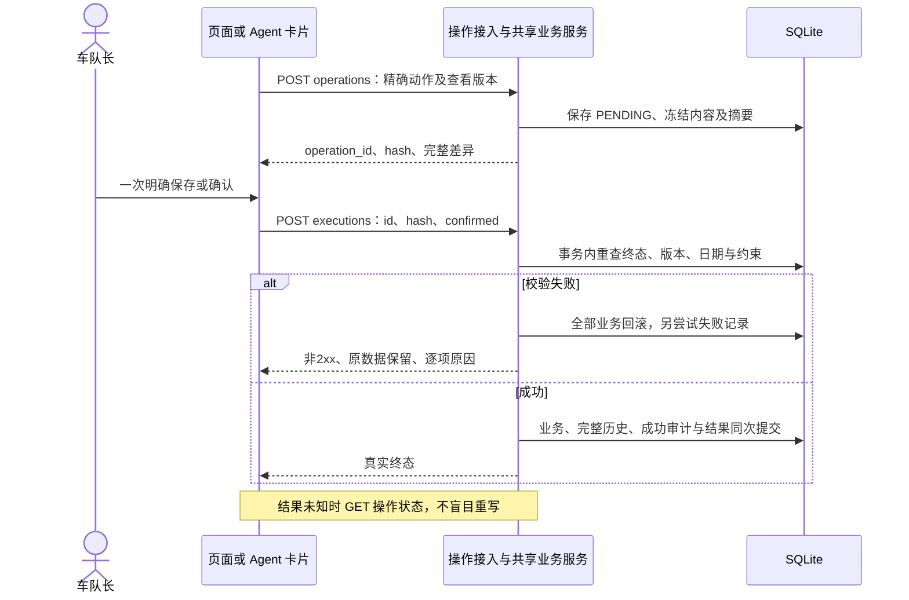

# 司机智能排班 Agent 系统——API 接口设计

| 项目 | 内容 |
| --- | --- |
| 设计阶段 | 第四阶段：API 接口设计 |
| 编写/修订日期 | 2026-11-03 |
| 文档状态 | 2026-11-03 用户审核通过，采纳全部接口方案；逐项确认结果见 1.2，整体审核结论见 10.4 |
| 整体评审修订 | 2026-11-03，用户审核通过并采纳本轮修订；确定性修正见 [05.设计方案评审结果](05.设计方案评审结果.md)，沿用已审核接口及动作清单 |
| 设计基线 | 已审核的功能模块、整体架构、13 表数据库，以及同步本轮澄清的需求 V1.4 |
| 本轮边界 | 仅接口契约、校验、错误、访问边界及一致性检查；不实现接口，不修改表结构或 SQL |

## 1. 依据与已确认事项

### 1.1 依据

- [01.功能模块梳理](01.功能模块梳理.md)：M01—M09、整计划确认、未来单日修改/取消、需求排班联合变更。
- [02.整体架构设计](02.整体架构设计.md)：本机免登录、FastAPI 同源托管、同步应用服务、DeepSeek 云端、统一事务与服务端确认内容。
- [03.数据库设计](03.数据库设计.md)、[已审核 schema.sql](../../scripts/sql/schema.sql)：13 张表、字段/枚举/JSON、类型分离、正式历史和幂等结果。
- [需求文档](../智能排班-需求文档.md)、[原型说明](../../prototype/README.md)、[交互脚本](../../prototype/app.js)：功能与页面覆盖。旧 docs/API.md、openapi.json 及旧应用接口不作为新版契约。
- [AGENTS.md](../../AGENTS.md)、[API 规范](../rules/api-rules.md)：命名、方法、参数、响应、状态码和错误处理。项目及上级未找到用户提及的 CLAUDE.md，已向用户确认使用这两份现有规范，不创建替代 CLAUDE.md。

### 1.2 本轮逐项确认

| 编号 | 结论 | 影响 |
| --- | --- | --- |
| I01 | 按 AGENTS.md 与 docs/rules/api-rules.md 继续。 | 本阶段规范依据。 |
| I02 | 查询使用资源路径；写操作共用 operations 准备、一次确认、executions 执行。 | 不为每种业务动作再建立独立写路径；页面与 Agent 共用应用服务。 |
| I03 | 整体需求/缺口/分配率按日期、计划、类别/模式筛选；司机/效率筛选用于司机次数，车辆筛选用于车辆指标；历史资源筛选定位日期。 | 不能把全队需求当司机个人目标。 |
| I04 | 名称 100 字符、车牌 30、联系方式 40、备注/原因 2000、搜索词 100；分页默认 20、最大 100；Agent 输入 4000、历史最多 20 条；不设计划日期跨度上限。 | 只限制 API 输入，不修改数据库列。 |
| I05 | 只有全部日期在未来且从未有正式历史的计划可整体修改名称、备注、日期范围及逐日需求；有历史后仅保留未来单日调整。 | UPDATE_PLAN 与单日联合变更边界明确，沿用原型。 |
| I06 | 先生成预览（允许为空），再手工编辑；不从从未生成状态直接建立纯手工草稿。 | SAVE_DRAFT 须已有草稿元信息，不新增人工算法来源。 |

其余基线保持：单车队固定操作者、整计划统一确认、未来单日正式变更、合法非空允许缺口、草稿不预占、历史名称与容量冻结、资料逐条写入、通知未接入。

## 2. 接口风格、响应与传输类型

### 2.1 风格和边界

前缀 `/api/v1`；路径用小写英文及连字符，JSON 字段 snake_case。查询用 GET，无业务副作用；准备业务操作用 POST /operations，执行用 POST /operations/{operation_id}/executions。业务写入采用已确认的操作资源模式：action_code 为固定白名单，禁止任意表名、字段表达式、SQL 或通用批量命令。它不是对数据库表逐一开放 CRUD。

本阶段共 26 个 HTTP 契约，21 类写动作复用其中的操作入口，详见第 5—8 节。全部请求和响应使用 UTF-8 JSON；GET 无请求体。未知字段、重复查询参数、重复 JSON 键、NaN/Infinity、类型不符均拒绝，不静默转换或忽略。HTTP 方法与状态语义参考 [RFC 9110](https://www.rfc-editor.org/rfc/rfc9110.html)。

服务端生成 id、版本、快照、plate_key、actor_code、entry_source、hash、确认时间及结果；客户端不得直接修改这些持久化字段。系统不提供数据库初始化、清库、演示切换、系统时间修改、元数据维护、通知或登录 API。

### 2.2 统一响应

所有应用 JSON 响应有同一外层：

```json
{
  "success": true,
  "code": "OK",
  "message": "查询成功",
  "data": {},
  "errors": [],
  "request_id": "6e70ae29-cae1-499b-a7eb-61cb066481c4",
  "data_revision": "18"
}
```

| 字段 | 类型 | 语义 |
| --- | --- | --- |
| success | boolean | 本次 HTTP 处理是否成功；非 2xx 必须 false。 |
| code | string | 稳定机器码，客户端不解析 message 判断结果。 |
| message | string | 可读提示，无堆栈、SQL、密钥或供应商原始错误。 |
| data | 对象或 null | 成功数据；执行失败可带已持久化的失败 OperationView，否则 null。 |
| errors | ErrorItem[] | 成功通常 []；失败返回具体字段、对象、日期及原因。 |
| request_id | string | 服务端单次 HTTP 追踪标识，仅用于技术日志，不新增数据库列。 |
| data_revision | UInt 或 null | 一致性读取或业务提交所对应的 business_state.revision；数据库不可用时 null。 |

ErrorItem 固定字段：`code:string`、`message:string`、`field:string|null`（如 payload.packages[0].driver_id）、`target_type:string|null`、`target_id:Id|null`、`work_date:Date|null`。根错误放外层 code，逐日/逐项原因放 errors，不只返回第一天失败。

读取一条状态为 FAILED 的操作本身可以 HTTP 200、success=true、code=OK；**这仅表示查询成功**，data.status 仍为 FAILED。准备成功为 OPERATION_PREPARED，不表示业务已经生效；客户端必须检查状态、结果和 requires_confirmation，不能将任何 200/201 当作排班成功。

分页统一 `data={items:T[],page:integer,page_size:integer,total:UInt}`，page 从 1 开始，默认 1；page_size 默认 20、范围 1—100；越界页返回空数组及真实 total。正文内的任务包集合、单日需求、整计划摘要不分页，避免只确认一页数据。列表排序固定且带 id 作稳定次序，不接收自由排序表达式。

### 2.3 类型和字段一致性

| 类型 | JSON/查询表示 | 校验与数据库映射 |
| --- | --- | --- |
| Id | 正十进制字符串 | 无前导零/符号，1—9223372036854775807；数据库 INTEGER id。 |
| UInt | 非负十进制字符串 | `0` 或非零开头数字串；持久化列不能超过 INTEGER 正上限，汇总值用精确整数累计，不受单行 64 位求和溢出影响。 |
| IntText | 有符号十进制字符串 | 仅计算差额使用，禁止前导零、正号和负零；失效草稿可为负数，表示超分配，不写入正数分配列。 |
| Version | UInt | 通常≥1；formal_version 未确认时为 "0"。 |
| Flag | JSON 数字 0/1；查询为字符 0/1 | 对应 INTEGER 布尔列，不能用 true、"true"、其他数替代。 |
| Date | string | 严格 YYYY-MM-DD，有效自然日，Asia/Shanghai，范围包含首尾。 |
| Timestamp | string | UTC YYYY-MM-DDTHH:mm:ss.SSSZ；由服务端产生。 |
| Rate | string 或 null | 六位小数的比例，如 "0.160000" 表示 16%；分母为零时 null。最终展示四舍五入，不用于硬约束判断。 |
| JSON 列 | 对象/数组，而非二次编码字符串 | 字段名保留 `_json`，如 summary_json 对应 SQLite TEXT 中的结构化内容；按白名单投影，不直接倾倒整行。 |

本设计将 id、版本和精确整数量作为十进制字符串传输，以保留 SQLite 整数范围且避免浏览器丢精度；**列名、单位和数据库类型不改变**。分页参数和 Flag 是上述例外。JSON 对大整数的跨实现精度边界见 [RFC 8259 §6](https://www.rfc-editor.org/rfc/rfc8259.html#section-6)。前端输入 ROAD 公里时先精确检验最多三位小数，再换算整数米填入现有 `_meters` 字段；不增加一套 `_km` 持久化字段，不接受浮点米数。

更新请求：字段未出现=不修改；明确 null=清空允许为空的文本；不允许清空必填。整体替换集合时完整提交，缺项代表移除，须在摘要体现。请求不收 created_at、updated_at、id、version、状态快照等服务端字段；下文专门允许的 existing id 仅定位待保留任务包，不是修改主键。

### 2.4 输入边界

- Name：去首尾空白后 1—100 字符；Plate：1—30；Phone：可空，非空时 1—40；Notes/Reason：可空，非空时最多 2000；q：可选，去空白后最多 100。字符数按 Unicode 码点计，不按字节。车辆可选名称同 Name，可用 null 清空。
- 枚举完全复用数据库：task_mode=TAG/ROAD；shift_code=MORNING/MIDDLE/EVENING；efficiency_level=HIGH/MEDIUM/LOW；formal_status=NONE/ACTIVE/CANCELLED；schedule_kind=DRAFT/FORMAL。计划 derived_status 是计算值 PENDING/PARTIAL_CONFIRMED/ALL_CONFIRMED/CANCELLED，不新增列。
- 时间范围 start_date、end_date 成对给出，结束不早于开始；UPDATE_UNAVAILABILITY 若修改任一日期也必须同时提供两者，仅改 reason 时可同时省略。要求范围的接口均必填。不以 31 天验收样例作为 API 日期跨度上限。
- 当日需求最多为当前类别集合中不重复的类别数；任务包最多为日期可引用车辆数×3，同时受司机每日一次约束；每包明细为该日同模式不重复需求子集。date_overrides 不超过范围天数且日期唯一。数组由实体集合、唯一性和业务关系限制，不暗设 31 日或 50 车上限。
- Agent 单条 message 1—4000 字符，history 0—20 条；每条仅 USER/ASSISTANT、content 1—4000。超限明确 422，不静默删上下文后猜写操作。
- Pydantic 结构严格校验后再作业务校验，不能把 "1.5"、true 或非法日期自动转换为合法数量。[Pydantic 严格校验](https://docs.pydantic.dev/latest/concepts/strict_mode/)

## 3. 本地访问、权限与版本

### 3.1 本机免登录

仅监听 127.0.0.1/::1 回环，Host 精确匹配本机部署允许的主机和端口；不信任客户端提供的转发头扩展访问范围。正式使用同源托管；开发 Vite 来源需显式列入允许清单，不开通配 CORS。

写请求须 Content-Type=application/json，Origin 必须精确匹配允许的 scheme/host/port；拒绝缺失、null 或外部来源。GET 如携带 Origin 也必须允许；浏览器同源 GET 未带 Origin 可以正常读取。不能用 CORS 响应头代替服务端来源拒绝。相关语义参见 [Fetch Standard](https://fetch.spec.whatwg.org/#origin-header)。首版浏览器可通过这些检查，不承诺任意命令行来源自动放行。

统一固定操作者 LOCAL_CAPTAIN，外部页面入口记 PAGE，后端 Agent 编排创建的操作记 AGENT，执行时保留准备时入口。客户端没有 actor_code、entry_source、角色或模型密钥的写权限。无登录态，无 401 登录流程；来源拒绝为 403 ACCESS_DENIED。以后局域网/公网使用必须另行设计身份认证，不复用本机来源检查充当多用户权限。

### 3.2 旧页面和精确确认

expected_versions_json 是协议对象，映射现有版本列：

```json
{
  "business_revision": "18",
  "collection_plans": [{"id": "1", "version": "3"}],
  "plan_days": [{"id": "2", "version": "5", "formal_version": "0"}],
  "collection_categories": [],
  "drivers": [],
  "vehicles": [],
  "resource_unavailability": []
}
```

business_revision 必填，必须取自展示当前编辑内容的读取响应；其他数组默认 []，被直接编辑的已有对象版本必填，日操作须日版本及 formal_version，整计划操作须计划版本。服务器在一致性读取中补齐所有依赖并保存，不能用自动刷新版本替换旧页面所依据版本。执行阶段重查全局及相关版本，变化返回 409 VERSION_CONFLICT，重新展示、准备新操作。全局检查是首版保守策略，可能因其他页面的无关写入要求刷新；不增加行级锁服务。

自己的操作准备和审计不推进 revision；同一操作终态重放必须先于旧版本检查，否则自身已成功后的新 revision 会错误阻止结果核实。读取/准备不是锁住未来资源，真正执行仍检查最新约束。

## 4. 复用请求与响应对象

以下为接口对象，组合字段和计算字段不代表新增数据库列。未列出的持久字段不允许客户端写入。

### 4.1 资料对象

| 对象 | 字段与规则 |
| --- | --- |
| CategoryView | id:Id、task_mode、name、version:Version、created_at、updated_at，全部来自 collection_categories。 |
| PlanView | collection_plans 全部字段，另有 day_count、active_day_count、cancelled_day_count:UInt、derived_status，来自日期汇总。 |
| DriverView | drivers 全部公开字段，另有 work_date:Date、is_available:Flag、unavailability_ids:Id[]、scheduled_shift_count:UInt。可用性按所选日期，次数为系统当前有效 FORMAL 累计。 |
| VehicleView | vehicles 除 plate_key 外全部字段，另有 work_date、is_available、unavailability_ids、scheduled_shift_count。六容量为 UInt，源字段名不变。 |
| UnavailabilityView | resource_unavailability 全部字段，两个资源编号仅一个有值。 |
| DemandInput | collection_category_id:Id、task_mode 必填；target_tag_count/target_road_meters 按模式一项 UInt，另一项 null；sort_order:UInt≥1；notes 可选默认 null。创建/替换需求允许所选目标为 "0"，表示无需求，归一化后不写需求行。类别/顺序仍须唯一，每天归一化后至少一项正数。 |
| DemandView | daily_demands 的全部字段；数量必须正数，不返回零行。 |
| DriverCreate | name 必填；phone 默认 null；efficiency_level 默认 MEDIUM；is_enabled、can_morning、can_middle、can_evening 默认 1。 |
| VehicleCreate | plate_number、morning_max_tag_count、morning_max_road_meters、middle_max_tag_count、middle_max_road_meters、evening_max_tag_count、evening_max_road_meters 必填；name/notes 默认 null、is_enabled 默认 1；容量 UInt≥0。 |

### 4.2 日、任务包和指标

| 对象 | 字段与规则 |
| --- | --- |
| PlanDaySummary | plan_days 的 id、collection_plan_id、work_date、version、formal_status、formal_version、created_at、updated_at；另有 has_draft、needs_revalidation、is_readonly:Flag，以及 metrics:Metric[]。提示标记来自元信息，readonly 来自北京时间，metrics 为当前 FORMAL 对全部日需求的计算。 |
| PlanDayDetail | PlanDaySummary＋demands:DemandView[]、capacity_basis_revision、capacity_captured_at；不默认输出整个车队容量数组或内部校验依据。 |
| AllocationInput | collection_category_id、task_mode 必填；assigned_tag_count/assigned_road_meters 按模式仅一项正 UInt、另一项 null。无分配则不放该明细，禁止零值。 |
| PackageInput | id:Id 可选，存在时须属于本次同日同类型集合且不可重复；driver_id、vehicle_id、shift_code、task_mode、allocations:AllocationInput[] 必填。allocations 非空；完整集合中缺失的包视为删除，无 id 的包为新增。 |
| PackageView | task_packages 所有字段和 allocations:AllocationView[]；AllocationView 为 task_allocations 所有字段。id 可在整体替换后变化，客户端不可将旧包编号当跨版本永久编号。 |
| ScheduleView | plan_day_id、work_date、version、formal_status、formal_version、schedule_kind、draft_metadata_json、packages:PackageView[]、metrics:Metric[]、validation_errors:ErrorItem[]。draft_metadata_json 仅投影 schema_version、算法来源、输入修订、手工/待校验标记、shortage_reasons、生成/更新时间；不输出 validation_basis。FORMAL 视图中该字段 null。validation_errors 为只读诊断，不保存或修正草稿。 |
| Metric | collection_category_id:Id\|null、category_name_snapshot:string\|null、task_mode；target_tag_count/target_road_meters、assigned_tag_count/assigned_road_meters 按模式一列 UInt、另一列 null；unallocated_tag_count/unallocated_road_meters 为 IntText/null，精确等于目标减分配；allocation_rate:Rate。全模式合计的类别编号/名称 null；类别行采用参与统计的需求名称快照，跨日按编号＋名称＋模式拆行，不选择某一个名称代表所有历史。数量和比率为计算值。 |

ScheduleView 的 DRAFT：无草稿时元信息 null、packages=[]；空草稿时有元信息、packages=[]。两种情况都不能确认。FORMAL：NONE/CANCELLED 时 packages=[]，取消原安排在历史中查看；ACTIVE 至少一个非空合法包。两者 metrics 分别用对应类型计算，草稿依赖失效时显式提示，不把旧原因视为现况。

失效草稿指标不掩盖超量：例如目标从 100 改 50，旧草稿仍分配 100，则差额为 "-50"，validation_errors 返回 DEMAND_EXCEEDED，页面标明超分配、不能生效；不钳为零或改写旧草稿。被移除的类别若仍有草稿分配，也保留指标行，目标为 "0"、类别名取草稿快照、差额为负、rate=null。合法 FORMAL 差额始终非负；DRAFT 的大于 1 比率或负差额仅为失效诊断，不称为合法分配率达标。当前日类别行按需求顺序，已移除类别追加按编号排序。

### 4.3 操作、历史和报表

| 对象 | 字段与规则 |
| --- | --- |
| OperationView | business_operations 的 id、request_key、request_hash、action_code、entry_source、target_type、target_id、requires_confirmation、status、confirmed_at、result_code、result_json、error_message、finished_at、created_at、updated_at，以及 summary_json、expected_versions_json。不输出 request_payload_json 的内部执行快照或模型信息。 |
| Summary | summary_json 中固定 schema_version、action_code、target_type、target_id、title、before、after、affected_dates:Date[]、pending_dates:Date[]、preserved_dates:Date[]、warnings:ErrorItem[]。普通资料与正式变更 before/after 是公开完整变更投影，所有会生效字段及快照变化须显示；创建 before=null，删除 after=null；整计划 after 含全部待确认日方案。GENERATE_DRAFT 的例外见第 6.1 节，不把尚未运行的算法输出伪装成 after。 |
| ExecutionResult | result_json 中固定 schema_version、code、target_type、target_id、affected_dates、preserved_dates、resource_ids:Id[]、plan_day_ids:Id[]、revisions:[{plan_day_id,version,formal_version}]、errors:ErrorItem[]。无需的数组为 []；新增类别/司机/车辆/计划等的 resource_ids 只有新建对象编号；日操作返回日编号。 |
| AuditSummary | audit_logs 除 changes_json 外全部字段。普通/失败日志正式版本三字段 null；成功正式历史有值。 |
| AuditDetail | AuditSummary＋changes_json。正式完整 before/after 严格对应数据库第 5.3 节快照；不换成当前资源名称。 |
| HistoryDay | PlanDaySummary＋plan_name_snapshot:string、last_changed_at:Timestamp；plan_name_snapshot 与时间来自最新正式事件。只含 formal_version>0 的日期，取消也保留。 |
| DriverStatistic | driver_id、scheduled_shift_count:UInt、segments:[{driver_name_snapshot,efficiency_level_snapshot,scheduled_shift_count}]。同司机当时名称/效率有变化时按段保存，次数总计等于段之和，不用当前等级替换历史。 |
| VehicleStatistic | vehicle_id、labels:[{plate_number_snapshot,vehicle_name_snapshot}]、available_shift_count、scheduled_shift_count:UInt、shift_usage_rate:Rate；modes:[{task_mode,assigned_tag_count,assigned_road_meters,available_tag_count,available_road_meters,capacity_utilization}]，每种模式仅对应整数列有值。来自对应日期基准与有效 FORMAL。 |

报告中的 available_*、计数、标签段、汇总和比例均为计算响应字段，不是数据库增列。无计划日期没有历史需求/容量基准，不以当前车队资料补造该日历史。

### 4.4 公开 JSON 的准确结构

本节字段均为响应必有；允许 null 处明确标记。嵌套对象不允许额外键。JsonValue 指 JSON 的对象、数组、字符串、布尔、数值或 null；精确整数仍遵循字符串约定。

| 对象 | 准确字段、类型及含义 |
| --- | --- |
| ShortageItem | collection_category_id:Id、task_mode、unallocated_tag_count:UInt\|null、unallocated_road_meters:UInt\|null、reason_codes:string[]、message:string；仅该模式一列正数，代码取数据库设计第 5.1 节已定义的五种原因，未证实原因则 []。 |
| PublicDraftMetadata | schema_version:UInt="1"、algorithm_code:string、algorithm_version:string、input_revision:Version、is_manually_modified:Flag、needs_revalidation:Flag、shortage_reasons:ShortageItem[]、generated_at:Timestamp、updated_at:Timestamp。shortage_reasons 是对应输入依据时保存的解释，待校验时不得称为当前事实。 |
| CapacityRow | vehicle_id:Id、plate_number_snapshot:string、vehicle_name_snapshot:string\|null、shift_code、is_available:Flag、max_tag_count:UInt、max_road_meters:UInt。用于只读历史与容量变化说明。 |
| DemandState | collection_category_id:Id、category_name_snapshot:string、task_mode、target_tag_count:UInt\|null、target_road_meters:UInt\|null、sort_order:UInt、notes:string\|null；零输入归一化后不出现。 |
| AllocationState | collection_category_id:Id、category_name_snapshot:string、task_mode、assigned_tag_count:UInt\|null、assigned_road_meters:UInt\|null。 |
| PackageState | id:Id\|null、driver_id:Id、vehicle_id:Id、shift_code、task_mode、driver_name_snapshot:string、efficiency_level_snapshot、plate_number_snapshot:string、vehicle_name_snapshot:string\|null、max_tag_count_snapshot:UInt、max_road_meters_snapshot:UInt、allocations:AllocationState[]。新增拟执行包 id=null，服务端分配 id 不属于用户可修改业务值。 |
| DraftStateMetadata | 与 PublicDraftMetadata 的业务字段一致，但省略 generated_at、updated_at 两个自动时间戳，仅用于拟执行摘要；实际 Q13 响应仍返回完整 PublicDraftMetadata。 |
| DayState | id:Id\|null、work_date:Date、formal_status、formal_version:UInt、demands:DemandState[]、draft_metadata_json:DraftStateMetadata\|null、draft_packages:PackageState[]、formal_packages:PackageState[]。新计划日期 id=null、NONE/"0"，两类包空；正式 after 不含草稿。 |
| PlanState | id:Id\|null、name:string、start_date:Date、end_date:Date、notes:string\|null、days:DayState[]，包含范围全部日期及展开后的逐日完整需求，不使用仅有计数的 PlanView 替代。 |
| CategoryState | id:Id\|null、task_mode、name:string。 |
| DriverState | id:Id\|null、name:string、phone:string\|null、efficiency_level、is_enabled:Flag、can_morning:Flag、can_middle:Flag、can_evening:Flag。 |
| VehicleState | id:Id\|null、plate_number:string、name:string\|null、notes:string\|null、is_enabled:Flag、六个与 VehicleCreate 同名的容量 UInt 字段；不输出 plate_key。 |
| UnavailabilityState | id:Id\|null、driver_id:Id\|null、vehicle_id:Id\|null、start_date:Date、end_date:Date、reason:string\|null；两个资源编号二选一。 |
| FieldChange | field:string、label:string、before:JsonValue、after:JsonValue。field 是服务端生成的公开字段路径，仅供展示，不接受执行表达式。 |
| RelatedChange | plan_day_id:Id\|null、work_date:Date、changes:FieldChange[]。仅拟新增日期可用 null，执行后真实编号由结果返回；列需求名称、草稿标记/明细名称和容量基准等关联变化，保留全部涉及日期。 |
| GenerationSnapshot | algorithm_code:string、algorithm_version:string、input_revision:Version、is_manually_modified:Flag；正式修改从原正式来源继承并标明人工修改。input_revision 仅为来源修订号，不是可查询的完整算法输入历史；按第五阶段用户确认，不增加全司机候选池或算法重放数据。 |
| FormalSnapshot | header:{collection_plan_id:Id,plan_name_snapshot:string,plan_day_id:Id,work_date:Date,formal_status:ACTIVE或CANCELLED,formal_version:Version}；demands:DemandState[]；packages:PackageView[]（全部 FORMAL）；capacity_basis:{capacity_basis_revision:Version,capacity_captured_at:Timestamp,vehicle_capacities_json:CapacityRow[]}；generation:GenerationSnapshot；shortages:ShortageItem[]。 |

AuditDetail 的正式 changes_json 精确为 `{schema_version:"1",before:FormalSnapshot|null,after:FormalSnapshot}`，首次 before=null；其他普通成功或失败为 `{schema_version:"1",before:JsonValue,after:JsonValue,changes:FieldChange[],affected_dates:Date[],errors:ErrorItem[]}`，失败 after 与未生效业务状态一致，不造正式版本。快照 JSON 内部整数同样按传输字符串输出；持久化时按第三阶段结构转为精确整数，不改变列类型。

正式历史只展示当时快照和已记录的缺口说明，不提供按 input_revision 重放算法的接口。未记录原因时只返回已知数量，不用当前司机/车辆池推断旧原因。

Summary 在第 4.3 节所列字段外，固定包含 `changes:FieldChange[]` 和 `related_changes:RelatedChange[]`；changes 是主对象的完整变更差异，related_changes 是关联变化，二者与 before/after 一起冻结计算 hash。结构按 action_code 判别：

| 动作族 | before / after 的具体类型 |
| --- | --- |
| 类别 CREATE / UPDATE / DELETE | CategoryState；创建 before=null、删除 after=null，更新为前后两个状态；未来名称传播写 related_changes。 |
| 司机 CREATE / UPDATE / DELETE | DriverState，同上；草稿待校验日期写 related_changes。 |
| 车辆 CREATE / UPDATE / DELETE | VehicleState，同上；全部受影响未来容量行的前后值、草稿待校验写 related_changes。 |
| 不可用 CREATE / UPDATE / DELETE | UnavailabilityState，同上；所属资源及日期影响写 changes/related_changes，不悄悄更换资源。 |
| 计划 CREATE / UPDATE / DELETE | PlanState，同上；全部展开需求、被移除日期与人工草稿在状态中保留，容量/日期关联变更写 related_changes。 |
| UPDATE_DEMAND、SAVE_DRAFT | DayState / DayState，before/after 为完整同日需求与对应类型任务包；纯草稿编辑不生成新的正式状态。 |
| GENERATE_DRAFT | before={days:DayState[]}，包含请求范围所有日与旧草稿；after={generation_request:{start_date:Date,end_date:Date,overwrite_manual:Flag,algorithm_code:string,algorithm_version:string}}，新包尚未知，不能提前声称存在。 |
| CONFIRM_PLAN | before={days:DayState[]}、after={days:DayState[]}，均覆盖完整计划；待确认日 after 为拟生效完整包，已有 ACTIVE 日前后一致保留；实际新包 id 可为 null，自动生成版本按 expected_versions 校验。 |
| MODIFY_FORMAL_DAY、CANCEL_FORMAL_DAY | DayState / DayState；前后需求及完整正式包明确，取消 after 正式包空、状态 CANCELLED；正式历史仍用实际提交后的 FormalSnapshot 保存。 |

上述状态有意省略自动生成的时间戳、plate_key 等内部值，自动 id 通过结果返回；用户确认的业务内容、关联变化和版本依据必须一致。正式快照使用提交后实际 id/版本/时间，不把拟创建的 null id 存成已生效实体编号。

## 5. HTTP 接口清单与查询契约

所有路径均带 `/api/v1` 前缀；以下成功读取 HTTP 200/code=OK，除第 6 节另述。Id 路径参数必填，无默认；不存在 404 NOT_FOUND。列表分页和所有全局错误按第 2、9 节，未列出的筛选参数拒绝。

### 5.1 M01：本机上下文

**Q01 GET /api/v1/context**

无参数。data：`{actor_code:"LOCAL_CAPTAIN",actor_name:"车队长",business_date:Date,timezone:"Asia/Shanghai",notification_status:"NOT_CONNECTED"}`。业务时间来自服务器，不收客户端 today；该响应无登录凭证或会话。notification_status 为固定页面占位计算值，不是通知状态列。

### 5.2 M02：类别、计划与需求

| 编号、方法、路径 | 查询参数（除公共分页外） | data 与规则 |
| --- | --- | --- |
| Q02 GET /api/v1/collection-categories | task_mode 可选，无默认；q 可选，无默认 | Page<CategoryView>，按 task_mode、id 升序。 |
| Q03 GET /api/v1/collection-plans | q、start_date/end_date、derived_status 可选，无默认 | Page<PlanView>；范围筛选有任一归属日期落入范围的计划；按 start_date、id 降序。 |
| Q04 GET /api/v1/collection-plans/{collection_plan_id} | 无 | PlanView；日明细通过 Q05 按 collection_plan_id 获取，不在计划详情默认加载无限日期。 |
| Q05 GET /api/v1/plan-days | collection_plan_id、start_date/end_date、formal_status、has_draft:Flag、has_unallocated:Flag 可选，无默认 | Page<PlanDaySummary>，按 work_date、id 升序。has_unallocated 比较全部需求与当前 FORMAL，取消/未确认也有缺口。 |
| Q06 GET /api/v1/plan-days/{plan_day_id} | 无 | PlanDayDetail；用于编辑当日需求及取得版本。 |

Q05 的范围仅选已有日期，不生成新日期、不清理草稿。Q02 类别删除/更名与所有资料写入通过第 7 节动作，不另设未受控写路径。

### 5.3 M03：司机、车辆与不可用记录

| 编号、方法、路径 | 查询参数 | data 与规则 |
| --- | --- | --- |
| Q07 GET /api/v1/drivers | 公共分页；q、efficiency_level、is_enabled、is_available:Flag、work_date 可选 | Page<DriverView>，id 升序；work_date 默认服务器 business_date，不能将效率当可用性。 |
| Q08 GET /api/v1/drivers/{driver_id} | work_date 可选，默认 business_date | DriverView。 |
| Q09 GET /api/v1/vehicles | 公共分页；q、is_enabled、is_available:Flag、work_date 可选 | Page<VehicleView>，id 升序；日期默认 business_date。 |
| Q10 GET /api/v1/vehicles/{vehicle_id} | work_date 可选，默认 business_date | VehicleView。 |
| Q11 GET /api/v1/resource-unavailability | 公共分页；driver_id 或 vehicle_id 可选且不能同时给；start_date/end_date 可选 | Page<UnavailabilityView>；范围按区间相交筛选，start_date、id 升序；无资源筛选时列两类。 |
| Q12 GET /api/v1/resource-unavailability/{unavailability_id} | 无 | UnavailabilityView。 |

司机/车辆关键词查询同时匹配名称、编号及车辆车牌；重名不会被查询层擅自折叠或选择首条。资源详情可查询过去指定日期的整日不可用记录，但不将当前启用/容量资料宣称为历史快照；历史统计使用日期基准与正式事件。

### 5.4 M04/M05/M06：每日草稿与当前正式安排

| 编号、方法、路径 | 查询参数 | data 与规则 |
| --- | --- | --- |
| Q13 GET /api/v1/plan-days/{plan_day_id}/draft | 无 | schedule_kind=DRAFT 的 ScheduleView，关闭页面后恢复；无草稿也返回 200，元信息 null。 |
| Q14 GET /api/v1/plan-days/{plan_day_id}/formal | 无 | schedule_kind=FORMAL 的 ScheduleView；取消或未确认时空包，返回真实状态，不把取消历史当当前安排。 |

两个完整编辑视图均返回该日全部包和需求指标，不允许按模式分页后直接整体替换；前端看板/明细/模式筛选在完整日数据上展示，不扩大生效范围。

### 5.5 M07：正式历史与统计

| 编号、方法、路径 | 查询参数 | data 与规则 |
| --- | --- | --- |
| Q15 GET /api/v1/schedule-history | 公共分页；collection_plan_id、start_date/end_date、driver_id、vehicle_id、efficiency_level、formal_status、is_readonly:Flag、has_unallocated:Flag、q 可选 | Page<HistoryDay>，work_date、id 降序；formal_status 仅 ACTIVE/CANCELLED。司机/车辆/效率/关键词定位该日任意正式 before/after 中匹配的资源；组合资源条件须同一快照同一个包满足，返回完整日期概况，不把过滤后的部分包当整日。 |
| Q16 GET /api/v1/plan-days/{plan_day_id}/history | 公共分页，无其他参数 | Page<AuditSummary>，仅该日成功正式版本，formal_version 降序；无历史时空列表。用 Q21 取完整版本快照。 |
| Q17 GET /api/v1/reports/allocation | start_date、end_date 必填；collection_plan_id、collection_category_id、task_mode 可选；无分页 | `{filters,totals:Metric[],categories:Metric[],days:[{work_date,metrics:Metric[]}]}`。totals 为模式合计，categories 按类别编号＋日期需求名称快照＋模式分组，days 为逐日模式合计；全部需求计入，正式仅 FORMAL/ACTIVE，不接受司机/效率/车辆筛选。类别与 mode 同时给必须一致，否则 422。 |
| Q18 GET /api/v1/reports/drivers | start_date、end_date 必填；公共分页；collection_plan_id、driver_id、efficiency_level 可选 | Page<DriverStatistic>，driver_id 升序；效率按正式包当时等级筛选。默认只返回有匹配正式班次的司机；明确指定现存 driver_id 无班次时返回一行 0 次/空段，缺失对象 404。 |
| Q19 GET /api/v1/reports/vehicles | start_date、end_date 必填；公共分页；collection_plan_id、vehicle_id 可选 | Page<VehicleStatistic>，vehicle_id 升序；保留有容量基准但未使用的车辆，可包含已删除但有纯容量历史的编号。明确编号未匹配任何该范围数据时空列表，不用当前车辆补历史。 |

filters 只回显各报告允许的归一化筛选对象，日期必填不隐含“本周”；TAG/ROAD 独立。allocation_report 不混入容量利用率，容量指标由 Q19 提供，避免按类别过滤的分配量误除全模式容量。车辆使用率分母仍为至少一种模式正容量班次，两个模式容量分母分别按 B01；无分母为 null。

### 5.6 M09：操作记录与历史详情

| 编号、方法、路径 | 查询参数 | data 与规则 |
| --- | --- | --- |
| Q20 GET /api/v1/audit-logs | 公共分页；q、entry_source、outcome、action_code、target_type、target_id、business_operation_id、start_date/end_date 可选 | Page<AuditSummary>，created_at、id 降序。日期筛选指审计发生时间的北京时间自然日，与正式采集日区分；target_id 须同时给 target_type。 |
| Q21 GET /api/v1/audit-logs/{audit_log_id} | 无 | AuditDetail；普通日志与完整正式版本均从此读取，不另建重复历史详情接口。 |

GET 不因查询清理旧事件，正式历史永不按普通日志条数截断。操作对象删除后依当时标签显示。action_code 筛选固定业务白名单，不接收 SQL 或任意数据库字段名。

## 6. 统一操作协议（M02—M06/M08/M09）

### 6.1 W01 POST /api/v1/operations：准备精确操作

创建 business_operations 的 PENDING 记录；**不修改司机、需求、草稿或正式安排**，不代表执行完成。页面自动准备摘要后，唯一的“保存并生效”调用 W04；Agent 同样先返回准备好的卡片。生成、保存普通草稿这类无需生效确认的动作，也先准备再自动执行，不增加人工步骤。

请求体：

| 字段 | 类型 | 必填/默认 | 校验 |
| --- | --- | --- | --- |
| request_key | string | 必填 | 本机客户端生成的规范小写 UUID v4，例如 36 字符键；业务请求键不是登录令牌。 |
| action_code | string | 必填 | 第 7 节 21 项白名单之一。 |
| target_type | string | 必填 | 与动作对应的数据库目标枚举。 |
| target_id | Id 或 null | 必填 | 创建动作 null，已有目标必须精确编号；日草稿、正式目标均为 plan_days.id。 |
| payload | object | 必填 | 对应动作的专用请求对象；删除也是显式 {}。 |
| expected_versions_json | object | 必填 | 第 3.2 节，至少 business_revision 与对应直接目标版本；创建无需虚构目标版本。 |

```json
{
  "request_key": "92ee9d81-856c-421e-b95e-64df729583d6",
  "action_code": "UPDATE_DRIVER",
  "target_type": "DRIVER",
  "target_id": "7",
  "payload": {"efficiency_level": "HIGH"},
  "expected_versions_json": {
    "business_revision": "18",
    "drivers": [{"id": "7", "version": "2"}]
  }
}
```

新建成功：HTTP 201、code=OPERATION_PREPARED、data=OperationView，status=PENDING。相同 key 的相同输入再次准备返回已有操作，HTTP 200、code=OPERATION_REPLAY；不生成新摘要或新记录。不同输入复用 key：409 IDEMPOTENCY_KEY_REUSED。对象/字段非法按 404/422，资源引用、版本或日期冲突按 409；准备失败不创建半个 PENDING，可尝试保存失败审计。

准备顺序：检查来源/结构→按 key 查既有记录→比较原始规范输入→一致性读取版本与业务依据→构建完整 before/after 和差异→冻结内容与 hash。既有记录重放先于最新版本检查，不能让已成功请求因后续数据变化失去可核实结果。

持久化映射：action_code、target_type/id、request_key 用同名列；payload 与归一化原始请求、版本输入存 request_payload_json.input，服务器完整解析结果/快照存 request_payload_json.resolved；完整依赖存 expected_versions_json，公开摘要存 summary_json。request_hash 由服务端对这四部分与动作目标作确定性序列化后计算：对象键排序，数组顺序保留，数量规范化，不作浮点转换，不将“未出现”与 patch 中的 null 混同。重放比较 input，而不是重新用当前数据构造 resolved；相同输入才能取得原 hash。

GENERATE_DRAFT 在 W01 不运行算法：before 保存将被覆盖的旧草稿，after 明确为 `{generation_request:{start_date,end_date,overwrite_manual,algorithm_code,algorithm_version}}`；resolved 保存生成范围与输入依据。冻结的是“按哪些输入生成、覆盖哪些内容”，没有提前确认新任务包。W04 核对版本与算法配置后才计算并保存 DRAFT；算法版本已变时 INPUT_CHANGED，不能静默换算法。计算结果通过 Q13 与 ExecutionResult 获取，后续仍须单独整计划确认才会正式生效。人工覆盖确认也只授权该次生成/覆盖，不授权任何正式排班。

requires_confirmation 由服务端按动作和人工草稿覆盖情况决定，外部不允许提交。准备时保存的 `entry_source` 由实际 PAGE/AGENT 调用链标记，不接受从 JSON 伪造。

### 6.2 W02 GET /api/v1/operations?request_key={request_key}：未知结果按键查询

request_key 必填且为 UUID v4，无其他参数、无分页输入。HTTP 200、code=OK；data 统一为 Page<OperationView>，page=1、page_size=1、total 为 "0" 或 "1"，items 最多一项。键不是凭证，可用于本机结果定位；不把模型密钥放入此 URL。

零项表示当前没有可见的已准备记录，不能单凭它判定另一个仍在处理的准备请求已结束。无自动业务重试；在原请求结束或用户重新发起时可用相同 key 核实/准备，由唯一键及输入绑定防重复。

### 6.3 W03 GET /api/v1/operations/{operation_id}：读取摘要与状态

operation_id:Id 必填，其他参数无。HTTP 200、data=OperationView；不存在 404。PENDING 表示尚无可见终态，不能据此判断正在执行、未执行或执行锁归属；SUCCEEDED/FAILED 以真实存储内容显示。查询不推进版本、不执行写入、不再次调用模型。

### 6.4 W04 POST /api/v1/operations/{operation_id}/executions：执行已保存内容

请求体仅接受：

| 字段 | 类型 | 必填/默认 | 规则 |
| --- | --- | --- | --- |
| request_hash | string | 必填 | 必须为最近展示且准备记录中同一 64 位小写十六进制 hash。 |
| confirmed | boolean | 必填 | requires_confirmation=1 必须 true；requires_confirmation=0 为 false，由页面/受控工具自动提交。 |

```json
{
  "request_hash": "aaaaaaaaaaaaaaaaaaaaaaaaaaaaaaaaaaaaaaaaaaaaaaaaaaaaaaaaaaaaaaaa",
  "confirmed": true
}
```

示例 hash 仅说明格式，实际必须使用服务端返回值。请求不再接收 payload、日期列表、司机或数量；修改拟执行内容必须新准备，不能在执行请求中夹带变化。明确确认按钮，或与具体 operation_id/hash 绑定的明确用户动作，均只执行一次；未绑定对象的自然语言“确认”不能由模型自行猜卡片。

先验证来源、hash 与确认动作，再取得写入机会，在锁内重查终态。已有终态返回持久结果，不再执行业务；不同 hash 为 409 CONFIRMATION_MISMATCH，未确认不把操作改 FAILED，可继续正确确认同一摘要。

新执行：重新核对版本、日期、引用及硬约束；成功业务、正式事件历史、审计、操作终态一起提交，提交后 HTTP 200、success=true、code=EXECUTED，data.status=SUCCEEDED。无新增确认的整计划重复操作返回 HTTP 200、code=ALREADY_CONFIRMED，result_code 同值，不新增正式版本或包。

NO_PENDING_DATES 是 GENERATE_DRAFT 的成功业务结果码，仅出现在 data.result_code / result_json.code；此时外层仍为 HTTP 200、code=EXECUTED。同一已成功操作的重放返回原结果；新准备的整计划确认在全 ACTIVE 时返回 ALREADY_CONFIRMED。二者都不重复生效。

业务失败：回滚全部业务，独立短事务尝试保存 FAILED 和失败审计，再按原业务错误 HTTP 409 或 422 返回 success=false、对应 code、errors；持久化成功时 data 为 FAILED OperationView。FAILED 终态重放仍用原 409/422 与同一错误，不因查询成功包装成执行成功；HTTP 语义由固定错误码映射决定，不新增状态码数据库列。

锁等待失败/数据库不可用：503 STORAGE_UNAVAILABLE 或 WRITE_BUSY；若仍无终态，不能伪造 FAILED/SUCCEEDED。响应超时/丢失先用 W02/W03 核实；任何自动重新写入前必须重查状态及同 key/hash。W04 允许安全地重放同一已绑定操作，但不能换 key 当作不明结果的重试。

生成算法例外：W04 接管 GENERATE_DRAFT 后在一致性读事务抓取输入并核对版本，释放事务运行算法。最后短写事务必须先重查操作终态，已被并发请求完成则返回已存结果；仍 PENDING 才核对全局修订、日期版本和当前业务日期后保存。不能沿用计算前的终态判断，也不能因自身已完成而误报 INPUT_CHANGED。中间没有持锁计算，模型等待、人工确认都不在写事务内。

### 6.5 统一链路



## 7. 21 类业务动作的请求与结果

每类动作是 W01 的 payload 契约，不是额外 HTTP 路由。所有动作执行均返回 OperationView，其 result_json 为第 4.3 节 ExecutionResult；下表列出具体结果对象/日期和关键错误。需要明确确认标 1，自动草稿操作标 0。默认不存在的参数必须按下文处理，不能自动猜日期、模式或对象。

### 7.1 M02：类别、计划和每日需求（7 类）

| action_code | target_type / target_id | payload：必填、可选及默认 | 确认与规则 / 具体结果 |
| --- | --- | --- | --- |
| CREATE_CATEGORY | CATEGORY / null | task_mode、name 必填 | 确认 1；同模式同名 409 DUPLICATE_CATEGORY；创建结果 target_id/resource_ids 为新类别 id。 |
| UPDATE_CATEGORY | CATEGORY / 类别 id | name 必填，其他字段禁止 | 确认 1；须类别 version；未来需求、DRAFT 名称及相关版本同事务刷新，FORMAL/历史不刷新；affected_dates 列全部受影响未来日期。 |
| DELETE_CATEGORY | CATEGORY / 类别 id | {} | 确认 1；须类别 version；需求、DRAFT 依据/明细、FORMAL 和全历史任务引用则 409 RESOURCE_REFERENCED，否则删除并保留审计。 |
| CREATE_PLAN | PLAN / null | PlanInput，见下文 | 确认 1；全部日期未来、唯一且每天正需求；冲突整体 409 DATE_OVERLAP；结果含新计划 id、全部新 plan_day_ids 和日期。 |
| UPDATE_PLAN | PLAN / 计划 id | PlanInput 完整替换，见下文 | 确认 1；须计划 version，全部日期未来且无正式版本/历史，否则 PLAN_EDIT_NOT_ALLOWED；日期冲突整体拒绝，不能迁移正式历史，草稿及需求的全部影响进入摘要。 |
| DELETE_PLAN | PLAN / 计划 id | {} | 确认 1；须计划 version；整计划未来且无正式版本/历史，否则 409 PLAN_HAS_HISTORY 或 DATE_LOCKED；按数据库删除顺序清理，结果保留原计划编号及受影响日期。 |
| UPDATE_DEMAND | PLAN_DAY / 日期 id | demands:DemandInput[] 必填，完整替换该日需求 | 确认 1；须日 version/formal_version。NONE/CANCELLED 未来日可改，保留草稿内容并标待校验；ACTIVE 返回 409 FORMAL_CHANGE_REQUIRED，转 MODIFY_FORMAL_DAY 联合处理；结果为该日及新版本。 |

PlanInput：name、start_date、end_date、default_demands:DemandInput[] 必填；notes 默认 null；date_overrides 默认 []，每项 work_date、demands 必填且完整替换该日默认。覆盖日期须在范围内且唯一，按同模式 sort_order 分配。日需求展开属于一个计划创建/替换的专用操作，不是跨模块批量资料写入。默认数组归一化后至少一项正需求，覆盖日也同样要求。

UPDATE_PLAN 是整体替换：客户端必须提交完整未来计划及保留的逐日差异，不能只发改动日却清空其他需求。摘要列出新增、移除、改变日期及被清理的草稿；保留日期需求变化的旧草稿仅标待校验。没有默认截取重叠日期、合并计划或把正式日期搬到新日期的能力。

### 7.2 M03：司机、车辆与整日不可用（9 类）

| action_code | target_type / target_id | payload：必填、可选及默认 | 确认与规则 / 具体结果 |
| --- | --- | --- | --- |
| CREATE_DRIVER | DRIVER / null | DriverCreate | 确认 1；允许同名，结果含新司机 id；不以姓名作更新目标。 |
| UPDATE_DRIVER | DRIVER / 司机 id | DriverCreate 中字段的非空 patch，省略保持；phone 可 null | 确认 1；须司机 version；资格、停用或请假相关影响检查未来 FORMAL，非法 409 FUTURE_SCHEDULE_INVALID；效率变化不重排；结果含司机编号与受影响草稿日期。 |
| DELETE_DRIVER | DRIVER / 司机 id | {} | 确认 1；须司机 version；任何 DRAFT/FORMAL 包和正式任务历史引用拒绝，删除未用资源时清理其不可用记录。 |
| CREATE_VEHICLE | VEHICLE / null | VehicleCreate | 确认 1；plate_key 服务端计算，重复 409 DUPLICATE_PLATE；结果新车辆 id；同事务刷新所有受影响未来容量基准。 |
| UPDATE_VEHICLE | VEHICLE / 车辆 id | VehicleCreate 中字段的非空 patch，name/notes 可 null | 确认 1；须车辆 version；当前完整六容量合并校验，降低容量、停用若使未来正式非法则全拒绝；成功同步未来基准和草稿提示。 |
| DELETE_VEHICLE | VEHICLE / 车辆 id | {} | 确认 1；须车辆 version；任务引用受保护，纯容量快照不阻止删除；清理维修、刷新未来基准，过去及正式历史纯容量来源保留。 |
| CREATE_UNAVAILABILITY | UNAVAILABILITY / null | driver_id 或 vehicle_id 二选一；start_date、end_date 必填；reason 默认 null | 确认 1；须所属资源 version，资源存在且范围全未来；检查未来 FORMAL；结果新记录 id、受影响日期与资源，不新增资源。 |
| UPDATE_UNAVAILABILITY | UNAVAILABILITY / 记录 id | 非空 patch：日期要改则 start_date/end_date 一起给，或仅 reason；reason 可 null | 确认 1；须记录 version 和所属资源 version；所属司机/车辆不在此修改；原区间和合并后的完整区间均须全部未来，否则 DATE_LOCKED，不能通过更新移除锁定部分；覆盖可用性按区间并集判断。 |
| DELETE_UNAVAILABILITY | UNAVAILABILITY / 记录 id | {} | 确认 1；须记录及所属资源 version；原记录涉及锁定日期时 409 DATE_LOCKED，不部分删除区间；成功恢复对应区间可用性时仍考虑其他重叠记录。 |

全部资源变更失败完整保留原资料；错误 errors 列受影响日期和具体非法条件，车队长先改正式安排再改资源。resource ids 与 target_id 指业务动作目标，涉及的司机车辆明示在 summary before/after。客户端不提交物理快照数组，车辆未来容量基准由服务端维护。

### 7.3 M04/M05：生成与手工保存草稿（2 类）

| action_code | target_type / target_id | payload | 确认与规则 / 具体结果 |
| --- | --- | --- | --- |
| GENERATE_DRAFT | PLAN / 计划 id | start_date、end_date 必填；overwrite_manual:Flag 默认 0 | 通常确认 0；范围须全部未来、归属此计划且连续。已有 ACTIVE 日期明确列 preserved_dates，不覆盖；其余生成。任一日非法输入则本次草稿保存整体失败，不自动裁剪。结果返回实际更新日 id/版本，若全为 ACTIVE 则 NO_PENDING_DATES，无新包或业务版本。 |
| SAVE_DRAFT | DRAFT / 日期 id | packages:PackageInput[] 必填，完整替换，允许 [] | 确认 0；须日期 version/formal_version，未来且无 ACTIVE；需要存在已生成的草稿元信息，才能按生成来源编辑；全部硬约束检查，成功标手工、保存最新依据，返回该日版本。 |

生成范围有人工草稿时，overwrite_manual=0 返回 409 MANUAL_DRAFT_OVERWRITE_REQUIRED，保留原稿，列出需覆盖日期；明确改为 1 后准备摘要显示全部覆盖内容，requires_confirmation=1，用户只确认一次才执行。自动草稿覆盖也展示真实摘要，但没有虚构正式确认。日期范围包含当天/过去时直接 DATE_LOCKED，不把 ACTIVE 的过去日期当生成豁免。

SAVE_DRAFT 完整日集合支持新增/删除任务包、更换人员车辆/班次/模式、调整类别和数量；不能修改只读 id、work_date、schedule_kind、快照或算法字段。人工合法方案可偏离效率均衡偏好。数组为空只保存空预览，不可据此正式确认。

### 7.4 M06：整计划确认、未来单日修改与取消（3 类）

| action_code | target_type / target_id | payload | 确认与规则 / 具体结果 |
| --- | --- | --- | --- |
| CONFIRM_PLAN | PLAN / 计划 id | {}，禁止日期子集、任务包子集或 confirm_empty | 确认 1；须计划 version；服务器摘要覆盖完整计划、逐日草稿与保留日，补齐各日版本。首次全部日期；再确认保留 ACTIVE 日，对其余全部未来日统一校验。结果列全部新增 affected_dates/plan_day_ids/revisions 和 preserved_dates；全已有效为 ALREADY_CONFIRMED。 |
| MODIFY_FORMAL_DAY | FORMAL_DAY / 日期 id | packages:PackageInput[] 必填且非空，完整日替换；demands:DemandInput[] 可选，省略保留，明确给则完整替换当日需求 | 确认 1；须日 version/formal_version、当前 ACTIVE 且未来。所有差异一次确认，需求/FORMAL/完整历史同事务；任一非法两者均保留；只返回该日新版本。 |
| CANCEL_FORMAL_DAY | FORMAL_DAY / 日期 id | {} | 确认 1；须日 version/formal_version、ACTIVE 且未来。整日取消，释放 FORMAL 包占用，保留需求/日期/完整历史，formal_version 递增；其他日期不变。非 ACTIVE 返回 409 FORMAL_NOT_ACTIVE，同一已成功操作仍可重放结果。 |

CONFIRM_PLAN：无草稿、空预览、日期锁定、重复占用、不可用/资格或数量冲突均使整次新增失败，返回所有失败日，不消费草稿、不改变原有效日。合法非空但有缺口只在 warnings 提示；不能因缺口拒绝。确认保存精确摘要所列包，不能在提交中静默再跑算法或换资源。

MODIFY_FORMAL_DAY：需要降低需求并相应减少分配时，把完整 demands 和 packages 放在同一 payload；只想改需求但正式包不变时也提交当前全部包，快照无变化部分保留。清空整个日正式安排须 CANCEL，不能用 packages=[] 规避取消。多日正式修改、追加确认、独立正式调整草稿均不提供。

## 8. Agent 接口及工具边界

### 8.1 A01 POST /api/v1/agent/messages （M08）

普通 HTTP 请求响应，不新增 SSE/WebSocket、聊天会话表或登录态。请求：

| 字段 | 类型 | 必填/默认 | 规则 |
| --- | --- | --- | --- |
| request_key | string | 必填 | UUID v4，浏览器为本轮生成；本轮最多准备/执行一个业务写操作，并复用该键核实结果。 |
| message | string | 必填 | 1—4000 字符，原始用户指令。 |
| history | array | 默认 [] | 最多 20 项，每项仅 role=USER/ASSISTANT、content=1—4000 字符；不能传 SYSTEM、TOOL 或工具执行证据。 |
| context | object | 默认 {} | 可选 collection_plan_id、plan_day_id、work_date、pending_operation_id；编号须真实且关系一致，不接受客户端 today、角色或已授权工具列表。 |

必要对象、日期或数量缺失、重名、部分日期确认指令、复杂批量写指令，先返回明确澄清或拆解说明，不选首条、不扩大/缩小用户范围。相对日期按服务端北京时间，本周周一至周日；范围含锁定日必须提示，不裁剪后执行。

HTTP 200、code=AGENT_REPLIED，data 固定：

| 字段 | 类型 | 含义 |
| --- | --- | --- |
| reply_type | string | ANSWER / CLARIFICATION / OPERATION_READY / EXECUTION_RESULT。 |
| content | string | 基于真实数据的回复；不是执行成功凭证。 |
| clarification | object 或 null | 非空时为 `{question:string,options:[{label:string,target_type:string,target_id:Id\|null}]}`；选项仅帮助定位，用户回答后仍校验。 |
| operation | OperationView 或 null | 准备卡片或真实执行结果；正式写入不能只返回一句“已完成”。 |
| facts | array | `{query_id:string,data:对应 Q01—Q21 的公开响应对象}`；只允许白名单查询，保留分页，不能只取首页就声称“全部”。 |

ANSWER/CLARIFICATION 为正常已处理对话，并非 HTTP 错误。必要澄清可以只返回文字问题和空 options。OPERATION_READY 尚未生效；页面使用同一 W04 将真实用户动作与 id/hash 绑定，已经绑定的确认不再要求第二次确认。普通未绑定“确认”先澄清操作对象，模型不能自行证明已经获准。

### 8.2 工具调用范围及未知结果

- 工具只适配共享查询和 21 类操作服务；模型没有外部任意 URL、SQL、Repository、脚本执行或可直接绕过确认的写工具。
- 资料写入、正式确认/修改/取消只能准备 requires_confirmation=1 的卡片，模型不能调用有效生效动作。普通预览生成/保存可由服务端按明确指令执行 requires_confirmation=0 的操作；人工草稿覆盖须按第 7.3 节明确确认。
- 一轮只处理一个资料对象或一个已确认的专用业务操作；计划多日需求/草稿生成、整计划确认和单日需求排班联合变更不扩展为通用批量资料写入。
- Agent 准备时，服务器把本轮 message/history/context 的规范化哈希写入已有 request_payload_json 的 agent_input_hash，不持久化整段聊天。相同 Agent request_key 再来时先比较该哈希和 AGENT 入口，变化为 IDEMPOTENCY_KEY_REUSED；已有操作直接返回其摘要/终态，不重跑模型或重复工具写入。仅查询轮次没有操作记录，不将技术 request_id 当聊天持久化。
- 存在 PENDING 且 requires_confirmation=0 的未知执行，返回可核实状态；后续通过 W02/W03/W04 核实/重放同一绑定操作，不重新生成另一请求键。已成功的预览即使模型后续解释超时，也应按存储结果返回真实 EXECUTION_RESULT，可用服务端事实模板说明；不能撤销预览或声称写入失败。
- 超时、最大轮数/工具数、输出规模使用第二阶段待接入验证的参数，本设计不预设数值。DeepSeek 未可用 503 AGENT_UNAVAILABLE、上游错误 502 AGENT_UPSTREAM_ERROR、等待超时 504 AGENT_TIMEOUT；返回安全错误，页面业务查询与操作仍可用。

## 9. 状态码、错误与处理顺序

### 9.1 固定映射

| HTTP | code 范围 | 客户端处理 |
| --- | --- | --- |
| 200 | OK、OPERATION_REPLAY、EXECUTED、ALREADY_CONFIRMED、AGENT_REPLIED | 按具体 data.status / reply_type 显示，不混淆查询与写成功。 |
| 201 | OPERATION_PREPARED | 操作记录已创建，业务尚未执行；显示摘要或自动执行无需确认的草稿动作。 |
| 400 | MALFORMED_JSON | JSON 语法、重复键等错误，修正请求；不能将错误原文当模型回复。 |
| 403 | ACCESS_DENIED | 本机边界、Host、Origin 不允许；不弹登录页，不降级通配跨域。 |
| 404 | NOT_FOUND、REFERENCED_OBJECT_NOT_FOUND | 目标或引用不存在，定位对象；删除后的旧页面不重新创建目标。 |
| 405 | METHOD_NOT_ALLOWED | 非本契约方法，响应 Allow。 |
| 409 | IDEMPOTENCY_KEY_REUSED、CONFIRMATION_MISMATCH、CONFIRMATION_REQUIRED、VERSION_CONFLICT、INPUT_CHANGED | 保留用户编辑；版本变更须刷新及新准备，hash 错不能覆盖原操作；同键异内容不重试。 |
| 409 | DATE_LOCKED、DATE_OVERLAP、PLAN_HAS_HISTORY、PLAN_EDIT_NOT_ALLOWED、FORMAL_CHANGE_REQUIRED、FORMAL_NOT_ACTIVE、DRAFT_NOT_FOUND、EMPTY_SCHEDULE、MANUAL_DRAFT_OVERWRITE_REQUIRED | 日期、生命周期或范围冲突，按明确动作修正；不能自动忽略日期或清空正式。 |
| 409 | RESOURCE_REFERENCED、DUPLICATE_CATEGORY、DUPLICATE_PLATE、DRIVER_CONFLICT、VEHICLE_SHIFT_CONFLICT、VEHICLE_MODE_CONFLICT、RESOURCE_UNAVAILABLE、SHIFT_NOT_QUALIFIED、CAPACITY_EXCEEDED、DEMAND_EXCEEDED、FUTURE_SCHEDULE_INVALID、CONFIRM_PLAN_FAILED | 展示 errors 的日期/对象；先调整合法业务内容，原状态保留。整计划多日失败统一 CONFIRM_PLAN_FAILED，细项列原因。 |
| 415 | UNSUPPORTED_MEDIA_TYPE | 写请求非 JSON，不尝试表单隐式转换。 |
| 422 | VALIDATION_ERROR、INVALID_QUANTITY、INVALID_PLAN_DAYS、CATEGORY_MODE_MISMATCH、UNSUPPORTED_BATCH、CONFIRMATION_SCOPE_INVALID | 指向准确字段；数值、枚举、日期、数组及写范围修正后新准备。 |
| 500 | INTERNAL_ERROR、DATA_INTEGRITY_ERROR | 安全提示及 request_id；不泄露堆栈，也不假称原操作失败/成功。 |
| 502/503/504 | AGENT_UPSTREAM_ERROR、AGENT_UNAVAILABLE、AGENT_TIMEOUT | 查询本轮真实操作后反馈；不重复模型已触发的写入。 |
| 503 | WRITE_BUSY、STORAGE_UNAVAILABLE | 尚无可靠终态时先核实；不自动换 key 重写，不拆事务逐日提交。 |

框架默认 404、405、参数错误和未捕获异常也转成第 2.2 节外层；HTTP 状态与 success 不矛盾。应用层能处理的错误须统一；连接中断或 Web 服务未启动时没有 JSON 响应，前端按传输失败及未知结果处理，不能制造服务器响应。

### 9.2 校验与事务顺序

1. 本地访问边界、方法/媒体类型、JSON 解析；客户端字段严格白名单、原始类型/长度/数量/日期验证。
2. 幂等定位、目标与引用存在性、对象唯一定位；准备或执行按前述各自顺序核对版本。
3. 计划日期、生命周期、完整范围、快照/摘要一致；资源状态、资格、司机车班、同车模式、包内模式、正数、容量与需求汇总等硬约束。
4. 成功用一个 BEGIN IMMEDIATE 事务保存业务、版本、完整正式审计和操作终态；写入前及提交前按当前北京时间检查本次实际写入日期，若中途跨零点导致锁定则整体回滚，再报告结果。已有有效日期只读保留时不当作新写入日期。SQLite 约束冲突翻译成稳定业务码，不能把所有 IntegrityError 当同一种重复记录。
5. 已明确回滚的业务失败才以独立短事务记录 FAILED；失败落库前重查终态，避免并发成功被覆盖。COMMIT 结果不明或仅响应丢失时，不假定回滚：关闭失效 Session，用新的短事务先核实已存结果，不能在原失效事务上查询后覆盖成功；无法核实返回安全的未知结果/存储不可用并保留原操作键。记录失败的能力本身失败时仅写技术日志，不编造持久化结果。

确认失败示例：

```json
{
  "success": false,
  "code": "CONFIRM_PLAN_FAILED",
  "message": "本次新增确认全部未生效，草稿已保留",
  "data": null,
  "errors": [
    {"code":"EMPTY_SCHEDULE","message":"该日预览为空","field":null,"target_type":"PLAN_DAY","target_id":"12","work_date":"2026-11-06"},
    {"code":"SHIFT_NOT_QUALIFIED","message":"司机不具备早班资格","field":"packages[0].driver_id","target_type":"DRIVER","target_id":"7","work_date":"2026-11-07"}
  ],
  "request_id": "795596f3-b681-4fbe-acdc-3288dc78394c",
  "data_revision": "18"
}
```

此示例 data=null 表示失败操作记录本身未能持久化或当前仅提供失败详情；有持久失败记录时 data 返回 FAILED OperationView。客户端仍按 request_key 查询核实，不能仅凭 data 为空重试业务。

## 10. 数据库映射、完整性检查及审核事项

### 10.1 字段映射与不新增数据库列

| API 内容 | 已有持久化位置 / 计算依据 |
| --- | --- |
| 类别、计划、司机、车辆、不可用资料 | 同名已审核表的列；字段名称、模式、三班、效率、六容量完全沿用。 |
| default_demands / date_overrides | 仅创建/替换命令的协议集合，展开到 plan_days 与 daily_demands；无默认模板新表。 |
| demands、packages、allocations | 关系组合，分别来自 daily_demands、task_packages、task_allocations；输入由服务端补归属、类型、快照。 |
| 日 version、formal_status、formal_version、草稿元信息 | plan_days 既有字段；无独立草稿头/正式头 id 或版本。 |
| 日期容量、未用班次、历史分母 | plan_days.vehicle_capacities_json、capacity_basis_revision、capacity_captured_at；不允许客户端上传覆盖。 |
| summary、hash、requires_confirmation、结果 | business_operations 的既有列和 JSON；payload、input/resolved、agent_input_hash 是现有 JSON 内的结构，不新增列。 |
| 正式 before/after、名称/效率/容量历史 | audit_logs 的 formal_version/formal_change_type、changes_json；仍追加且禁止清理正式版本。 |
| expected_versions_json | 对应现有各实体 version、日 formal_version 及全局 revision；数组映射对象不是新版本表。 |
| data_revision | business_state.revision 的传输投影；schema_migrations 不暴露 HTTP。 |
| 分页、request_id、context、history、query filters、计算指标 | 传输、临时上下文或计算响应，不持久化为新列；聊天历史只在本次上下文中。 |

所有服务器生成字段拒绝客户端伪造；不因 API 校验长度新增 SQL CHECK，不改变 13 表设计。本轮保持 scripts/sql/schema.sql 的建表与索引内容不变。

### 10.2 功能模块与需求覆盖

| 模块 / 需求 | HTTP 与动作覆盖 |
| --- | --- |
| M01 / R01、R53 | Q01、本机访问边界、固定身份；无登录/账号/角色 API。 |
| M02 / R02—R14 | Q02—Q06；7 类类别/计划/需求动作，日期唯一、逐日复制、顺序、删除及联合变更。 |
| M03 / R15—R23 | Q07—Q12；9 类司机/车辆/不可用动作，零容量、资格、停用、引用与未来正式影响。 |
| M04 / R24—R31 | GENERATE_DRAFT，确定性本地算法、临时累计、TAG 优先和缺口，模型不代替分配。 |
| M05 / R32—R34 | Q13、SAVE_DRAFT、覆盖人工检查，可恢复不自动过期，合法手工可偏离优化。 |
| M06 / R35—R42 | Q14、整计划确认、单日修改取消，版本/精确摘要、空正式禁止、旧页面保护与再确认。 |
| M07 / R27、R42、R50—R51 | Q15—Q19 及历史详情 Q21，全部需求基数、类型隔离、完整快照与已确认容量分母。 |
| M08 / R43—R49 | A01、W01—W04、业务动作白名单；明确对象与日期、一次确认、资料逐条、真实结果。 |
| M09 / R52 | Q20—Q21、所有关键写动作日志；正式历史兼存但不截断。 |
| R54—R55 | 固定未接入通知占位；所有业务通过现有 SQLite 保存，新库空业务、无旧库导入或清库 API。 |
| R56 | 普通请求方式；计算在事务外、模型等待分离，5 秒目标仍需实施验收，不能用 API 超时承诺代替测试。 |

### 10.3 设计验证场景

以下为后续契约/集成验收要求，未实现接口：

1. 非允许 Host/Origin、缺失写 Origin、伪造身份/入口字段均被拒绝；本机正常浏览器不需要登录。
2. 相同准备 key/input 重放原摘要，不同内容同 key 拒绝；确认 hash 或所依据版本变化，不能夹带生效。
3. 结果未知、提交后断连、并发执行同一操作，最终只有一次业务写入；查询失败操作 HTTP 成功不误报业务成功。
4. 创建计划冲突列全部日期；逐日需求/零值、TAG 整数、ROAD 米整数及公里边界、类别顺序完整验证。
5. 整计划含过去未确认、无草稿、空预览、资源冲突则所有新增回滚；合法非空有缺口允许；旧有效日保持；拒绝日期子集；全有效返回 ALREADY_CONFIRMED。
6. 单日需求与安排联合降低后合法统一提交，任一失败两者保留；空正式只能取消；取消后整计划再确认，过去有效日只读保留。
7. 资料变更导致未来正式非法先拒绝，历史与锁定容量不改；草稿失效提示、人工覆盖和全历史删除保护完整。
8. 日期/资源/效率/状态/缺口筛选、查询分页、历史名称、资源段、零分母及取消统计正确；10 个可用班次×100、正式 160 为 16%，其他草稿不混入。
9. 跨北京时间零点重新检查，不能使用准备时的“今天”；上下文超限、目标重名、批量资料和模糊范围澄清，不静默裁剪。
10. 模型故障仍可页面工作；模型在写后解释超时用真实结果核实，不重复；通知仅占位不生成发送状态。

### 10.4 本轮检查记录与审核结论

2026-11-03 已完成本轮设计检查：

| 检查 | 结果与边界 |
| --- | --- |
| 接口清单 | Q01—Q21、W01—W04、A01 共 26 个 HTTP 契约，编号及方法/路径无重复；请求位置、参数/默认、响应对象和主要错误均已定义。 |
| 写动作与数据库 | 21 类动作逐项匹配 SQL action_code 白名单，无增删；已审核 schema.sql SHA-256 与本轮开始一致，未改表、列、约束或索引。 |
| 示例与文档 | 5 段 JSON 示例均可解析；需求 R01—R56 完整且唯一；本轮本地链接、UTF-8、代码围栏与表格连续性检查通过。 |
| 人工一致性 | 核对 M01—M09、核心流程、异常及 13 表映射；已确认业务澄清同步需求 V1.4 和前序相关设计说明。 |
| 独立读者复核 | 发现并修正生成指令/输出摘要的区别、NO_PENDING_DATES 内外层码、不可用日期 patch、失效草稿负差额、公开 JSON 结构、拟新增日期空编号及跨日名称分组。最终复核未发现范围内新增契约矛盾。 |

2026-11-03，用户明确确认“API设计审核通过，采纳该接口方案”。I01—I06、统一外层响应、26 个 HTTP 契约、21 个动作细节、整数十进制字符串传输、比率精度、公开 JSON 投影、错误码和本地来源校验策略全部纳入后续设计与实施基线。当前没有阻塞性的未明确业务规则。

模型具体型号/预算、执行轮数/工具数/超时、部署允许端口及开发来源、运行备份参数、实际性能继续第二阶段实施待办。本轮只进行了文档和一致性检查，没有实现或运行 API，也未将旧接口测试说成新契约验收。

第四阶段完成。本轮只同步审核状态，没有实现接口、修改数据库结构或进入后续开发；后续按用户新指令继续，实施参数仍按上述待办验证。

## 11. 第一阶段开发落实记录

2026-11-03 已实现 Q01、W01—W04、Q20—Q21 的公共 HTTP 接入，以及七字段统一响应、错误码、本机 Host/Origin 校验、严格 JSON/参数处理、持久化操作状态、幂等、版本和审计。动作仍使用本文件的 21 项白名单。

生产装配的业务适配器将在对应业务阶段注册。本阶段通过测试专用适配器进入真实 W01—W04 验证公共链路。其余查询、业务动作实现及 Agent 接入按用户后续开发任务推进。前端已封装公共操作 API，当前基础页面读取 Q01。实际验证及实现位置见 [第一阶段实施记录](../implementation/01.基础与公共能力.md)。

## 12. 第二阶段开发落实记录

2026-11-03，已实现 Q02、Q07—Q12，默认装配类别、司机、车辆及不可用记录的十二类 CREATE / UPDATE / DELETE 动作。启停采用司机或车辆的 UPDATE patch，取消请假维修采用 DELETE_UNAVAILABILITY。写入统一使用 W01 和 W04，Q20—Q21 供新增审计页面查询。

本轮公开字段、分页、筛选、数量单位、整数传输、确认和错误语义均沿用本设计。前端实现完整摘要、关联差异、一次生效确认、旧版本输入保留及原请求结果核实。实际契约和浏览器验证记录见 [第二阶段实施记录](../implementation/02.基础资料管理.md)。
