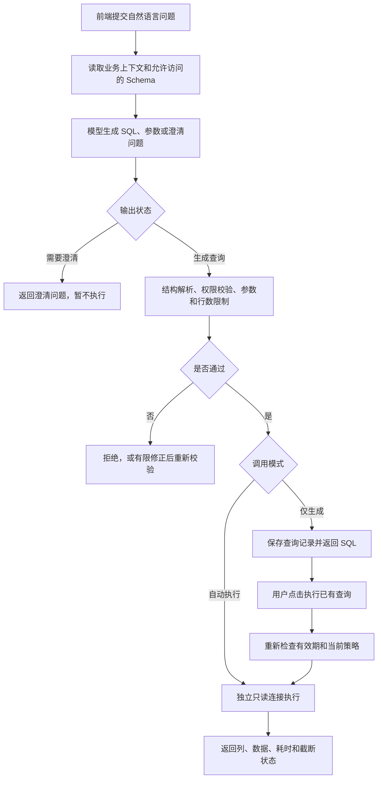

# 自然语言生成 SQL 与执行：接入方案

日期：2026-10-27。状态：设计建议，尚未实现。本轮仅新增本方案文档。

## 1. 建议采用的方案

在现有 FastAPI 系统中增加独立的 `nl_sql` 模块，实现：

> 用户问题 → 业务语义与表结构 → 大模型生成结构化 SQL → 后端校验 → SQLite 只读执行 → 返回 SQL、参数、结果和执行状态。

参考 DB-GPT 的表结构上下文、提示词、输出解析和查询工具设计，不需要引入它完整的应用服务、工作流、向量库或多 Agent 框架。当前数据库共 22 张表，首版可直接提供经过权限过滤的精简 Schema，配合中文业务词典和少量示例。表数量、上下文长度或实测准确率需要时，再增加 Schema 检索。

这里将首期“执行”定义为执行查询 SQL：支持单条 SELECT、聚合、多表 JOIN、非递归只读 CTE，以及只读集合查询。修改司机、确认排班、发送通知等操作继续使用已有业务服务。若后续需要自然语言执行 INSERT / UPDATE / DELETE，应另行实现写入方案，不能直接放开查询执行器。

本次新增需求可以在 V3.0 预留能力上扩展受控查询，不必实现完整排班 Agent。建议保持 `app/agent/` 空目录，将本模块作为未来 Agent 可调用的独立能力。

## 2. DB-GPT 中值得参考的实际代码

以下结论基于本地 `D:/code_Agent/AAAsjpb/DB-GPT-main` 源码；不假定它与线上最新版本完全一致。

| 代码位置 | 实际职责 | 本项目如何参考 |
|---|---|---|
| `packages/dbgpt-app/src/dbgpt_app/scene/chat_db/auto_execute/chat.py:50`，`generate_input_values()` | 获取与问题相关的表结构；检索失败时回退到简要表结构；提供数据库方言、结果数量等提示词变量 | 将“获得真实表结构”和“调用模型”分开 |
| 同文件 `:90`，`do_action()` | 返回 `database.run_to_df` 执行回调 | 借鉴生成与执行分层；执行器由后端固定选择 |
| `packages/dbgpt-app/src/dbgpt_app/scene/chat_db/auto_execute/prompt.py:55`、`:90` | 提示词约束方言、可用表、关联关系、结果数量；约定 JSON 输出，包括 `sql` | 使用更小的 JSON 契约，增加绑定参数和澄清状态 |
| `packages/dbgpt-app/src/dbgpt_app/scene/chat_db/auto_execute/out_parser.py:50`、`:125` | 解析 SQL / JSON；通过回调执行并组织表格数据 | Pydantic 严格解析；执行与展示分离 |
| `packages/dbgpt-serve/src/dbgpt_serve/datasource/service/db_summary_client.py:98` | 调用 DBSchemaRetriever 获取相关 Schema | 作为后续 Schema 检索扩展参考 |
| `packages/dbgpt-ext/src/dbgpt_ext/rag/retriever/db_schema.py:27` | 表级、字段级 Schema 检索；也支持无向量连接器的路径 | 首版无需部署向量库 |
| `packages/dbgpt-app/src/dbgpt_app/openapi/api_v1/tools/sql_read_only.py:18` | 拒绝多语句、写入型 CTE、SELECT INTO；允许只读查询及其 EXPLAIN | 参考危险语句覆盖范围；增加表、字段、函数权限 |
| `packages/dbgpt-app/src/dbgpt_app/openapi/api_v1/tools/sql_query.py:35` | 查询执行、调用次数限制、超时、取消、结果截断及错误记录 | 查询执行器最值得参考的部分 |
| `packages/dbgpt-core/src/dbgpt/datasource/rdbms/base.py:483`，`query_ex()` | 参数化执行；SQLite 通过 progress handler 配合截止时间和取消事件中断查询 | 采用数据库实际中断机制 |

需要区分两条链路：传统 `auto_execute` 本身已经串起自然语言到执行的流程；新的 `sql_query` 只接收 SQL，生成 SQL 的模型调用发生在它上游。

也不能把传统链路中的 `run_to_df()` 当成只读边界：本地 `RDBMSConnector.run()`（同文件 `:686`）还包含写入分支。新模块应使用专门的只读执行器。另外，`sql_query` 当前的展示行数/字符截断发生在得到查询结果之后，本项目应在读取结果时就限制行数和字节数。

## 3. 可选路径比较

| 路径 | 实现方式 | 适用情况 | 本项目判断 |
|---|---|---|---|
| A：固定 SQL 模板 | 模型识别查询类型和参数，后端选择预写 SQL | 查询种类有限、口径稳定 | 可用于“可用司机”等复杂业务口径 |
| B：受控 NL2SQL | Schema + 业务词典 + 示例 → 模型 SQL → 校验 → 只读执行 | 需要灵活筛选、关联和统计 | 建议作为主体 |
| C：多轮工具调用 | 模型查询表结构、生成 SQL、执行、根据错误修正 | Schema 较大、问题复杂 | 后续按效果增加，首版无需完整 Agent |

推荐以 B 为主体，少量关键业务查询使用 A。C 中只先吸收“有限纠错”机制，避免无边界循环。

## 4. 最小处理链



推荐默认支持“一次提问自动查询”，同时提供“仅生成 SQL”和“执行已生成查询”的入口。只读查询无需每次增加人工审批步骤。

### 4.1 Schema 与业务语义

Schema 从 SQLAlchemy 元数据 / 数据库反射中获得，经过后端权限过滤，避免手写表结构与数据库漂移。中文业务词典单独维护，至少包括：

| 用户说法 | 数据库语义与口径 |
|---|---|
| 高效率司机 | `drivers.efficiency_level = 'HIGH'` |
| 在用司机、停用司机 | `drivers.status = 'ACTIVE' / 'DISABLED'` |
| 早班、中班、晚班 | `shifts.code = 'MORNING' / 'AFTERNOON' / 'NIGHT'` |
| 正式排班 | `daily_schedules` 与 `schedule_assignments`；不能把预览算成正式排班 |
| 司机工作量 | 指定日期范围内 ACTIVE 正式明细的班次数；需说明是否包含零班次司机 |
| 每日需求 | `daily_tasks` 和两类 `daily_*_requirements`；默认计划需求已经展开并应用每日覆盖 |
| 道路公里数 | 数据库为整数米；展示公里时转换，保持精度和单位 |
| 未分配量 | 每个“每日需求 ID”的目标减去对应有效正式分配量；没有正式分配时按零分配计算 |
| 通知失败 | `notifications.status = 'FAILED'`；默认只开放状态、时间、重试次数等元数据 |

准确率主要取决于这些口径。特别注意：

- 分别预聚合 Tag 和 ROAD 分配，再关联每日需求；直接把多个一对多明细一起 JOIN 会放大 SUM。
- Tag 数量和 ROAD 里程分别统计，不相加，也不生成混合单位的完成率。
- 查询“未分配需求”需从需求表 LEFT JOIN 分配汇总，才能保留完全未分配的任务。
- “可用司机”必须考虑启用状态、当天请假、班次资格、班次启用状态和跨计划正式占用。预览不占资源。优先复用已有 ResourceService 的口径，或编写与它一致的 SQL 模板并做对照测试。
- “可用车辆”还涉及班次容量、车辆维修、正式占用及当日 TAG / ROAD 模式限制。
- “明天”“本周”由服务端按 Asia/Shanghai 解析为明确日期，并在返回中展示解释后的日期。模型上下文包含可信的当前日期和时区。
- “张师傅”“这个计划”“第三天”等存在多个候选或缺少上下文时，返回澄清问题。没有足够上下文时不自行选择 ID。

首版提供允许访问表的精简完整 Schema，并附上连接关系、枚举和少量人工核对的示例。后续做 Schema 检索时，要补齐外键关联路径；只选相似度最高的几张表可能丢掉中间关联表。

### 4.2 模型输出契约

模型输出只描述查询，不决定执行权限、数据源、超时或结果上限：

```json
{
  "status": "SQL_READY",
  "sql": "SELECT d.id AS driver_id, d.name AS driver_name FROM schedule_assignments a JOIN drivers d ON d.id = a.driver_id JOIN shifts s ON s.id = a.shift_id JOIN daily_schedules ds ON ds.id = a.schedule_id WHERE a.work_date = :work_date AND s.code = :shift_code AND a.status = 'ACTIVE' AND ds.status = 'CONFIRMED' ORDER BY d.id",
  "params": {"work_date": "2026-11-05", "shift_code": "MORNING"},
  "interpretation": "查询2026年11月5日早班的正式排班司机",
  "clarification_question": null
}
```

另一种合法状态为 `NEEDS_CLARIFICATION`，此时 SQL 为空，返回具体问题。后端用 Pydantic 验证状态与字段之间的约束、SQL 长度、参数类型及占位符一致性。

值通过绑定参数传递；表名、列名只能来自白名单并经过 SQL 结构校验。不能使用字符串替换把用户输入拼入 SQL。模型给出的表名清单或 `read_only: true` 也不能代替后端分析。

`interpretation` 是简短查询口径，不要求模型返回推理过程。SQL 未执行时，界面不得显示已经查到数据。空结果明确显示“没有符合条件的记录”。

### 4.3 校验与执行边界

1. 使用 SQLGlot 按 SQLite 方言解析全部语句，确认只有一条受支持的查询；遍历完整语法树，检查 CTE、子查询和集合查询。仅检查字符串以 SELECT / WITH 开头不足以限制写入。SQLGlot 提供 SQL 解析与表达式树操作能力，但解析器本身不构成权限系统。[SQLGlot 官方文档](https://sqlglot.com/sqlglot.html)
2. 根据作用域解析别名和 CTE，再校验真实表、列及函数；未知结构默认拒绝。普通字段通配符禁止，`COUNT(*)` 单独处理。检查范围包括 SELECT、WHERE、JOIN、ORDER BY 等全部表达式，避免只限制结果列。
3. 默认拒绝 DML、DDL、多语句、递归 CTE、模型提交的 PRAGMA / ATTACH / DETACH / EXPLAIN，以及未授权系统表、虚拟表、表值函数和扩展函数。必要时由后端对已验证 SQL 生成 EXPLAIN QUERY PLAN，不直接执行模型的 EXPLAIN 文本。
4. 采用表和字段白名单。首期只开放业务查询需要的列，默认不开放 `drivers.phone`、通知正文、原始预览 JSON、幂等操作记录及审计 JSON。通知元数据等按需开放。系统元数据由后端 SchemaCatalog 读取，不开放给模型自由查询。
5. 为每次执行建立独立 SQLite `mode=ro` 连接，并由后端设置 `query_only=ON`。数据库路径来自服务端配置，客户端不能传入文件路径或连接串。不复用当前业务写连接工厂中的 WAL 配置逻辑；不对正在写入的业务数据库使用 `immutable=1`。[SQLite URI 文档](https://www.sqlite.org/uri.html)、[query_only 文档](https://www.sqlite.org/pragma.html#pragma_query_only)
6. 通过 `sqlite3.set_authorizer()` 再次限制读表、读列和函数，拒绝写入、附加数据库及扩展相关操作；保留扩展加载关闭。授权回调以允许列表为准，而不是认为所有 SELECT 都安全。若以后引入查询视图，需要同时验证视图依赖与授权回调上下文。[Python sqlite3 文档](https://docs.python.org/3.12/library/sqlite3.html#sqlite3.Connection.set_authorizer)
7. 用 progress handler、执行截止时间和取消事件中断实际 SQLite 查询，覆盖执行与取数；必要时调用连接的 `interrupt()`。锁等待超时也不能超过剩余预算。只给 HTTP / asyncio 套超时并不能保证后台查询停止。[Python progress handler 文档](https://docs.python.org/3.12/library/sqlite3.html#sqlite3.Connection.set_progress_handler)
8. 后端改写外层结果上限并限制读取量，分批读取、累计字节；不使用无限 `fetchall()`。最多额外读一行判断 `truncated`，不为显示总数再自动执行 COUNT。查询聚合或排序仍可能较重，行数限制不能替代超时。

建议初始参数为：展示默认 100 行、硬上限 500 行、响应数据上限 256 KiB、SQL 执行预算 3 秒、模型调用超时 30 秒、每次问题最多一次 SQL 修正、同时查询最多 2 个。均应配置化，并以实际数据测试调整；这些是产品限制建议，不是已测得的性能指标。

查询线程负责创建和关闭自己的连接；在 finally 中清理回调与游标。优先使用每次查询独立连接，避免权限、取消状态或 PRAGMA 污染业务连接池。审计写入使用现有业务写事务，与只读查询连接分离。

### 4.4 有限纠错与结果解释

- JSON 格式、列名或 SQLite 语法错误，可将脱敏错误反馈给模型修正一次；修正结果重新走完整校验链。
- 权限拒绝、用户要求修改数据、超时和资源超限直接返回相应错误，不通过自动重试扩大权限，也不原样重跑超时 SQL。
- 第一版直接返回执行结果表格和确定性结果说明即可；查询有结果后再调用一次模型做文字总结是可选项，不是闭环所必需。
- 如果增加总结，只发送已授权且有大小上限的数据；数据库文本作为数据处理。明确标注截断结果，避免把前 100 行说成全量结论。完整原始数据不默认进入模型上下文。

## 5. 建议 API

沿用现有 `success/data`、`success/error` 响应封装和 API Key 校验。

| 接口 | 用途 |
|---|---|
| `POST /api/nl-sql/queries` | 接收问题；`mode=generate` 仅生成，`mode=auto_execute` 校验后自动查询 |
| `POST /api/nl-sql/queries/{query_id}/execute` | 执行服务端保存的 SQL 与参数；不接受任意 SQL 替换 |
| `GET /api/nl-sql/queries/{query_id}` | 查看生成状态、SQL、执行摘要或已保存的有限结果 |

请求示例：

```json
{
  "question": "2026年11月5日早班有哪些司机？",
  "mode": "auto_execute",
  "context": {"plan_id": null},
  "max_rows": 100
}
```

`context.plan_id` 是用户选择的查询上下文，不能用作授权依据；后端验证对象存在及可访问性。当前系统只有可选共享 API Key，没有多用户身份隔离；若以后接入账号，需要把查询记录、上下文及执行权限绑定真实身份，不能假定已有该能力。

成功执行后的响应示意，行数据以真实查询为准：

```json
{
  "success": true,
  "data": {
    "query_id": "nlsql_example",
    "status": "SUCCEEDED",
    "interpretation": "查询2026年11月5日早班的正式排班司机",
    "sql": "后端最终校验并实际执行的 SQL，包含后端施加的行数限制",
    "params": {"work_date": "2026-11-05", "shift_code": "MORNING"},
    "columns": ["driver_id", "driver_name"],
    "rows": [],
    "returned_rows": 0,
    "truncated": false,
    "execution_ms": 12,
    "attempts": 1
  }
}
```

上面耗时仅为格式示例。澄清响应是成功受理但 `status=NEEDS_CLARIFICATION`，带问题且没有执行结果。错误码至少区分 `NL_SQL_UNSUPPORTED_OPERATION`、`NL_SQL_VALIDATION_FAILED`、`NL_SQL_PERMISSION_DENIED`、`NL_SQL_TIMEOUT`、`NL_SQL_MODEL_UNAVAILABLE` 和 `NL_SQL_EXECUTION_FAILED`。

“执行已生成 SQL”应检查记录有效期、当前白名单和 Schema 版本；默认生成记录 10 分钟后要求重新生成。执行的是当时存储的 SQL 与参数，不重新问模型生成另一条 SQL。相对日期在生成时解析并固定。每次执行有独立记录，结果是执行时的数据库快照；不承诺与生成时相同。

首版可增加一张 `nl_sql_queries` 记录表，保存问题、解析口径、生成/执行 SQL、脱敏参数、Schema/策略版本、状态、耗时、错误码、模型与提示词版本和有限结果或结果摘要。失败与拒绝也应记录。默认不永久保存完整结果；记录需设置大小和保留期限。事件同时接入现有 AuditService。

## 6. 建议目录

```text
app/
  api/nl_sql.py               # FastAPI 接口与现有鉴权依赖
  schemas/nl_sql.py           # 请求、模型输出与执行响应
  nl_sql/
    service.py               # 生成、校验、执行、有限纠错编排
    schema_catalog.py        # 精简 Schema、外键关系、Schema 版本
    domain_dictionary.yaml   # 中文术语、枚举、业务口径、连接路径
    examples.json            # 已核对的问句与参数化 SQL
    llm_client.py            # 可替换模型接口
    prompts.py               # 提示词及版本
    policy.py                # 允许表/列/函数、执行预算
    validator.py             # SQL AST 与作用域校验
    executor.py              # SQLite 只读连接、超时、限量取数
    repository.py            # 查询记录读写
  agent/                     # 保持预留，未来调用 nl_sql 服务
tests/
  unit/test_nl_sql_validator.py
  unit/test_nl_sql_semantics.py
  integration/test_nl_sql_api.py
```

以上均为建议路径，尚未创建实现文件。查询记录模型可按项目现有组织方式加入 `app/models/` 并注册元数据。首版业务查询不需要修改现有业务表结构。

技术上沿用 FastAPI、Pydantic、SQLAlchemy，新增 SQLGlot 做 SQL 结构分析，执行采用 Python 标准库 sqlite3。模型通过可替换客户端调用；可按原需求接入 DeepSeek，并将服务地址、模型名、Key、调用超时放入后端配置。模型名在实际接入时确认，API Key 不进入前端或日志。若使用 YAML 词典，再增加对应解析依赖；也可直接用 JSON 减少依赖。

## 7. 前端交互

增加“数据问答”入口，保留其他业务操作页面：

1. 用户输入问题，选择自动执行或仅生成，支持点击常见问句。
2. 显示解析后的时间范围和业务口径；存在歧义时显示澄清问题。
3. SQL 卡片展示最终 SQL、参数和复制按钮；仅生成模式提供“执行查询”。
4. 结果表显示行数、执行耗时和是否截断；空结果和执行失败有明确区别。
5. 过程状态至少有“生成中、校验中、执行中、完成、需要补充、失败”。

首版不必实现流式输出、自动图表、多轮记忆、知识库或自主工具循环。

## 8. 实施顺序与验收

### 阶段一：先打通确定性执行边界

完成 SchemaCatalog、Policy、SQLValidator、ReadOnlyExecutor。用人工 SQL 覆盖正常查询和拒绝案例，验证实际数据库没有被写入。实现独立查询连接，避免影响现有排班事务。

### 阶段二：接入自然语言生成

加入模型客户端、业务词典、已核对示例、JSON 输出解析和最多一次纠错，提供生成 / 执行 API。模型故障返回真实错误，不用假数据代替。自动化集成测试用可控模型响应，真实模型回归另行执行。

### 阶段三：前端与业务回归

接入问题输入、SQL 展示、执行与结果表；增加查询审计。用临时数据库运行原有 48 项测试和新增测试，防止影响正式排班和通知。

建议建立约 30 条中文语义回归案例，以数据库结果和口径一致性判断正确性，不要求生成 SQL 字符串完全一致：

- 单表筛选：在用高效率司机、停用车辆。
- 多表关联：指定日期和班次的正式司机、车辆、任务模式。
- 时间范围聚合：一周司机班次数，包含零班次和不包含零班次两种明确口径。
- 需求与分配：每日覆盖后的需求、完全未分配、部分分配；Tag / ROAD 分别计算。
- 关联放大：同一明细多种 Tag 与多种道路记录时，聚合不重复计数。
- 道路精度：60.001 km 等数据正确换算，不以浮点累加丢失米级精度。
- 可用资源：请假、维修、资格、班次关闭、跨计划占用、车辆当日模式限制。
- 语义澄清：重复司机姓名、未选计划的“第三天”、缺少基准日期的追问。
- 正常复杂 SQL：别名、子查询、只读 CTE、集合查询、字符串中含分号或 DELETE 字样。
- 拒绝案例：多语句、WITH 开头的写入、DDL、ATTACH、PRAGMA、系统表、受限列、扩展及危险函数。
- 权限绕过：受限列藏在 WHERE / ORDER BY / 子查询中，或者通过 `SELECT *` 间接读取。
- 执行预算：重型 JOIN 超时后 SQLite 实际停止，行数和字节限制生效，连接释放。
- 外部故障：模型超时、错误 JSON、未知字段、数据库锁等待、进程重启后过期查询。
- 回归：SQL 问答不会创建正式排班、改变预览、更新通知或破坏原有业务事务。

验收分别统计：SQL 可执行率、结果正确率、业务口径正确率、应拒绝案例的拦截率和延迟。不能把“能运行”当作“回答正确”。具体准确率目标应在确认案例集后约定，本方案未进行模型调用或准确率测试。

## 9. 以后需要写入时的扩展

写入意图先映射为受约束的业务命令，例如“停用司机”调用资源服务，“确认某天排班”调用 SchedulingService.confirm。排班确认必须继续保留资源复查、版本校验、事务、幂等和通知落库流程。单条 SQL 成功不能替代这些规则。

如果确实要建设通用自然语言数据库修改能力，需要单独确定允许修改的表/字段、操作前后差异、影响行数、审批令牌与请求绑定、执行前版本复查、事务及恢复办法。应使用独立写入执行器和权限策略，不在本次只读执行器上增加一个允许写入的开关。

本次推荐的最小交付是：中文问题能够生成可查看的 SQL，经过可验证的边界执行真实只读查询，并返回可追溯结果。后续 Agent 只需调用这个服务，无需重复实现 SQL 生成和执行逻辑。
